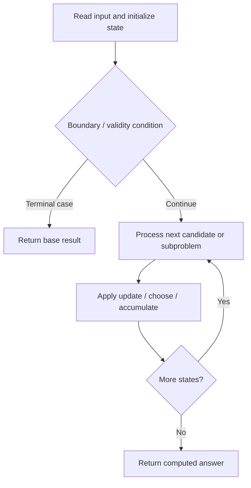

# 10. Regular Expression Matching

**Difficulty:** Hard  
**Concept family:** [String Matching and Sequence Alignment](https://github.com/gaurav1kr/Miscellaneous/blob/main/DSA/DP/DP_Mathematics_Master_Guide_Illustrated/Theory/Chapter-04.md)  
**Problem:** https://leetcode.com/problems/regular-expression-matching/  
**Original submission:** https://leetcode.com/submissions/detail/1542150785/

## Understand the mathematics first

This problem belongs to the study family **String Matching and Sequence Alignment**. Start by defining the objective and minimal sufficient state; inspect the code to identify the actual transitions.

### Problem-specific recurrence

Refer to the source-grounded algorithm walkthrough below for the state transitions used by your implementation. The generic family recurrence has been removed because it may not apply to this problem.

## Code landmarks

- `if (memo[i][j] != -1) return memo[i][j];`
- `if (j == p.size()) return memo[i][j] = (i == s.size());`
- `memo[i][j] = (dp(i, j + 2, s, p) || // Zero occurrence`

## Source-grounded algorithm walkthrough (expanded coverage)

> **Verification level:** The observations below are extracted from your actual Accepted C++ implementation. The symbolic trace is a **code-reading dry-run worksheet**, not a fabricated numerical run. The generic family formula above is not necessarily this problem's recurrence.

### 1. Identify the actual state and algorithm

**Problem:** 10. Regular Expression Matching. An explicit state table or memo is present. Interpret each index as a mathematical state and every update as a transition.

| Role | C++ source line | Evidence from your solution |
|---|---:|---|
| Candidate state / accumulator | 3 | `vector<vector<int>> memo;` |
| Candidate state / accumulator | 11 | `bool dp(int i, int j, const string &s, const string &p) {` |
| Candidate state / accumulator | 12 | `if (memo[i][j] != -1) return memo[i][j];` |
| Boundary / termination | 12 | `if (memo[i][j] != -1) return memo[i][j];` |
| Boundary / termination | 14 | `if (j == p.size()) return memo[i][j] = (i == s.size());` |
| Boundary / termination | 18 | `if (j + 1 < p.size() && p[j + 1] == '*') {` |
| Traversal order | — | No obvious matching statement; inspect the original C++ below. |
| Transition / update | 14 | `if (j == p.size()) return memo[i][j] = (i == s.size());` |
| Transition / update | 19 | `memo[i][j] = (dp(i, j + 2, s, p) \|\| // Zero occurrence` |
| Transition / update | 22 | `memo[i][j] = first_match && dp(i + 1, j + 1, s, p);` |
| Return / result | 8 | `return dp(0, 0, s, p);` |
| Return / result | 12 | `if (memo[i][j] != -1) return memo[i][j];` |

### 2. Trace the dependency chain



This is a **control-flow reading diagram**, not a claim about the exact shape of the mathematical state graph. Follow the code line numbers above to draw the actual dependency arrows.

### 3. Symbolic dry-run worksheet

| Stage | State to record | Mathematical question to answer |
|---|---|---|
| Initialize | Inputs, initialized containers/accumulators | What does the initial value mean? |
| First iteration / recursive call | Loop indices, branch, current state | Which predecessor states are available? |
| First update | Before → after for the updated variable | Why is this transition legal? Does it add, minimize, maximize, or overwrite? |
| Next iteration | Updated state and next candidate | Can a value be reused in this traversal order? |
| Finish | Return expression and its value | Why does this correspond to the problem's requested result? |

### 4. Mathematical explanation checklist

1. Define the exact meaning of each state variable, including all indices and constraints.
2. Translate the update expression into a mathematical equation **only after** establishing the state invariant.
3. Prove the transitions are exhaustive and do not double-count or reuse forbidden elements.
4. Check empty input, smallest input, impossible cases, and overflow/modulo behavior.
5. Compute a small numerical example using the actual problem constraints, then compare each row to the original C++.


---

## Your original Accepted C++ submission (unaltered)

```cpp
class Solution {
public:
    vector<vector<int>> memo;

    bool isMatch(string s, string p) {
        int m = s.size(), n = p.size();
        memo.assign(m + 1, vector<int>(n + 1, -1));
        return dp(0, 0, s, p);
    }

    bool dp(int i, int j, const string &s, const string &p) {
        if (memo[i][j] != -1) return memo[i][j];

        if (j == p.size()) return memo[i][j] = (i == s.size());

        bool first_match = (i < s.size() && (s[i] == p[j] || p[j] == '.'));

        if (j + 1 < p.size() && p[j + 1] == '*') {
            memo[i][j] = (dp(i, j + 2, s, p) || // Zero occurrence
                          (first_match && dp(i + 1, j, s, p))); // One or more occurrence
        } else {
            memo[i][j] = first_match && dp(i + 1, j + 1, s, p);
        }

        return memo[i][j];
    }
};
```

## Time and Space Complexity

- **Time:** `O(m × n)`
- **Auxiliary space:** `O(m × n)`

**Reasoning:** Memoization evaluates each (string index, pattern index) at most once; each state makes constant work.

**Basis:** Analyzed algorithm structure in the preserved C++ submission.
