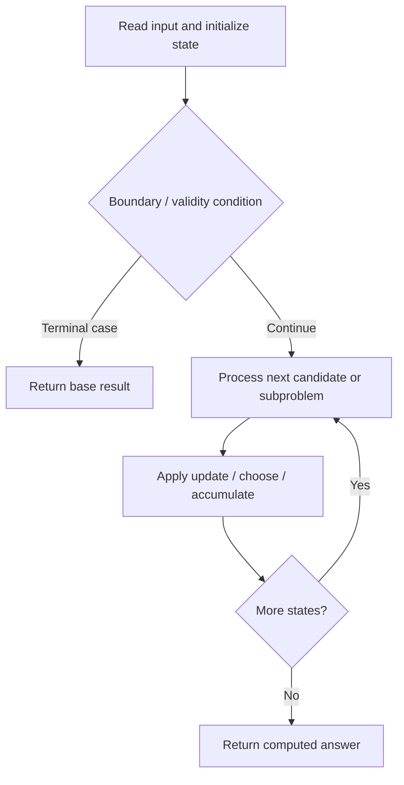

# 1000. Minimum Cost to Merge Stones

**Difficulty:** Hard  
**Concept family:** [Interval and Partition DP](https://github.com/gaurav1kr/Miscellaneous/blob/main/DSA/DP/DP_Mathematics_Master_Guide_Illustrated/Theory/Chapter-06.md)  
**Problem:** https://leetcode.com/problems/minimum-cost-to-merge-stones/  
**Original submission:** https://leetcode.com/submissions/detail/1590162182/

## Understand the mathematics first

This problem belongs to the study family **Interval and Partition DP**. Start by defining the objective and minimal sufficient state; inspect the code to identify the actual transitions.

### Related concept template (not necessarily this problem’s recurrence)

$$
F(l,r)=\min_{l\le k<r}(F(l,k)+F(k+1,r)+cost(l,k,r))
$$

**What this template illustrates:** Some interval problems maximize rather than minimize. Choosing the last operation can make otherwise interacting subproblems independent.

**Derivation exercise:** Define exactly what each state variable means for this problem; list valid choices, base cases, and forbidden transitions. Check the submitted code against that invariant. The family template alone is not a substitute for a problem-specific proof.

## Code landmarks

- `dp[i][j] = INT_MAX;`
- `dp[i][j] = min(dp[i][j], dp[i][m] + dp[m + 1][j]);`
- `dp[i][j] += prefix[j + 1] - prefix[i];`

## Source-grounded algorithm walkthrough (expanded coverage)

> **Verification level:** The observations below are extracted from your actual Accepted C++ implementation. The symbolic trace is a **code-reading dry-run worksheet**, not a fabricated numerical run. The generic family formula above is not necessarily this problem's recurrence.

### 1. Identify the actual state and algorithm

**Problem:** 1000. Minimum Cost to Merge Stones. An explicit state table or memo is present. Interpret each index as a mathematical state and every update as a transition.

| Role | C++ source line | Evidence from your solution |
|---|---:|---|
| Candidate state / accumulator | 11 | `vector<int> prefix(n + 1, 0);` |
| Candidate state / accumulator | 14 | `vector<vector<int>> dp(n, vector<int>(n, 0));` |
| Candidate state / accumulator | 18 | `dp[i][j] = INT_MAX;` |
| Boundary / termination | 9 | `if ((n - 1) % (k - 1) != 0) return -1;` |
| Boundary / termination | 22 | `if ((j - i) % (k - 1) == 0) {` |
| Traversal order | 12 | `for (int i = 0; i < n; i++) prefix[i + 1] = prefix[i] + stones[i];` |
| Traversal order | 15 | `for (int length = k; length <= n; length++) {` |
| Traversal order | 16 | `for (int i = 0; i + length <= n; i++) {` |
| Transition / update | 18 | `dp[i][j] = INT_MAX;` |
| Transition / update | 20 | `dp[i][j] = min(dp[i][j], dp[i][m] + dp[m + 1][j]);` |
| Transition / update | 23 | `dp[i][j] += prefix[j + 1] - prefix[i];` |
| Return / result | 9 | `if ((n - 1) % (k - 1) != 0) return -1;` |
| Return / result | 27 | `return dp[0][n - 1];` |

### 2. Trace the dependency chain



This is a **control-flow reading diagram**, not a claim about the exact shape of the mathematical state graph. Follow the code line numbers above to draw the actual dependency arrows.

### 3. Symbolic dry-run worksheet

| Stage | State to record | Mathematical question to answer |
|---|---|---|
| Initialize | Inputs, initialized containers/accumulators | What does the initial value mean? |
| First iteration / recursive call | Loop indices, branch, current state | Which predecessor states are available? |
| First update | Before → after for the updated variable | Why is this transition legal? Does it add, minimize, maximize, or overwrite? |
| Next iteration | Updated state and next candidate | Can a value be reused in this traversal order? |
| Finish | Return expression and its value | Why does this correspond to the problem's requested result? |

### 4. Mathematical explanation checklist

1. Define the exact meaning of each state variable, including all indices and constraints.
2. Translate the update expression into a mathematical equation **only after** establishing the state invariant.
3. Prove the transitions are exhaustive and do not double-count or reuse forbidden elements.
4. Check empty input, smallest input, impossible cases, and overflow/modulo behavior.
5. Compute a small numerical example using the actual problem constraints, then compare each row to the original C++.


---

## Your original Accepted C++ submission (unaltered)

```cpp
#include <vector>
#include <climits>
using namespace std;

class Solution {
public:
    int mergeStones(vector<int>& stones, int k) {
        int n = stones.size();
        if ((n - 1) % (k - 1) != 0) return -1;

        vector<int> prefix(n + 1, 0);
        for (int i = 0; i < n; i++) prefix[i + 1] = prefix[i] + stones[i];

        vector<vector<int>> dp(n, vector<int>(n, 0));
        for (int length = k; length <= n; length++) {
            for (int i = 0; i + length <= n; i++) {
                int j = i + length - 1;
                dp[i][j] = INT_MAX;
                for (int m = i; m < j; m += k - 1) {
                    dp[i][j] = min(dp[i][j], dp[i][m] + dp[m + 1][j]);
                }
                if ((j - i) % (k - 1) == 0) {
                    dp[i][j] += prefix[j + 1] - prefix[i];
                }
            }
        }
        return dp[0][n - 1];
    }
};
```

## Time and Space Complexity

- **Time:** `Depends on table dimensions and transitions per cell`
- **Auxiliary space:** `O(rows × columns) for the allocated table`

**Reasoning:** The two-dimensional table determines memory; time is its state count multiplied by work per state.

**Status:** Code-informed complexity guidance; exact tight bounds have not been individually verified.
