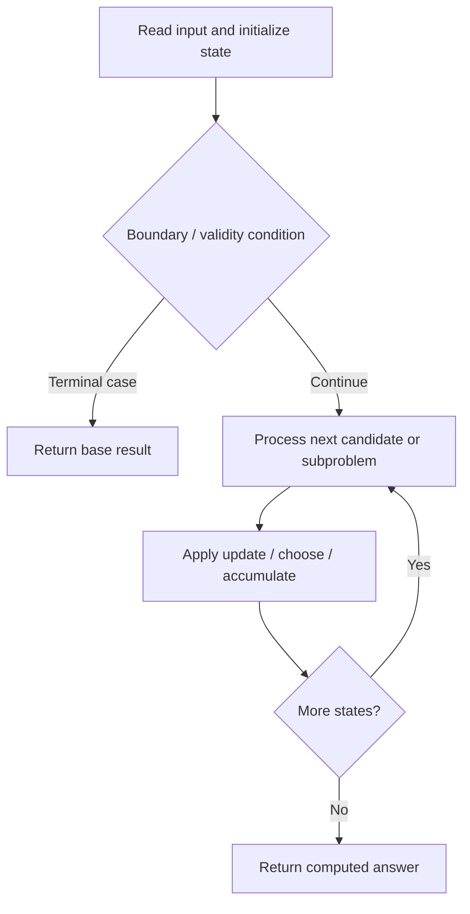

# 1031. Maximum Sum of Two Non-Overlapping Subarrays

**Difficulty:** Medium  
**Concept family:** [Scheduling and Weighted Intervals](https://github.com/gaurav1kr/Miscellaneous/blob/main/DSA/DP/DP_Mathematics_Master_Guide_Illustrated/Theory/Chapter-07.md)  
**Problem:** https://leetcode.com/problems/maximum-sum-of-two-non-overlapping-subarrays/  
**Original submission:** https://leetcode.com/submissions/detail/1590142220/

## Understand the mathematics first

This problem belongs to the study family **Scheduling and Weighted Intervals**. Start by defining the objective and minimal sufficient state; inspect the code to identify the actual transitions.

### Problem-specific recurrence

Refer to the source-grounded algorithm walkthrough below for the state transitions used by your implementation. The generic family recurrence has been removed because it may not apply to this problem.

## Code landmarks

- `return max(helper(nums, L, M), helper(nums, M, L));`
- `maxL = max(maxL, prefix[i - M] - prefix[i - M - L]);`
- `result = max(result, maxL + prefix[i] - prefix[i - M]);`

## Source-grounded algorithm walkthrough (expanded coverage)

> **Verification level:** The observations below are extracted from your actual Accepted C++ implementation. The symbolic trace is a **code-reading dry-run worksheet**, not a fabricated numerical run. The generic family formula above is not necessarily this problem's recurrence.

### 1. Identify the actual state and algorithm

**Problem:** 1031. Maximum Sum of Two Non-Overlapping Subarrays. Recursive state transitions are present. Check memoization, state identity, termination, and whether branches are mutually exclusive.

| Role | C++ source line | Evidence from your solution |
|---|---:|---|
| Candidate state / accumulator | 14 | `vector<int> prefix(n + 1, 0);` |
| Boundary / termination | — | No obvious matching statement; inspect the original C++ below. |
| Traversal order | 16 | `for (int i = 1; i <= n; i++) {` |
| Traversal order | 20 | `for (int i = L + M; i <= n; i++) {` |
| Transition / update | 9 | `return max(helper(nums, L, M), helper(nums, M, L));` |
| Transition / update | 21 | `maxL = max(maxL, prefix[i - M] - prefix[i - M - L]);` |
| Transition / update | 22 | `result = max(result, maxL + prefix[i] - prefix[i - M]);` |
| Return / result | 9 | `return max(helper(nums, L, M), helper(nums, M, L));` |
| Return / result | 25 | `return result;` |

### 2. Trace the dependency chain



This is a **control-flow reading diagram**, not a claim about the exact shape of the mathematical state graph. Follow the code line numbers above to draw the actual dependency arrows.

### 3. Symbolic dry-run worksheet

| Stage | State to record | Mathematical question to answer |
|---|---|---|
| Initialize | Inputs, initialized containers/accumulators | What does the initial value mean? |
| First iteration / recursive call | Loop indices, branch, current state | Which predecessor states are available? |
| First update | Before → after for the updated variable | Why is this transition legal? Does it add, minimize, maximize, or overwrite? |
| Next iteration | Updated state and next candidate | Can a value be reused in this traversal order? |
| Finish | Return expression and its value | Why does this correspond to the problem's requested result? |

### 4. Mathematical explanation checklist

1. Define the exact meaning of each state variable, including all indices and constraints.
2. Translate the update expression into a mathematical equation **only after** establishing the state invariant.
3. Prove the transitions are exhaustive and do not double-count or reuse forbidden elements.
4. Check empty input, smallest input, impossible cases, and overflow/modulo behavior.
5. Compute a small numerical example using the actual problem constraints, then compare each row to the original C++.


---

## Your original Accepted C++ submission (unaltered)

```cpp
#include <vector>
#include <algorithm>

using namespace std;

class Solution {
public:
    int maxSumTwoNoOverlap(vector<int>& nums, int L, int M) {
        return max(helper(nums, L, M), helper(nums, M, L));
    }

    int helper(vector<int>& nums, int L, int M) {
        int n = nums.size(), maxL = 0, result = 0;
        vector<int> prefix(n + 1, 0);
        
        for (int i = 1; i <= n; i++) {
            prefix[i] = prefix[i - 1] + nums[i - 1];
        }
        
        for (int i = L + M; i <= n; i++) {
            maxL = max(maxL, prefix[i - M] - prefix[i - M - L]);
            result = max(result, maxL + prefix[i] - prefix[i - M]);
        }
        
        return result;
    }
};
```

## Time and Space Complexity

- **Time:** `Depends on loop nesting and bounds`
- **Auxiliary space:** `Depends on auxiliary arrays/containers`

**Reasoning:** Count how many iterations each loop executes and whether loops are nested; do not assume all nested loops are quadratic.

**Status:** Code-informed complexity guidance; exact tight bounds have not been individually verified.
