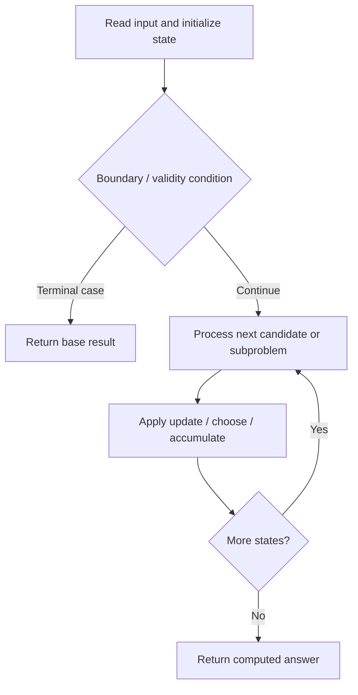

# 1048. Longest String Chain

**Difficulty:** Medium  
**Concept family:** [Subsequence and Ordering DP](https://github.com/gaurav1kr/Miscellaneous/blob/main/DSA/DP/DP_Mathematics_Master_Guide_Illustrated/Theory/Chapter-05.md)  
**Problem:** https://leetcode.com/problems/longest-string-chain/  
**Original submission:** https://leetcode.com/submissions/detail/1497897597/

## Understand the mathematics first

This problem belongs to the study family **Subsequence and Ordering DP**. Start by defining the objective and minimal sufficient state; inspect the code to identify the actual transitions.

### Related concept template (not necessarily this problem’s recurrence)

$$
L(i)=1+\max_{j<i,\;a_j<a_i}L(j)
$$

**What this template illustrates:** When there is no predecessor, length is one. More advanced variants add dimensions such as last difference or number of chosen elements.

**Derivation exercise:** Define exactly what each state variable means for this problem; list valid choices, base cases, and forbidden transitions. Check the submitted code against that invariant. The family template alone is not a substitute for a problem-specific proof.

## Code landmarks

- `sort(words.begin(),words.end(),cmp);`
- `mp[s]=max(mp[s],1);`
- `mp[s]=max(mp[s],mp[r]+1);`

## Source-grounded algorithm walkthrough (expanded coverage)

> **Verification level:** The observations below are extracted from your actual Accepted C++ implementation. The symbolic trace is a **code-reading dry-run worksheet**, not a fabricated numerical run. The generic family formula above is not necessarily this problem's recurrence.

### 1. Identify the actual state and algorithm

**Problem:** 1048. Longest String Chain. This solution does not expose an obvious `dp` or `memo` variable. Derive the algorithmic invariant from the code rather than assuming a DP recurrence.

| Role | C++ source line | Evidence from your solution |
|---|---:|---|
| Candidate state / accumulator | 10 | `int ans=0;` |
| Boundary / termination | 19 | `if(mp.find(r)==mp.end())` |
| Traversal order | 14 | `for(string &s:words)` |
| Traversal order | 16 | `for(int i=0;i<s.length();i++)` |
| Transition / update | 10 | `int ans=0;` |
| Transition / update | 21 | `mp[s]=max(mp[s],1);` |
| Transition / update | 24 | `mp[s]=max(mp[s],mp[r]+1);` |
| Transition / update | 26 | `ans=max(ans,mp[s]);` |
| Return / result | 6 | `return s1.length()<s2.length();` |
| Return / result | 28 | `return ans;` |

### 2. Trace the dependency chain



This is a **control-flow reading diagram**, not a claim about the exact shape of the mathematical state graph. Follow the code line numbers above to draw the actual dependency arrows.

### 3. Symbolic dry-run worksheet

| Stage | State to record | Mathematical question to answer |
|---|---|---|
| Initialize | Inputs, initialized containers/accumulators | What does the initial value mean? |
| First iteration / recursive call | Loop indices, branch, current state | Which predecessor states are available? |
| First update | Before → after for the updated variable | Why is this transition legal? Does it add, minimize, maximize, or overwrite? |
| Next iteration | Updated state and next candidate | Can a value be reused in this traversal order? |
| Finish | Return expression and its value | Why does this correspond to the problem's requested result? |

### 4. Mathematical explanation checklist

1. Define the exact meaning of each state variable, including all indices and constraints.
2. Translate the update expression into a mathematical equation **only after** establishing the state invariant.
3. Prove the transitions are exhaustive and do not double-count or reuse forbidden elements.
4. Check empty input, smallest input, impossible cases, and overflow/modulo behavior.
5. Compute a small numerical example using the actual problem constraints, then compare each row to the original C++.


---

## Your original Accepted C++ submission (unaltered)

```cpp
class Solution 
{
public:
    static bool cmp(string &s1,string &s2)
    {
        return s1.length()<s2.length();
    }
    int longestStrChain(vector<string>& words) 
	{
        int ans=0;
        sort(words.begin(),words.end(),cmp);
        map<string,int>mp;
        
        for(string &s:words)
        {
            for(int i=0;i<s.length();i++)
            {
                string r=s.substr(0,i)+s.substr(i+1);
                if(mp.find(r)==mp.end())
                {
                    mp[s]=max(mp[s],1);
                }
                else
                mp[s]=max(mp[s],mp[r]+1);
            }
            ans=max(ans,mp[s]);
        }
        return ans;
    }
};
```

## Time and Space Complexity

- **Time:** `O(n log n) or higher`
- **Auxiliary space:** `O(n) or higher`

**Reasoning:** Sorting costs O(n log n); additional data-structure operations may increase the bound. Confirm against the nested loops.

**Status:** Code-informed complexity guidance; exact tight bounds have not been individually verified.
