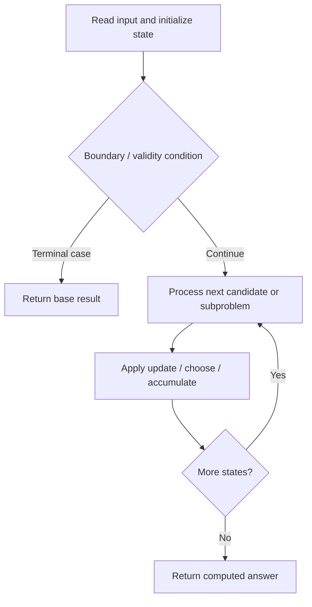

# 1049. Last Stone Weight II

**Difficulty:** Medium  
**Concept family:** [Take-or-Skip and Knapsack](https://github.com/gaurav1kr/Miscellaneous/blob/main/DSA/DP/DP_Mathematics_Master_Guide_Illustrated/Theory/Chapter-02.md)  
**Problem:** https://leetcode.com/problems/last-stone-weight-ii/  
**Original submission:** https://leetcode.com/submissions/detail/1366530350/

## Understand the mathematics first

This problem belongs to the study family **Take-or-Skip and Knapsack**. Start by defining the objective and minimal sufficient state; inspect the code to identify the actual transitions.

### Related concept template (not necessarily this problem’s recurrence)

$$
F(i,c)=\max(F(i-1,c),v_i+F(i-1,c-w_i))
$$

**What this template illustrates:** Only use the take branch when the remaining capacity is feasible. Counting versions use addition; feasibility versions use logical OR.

**Derivation exercise:** Define exactly what each state variable means for this problem; list valid choices, base cases, and forbidden transitions. Check the submitted code against that invariant. The family template alone is not a substitute for a problem-specific proof.

## Code landmarks

- `dp[i][j] = dp[i-1][j];`
- `dp[i][j] = max(dp[i-1][j],dp[i-1][j-stones[i-1]]+stones[i-1]);`
- `return total-(2*dp[n][sum]);`

## Source-grounded algorithm walkthrough (expanded coverage)

> **Verification level:** The observations below are extracted from your actual Accepted C++ implementation. The symbolic trace is a **code-reading dry-run worksheet**, not a fabricated numerical run. The generic family formula above is not necessarily this problem's recurrence.

### 1. Identify the actual state and algorithm

**Problem:** 1049. Last Stone Weight II. An explicit state table or memo is present. Interpret each index as a mathematical state and every update as a transition.

| Role | C++ source line | Evidence from your solution |
|---|---:|---|
| Candidate state / accumulator | 4 | `int sum = 0;` |
| Candidate state / accumulator | 11 | `vector<vector<int>> dp(n+1,vector<int>(sum+1,0));` |
| Candidate state / accumulator | 15 | `dp[i][j] = dp[i-1][j];` |
| Boundary / termination | 14 | `if(stones[i-1]>j) {` |
| Traversal order | 7 | `for(int i = 0;i<n;i++) {` |
| Traversal order | 12 | `for(int i =1;i<=n;i++) {` |
| Traversal order | 13 | `for(int j = 1;j<=sum;j++) {` |
| Transition / update | 4 | `int sum = 0;` |
| Transition / update | 10 | `sum = total/2;` |
| Transition / update | 15 | `dp[i][j] = dp[i-1][j];` |
| Transition / update | 18 | `dp[i][j] = max(dp[i-1][j],dp[i-1][j-stones[i-1]]+stones[i-1]);` |
| Return / result | 22 | `return total-(2*dp[n][sum]);` |

### 2. Trace the dependency chain



This is a **control-flow reading diagram**, not a claim about the exact shape of the mathematical state graph. Follow the code line numbers above to draw the actual dependency arrows.

### 3. Symbolic dry-run worksheet

| Stage | State to record | Mathematical question to answer |
|---|---|---|
| Initialize | Inputs, initialized containers/accumulators | What does the initial value mean? |
| First iteration / recursive call | Loop indices, branch, current state | Which predecessor states are available? |
| First update | Before → after for the updated variable | Why is this transition legal? Does it add, minimize, maximize, or overwrite? |
| Next iteration | Updated state and next candidate | Can a value be reused in this traversal order? |
| Finish | Return expression and its value | Why does this correspond to the problem's requested result? |

### 4. Mathematical explanation checklist

1. Define the exact meaning of each state variable, including all indices and constraints.
2. Translate the update expression into a mathematical equation **only after** establishing the state invariant.
3. Prove the transitions are exhaustive and do not double-count or reuse forbidden elements.
4. Check empty input, smallest input, impossible cases, and overflow/modulo behavior.
5. Compute a small numerical example using the actual problem constraints, then compare each row to the original C++.


---

## Your original Accepted C++ submission (unaltered)

```cpp
class Solution {
public:
    int lastStoneWeightII(vector<int>& stones) {
            int sum = 0;
    int total = 0;
    int n = stones.size();
    for(int i = 0;i<n;i++) {
        total+=stones[i];
    }
    sum = total/2;
    vector<vector<int>> dp(n+1,vector<int>(sum+1,0));
    for(int i =1;i<=n;i++) {
        for(int j = 1;j<=sum;j++) {
            if(stones[i-1]>j) {
                dp[i][j] = dp[i-1][j];
            }
            else {
                dp[i][j] = max(dp[i-1][j],dp[i-1][j-stones[i-1]]+stones[i-1]);
            }
        }
    }
    return total-(2*dp[n][sum]);
}
    };
```

## Time and Space Complexity

- **Time:** `Depends on table dimensions and transitions per cell`
- **Auxiliary space:** `O(rows × columns) for the allocated table`

**Reasoning:** The two-dimensional table determines memory; time is its state count multiplied by work per state.

**Status:** Code-informed complexity guidance; exact tight bounds have not been individually verified.
