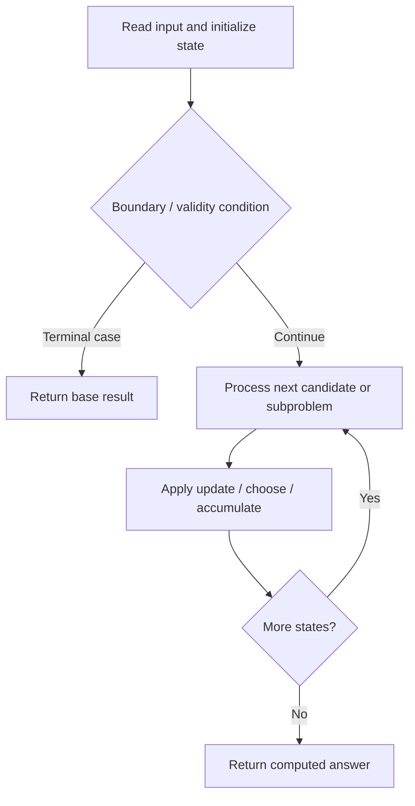

# 1125. Smallest Sufficient Team

**Difficulty:** Hard  
**Concept family:** [Bitmask, Assignment and Subset DP](https://github.com/gaurav1kr/Miscellaneous/blob/main/DSA/DP/DP_Mathematics_Master_Guide_Illustrated/Theory/Chapter-09.md)  
**Problem:** https://leetcode.com/problems/smallest-sufficient-team/  
**Original submission:** https://leetcode.com/submissions/detail/1617067453/

## Understand the mathematics first

This problem belongs to the study family **Bitmask, Assignment and Subset DP**. Start by defining the objective and minimal sufficient state; inspect the code to identify the actual transitions.

### Problem-specific recurrence

Refer to the source-grounded algorithm walkthrough below for the state transitions used by your implementation. The generic family recurrence has been removed because it may not apply to this problem.

## Code landmarks

- `long long dp[1<<17];`
- `if(dp[mask]!=-1)return dp[mask];`
- `return dp[mask]=ans;`

## Source-grounded algorithm walkthrough (expanded coverage)

> **Verification level:** The observations below are extracted from your actual Accepted C++ implementation. The symbolic trace is a **code-reading dry-run worksheet**, not a fabricated numerical run. The generic family formula above is not necessarily this problem's recurrence.

### 1. Identify the actual state and algorithm

**Problem:** 1125. Smallest Sufficient Team. Recursive state transitions are present. Check memoization, state identity, termination, and whether branches are mutually exclusive.

| Role | C++ source line | Evidence from your solution |
|---|---:|---|
| Candidate state / accumulator | 3 | `long long dp[1<<17];` |
| Candidate state / accumulator | 12 | `if(dp[mask]!=-1)return dp[mask];` |
| Candidate state / accumulator | 13 | `long long ans=maxm;` |
| Boundary / termination | 8 | `if(mask==((1<<sz)-1))` |
| Boundary / termination | 10 | `return 0ll;` |
| Boundary / termination | 12 | `if(dp[mask]!=-1)return dp[mask];` |
| Traversal order | 14 | `for(long long i=0;i<(int)people.size();i++)` |
| Traversal order | 19 | `for(int j=0;j<(int)people[i].size();j++)` |
| Traversal order | 45 | `for(int i=0;i<(int)req.size();i++)` |
| Transition / update | 13 | `long long ans=maxm;` |
| Transition / update | 34 | `ans=curr;` |
| Transition / update | 39 | `return dp[mask]=ans;` |
| Transition / update | 47 | `long long ans=helper(mp,people,0);` |
| Return / result | 10 | `return 0ll;` |
| Return / result | 12 | `if(dp[mask]!=-1)return dp[mask];` |

### 2. Trace the dependency chain



This is a **control-flow reading diagram**, not a claim about the exact shape of the mathematical state graph. Follow the code line numbers above to draw the actual dependency arrows.

### 3. Symbolic dry-run worksheet

| Stage | State to record | Mathematical question to answer |
|---|---|---|
| Initialize | Inputs, initialized containers/accumulators | What does the initial value mean? |
| First iteration / recursive call | Loop indices, branch, current state | Which predecessor states are available? |
| First update | Before → after for the updated variable | Why is this transition legal? Does it add, minimize, maximize, or overwrite? |
| Next iteration | Updated state and next candidate | Can a value be reused in this traversal order? |
| Finish | Return expression and its value | Why does this correspond to the problem's requested result? |

### 4. Mathematical explanation checklist

1. Define the exact meaning of each state variable, including all indices and constraints.
2. Translate the update expression into a mathematical equation **only after** establishing the state invariant.
3. Prove the transitions are exhaustive and do not double-count or reuse forbidden elements.
4. Check empty input, smallest input, impossible cases, and overflow/modulo behavior.
5. Compute a small numerical example using the actual problem constraints, then compare each row to the original C++.


---

## Your original Accepted C++ submission (unaltered)

```cpp
class Solution {
public:
    long long dp[1<<17];
    long long int maxm=(1UL << 61)-1;
    long long helper(unordered_map<string,int>&mp,vector<vector<string>>&people,int mask)
    {
        int sz=mp.size();
        if(mask==((1<<sz)-1))
        {
            return 0ll;
        }
        if(dp[mask]!=-1)return dp[mask];
        long long ans=maxm;
        for(long long i=0;i<(int)people.size();i++)
        {
          
            int newmask=mask;
            long long curr=0;
            for(int j=0;j<(int)people[i].size();j++)
            {
               
                if(mp.count(people[i][j]))
                {
                    int idx=mp[people[i][j]];
                    if((newmask & (1 <<idx ))==0)
                    {newmask=(newmask | (1<<idx));}
                }
            }
            if(newmask > mask)
            {
                curr=(curr | (1UL<<i));
                curr|=helper(mp,people,newmask);
                if(__builtin_popcountll(curr) < __builtin_popcountll(ans))          {
                    ans=curr;
                }
                
            }
        }
        return dp[mask]=ans;
    }
    vector<int> smallestSufficientTeam(vector<string>& req, vector<vector<string>>& people) 
    {
        memset(dp,-1,sizeof(dp));
        unordered_map<string,int>mp;
        for(int i=0;i<(int)req.size();i++)
        mp[req[i]]=i;
        long long ans=helper(mp,people,0);
        vector<int>res;
        for(int i=0;i<=60;i++)
        {
            if(ans & (1UL << i))
            res.push_back(i);
        }
        return res;
    }
};
```

## Time and Space Complexity

- **Time:** `Depends on operations (typically O(log n) per ordered-container operation)`
- **Auxiliary space:** `Depends on number of stored entries`

**Reasoning:** An ordered container or heap introduces logarithmic insertion, lookup, or removal costs; multiply by operation count.

**Status:** Code-informed complexity guidance; exact tight bounds have not been individually verified.
