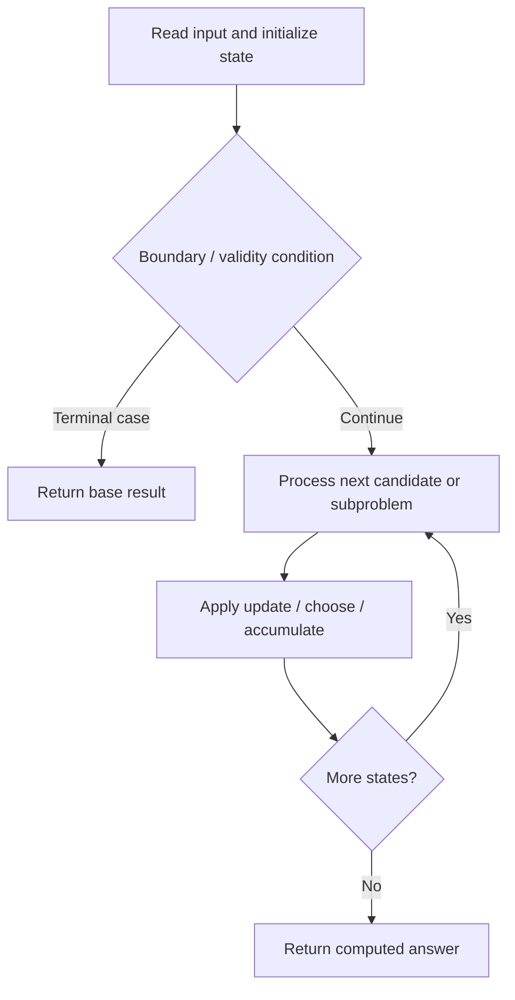

# 1139. Largest 1-Bordered Square

**Difficulty:** Medium  
**Concept family:** [Grid Paths and Geometric DP](https://github.com/gaurav1kr/Miscellaneous/blob/main/DSA/DP/DP_Mathematics_Master_Guide_Illustrated/Theory/Chapter-03.md)  
**Problem:** https://leetcode.com/problems/largest-1-bordered-square/  
**Original submission:** https://leetcode.com/submissions/detail/1610581593/

## Understand the mathematics first

This problem belongs to the study family **Grid Paths and Geometric DP**. Start by defining the objective and minimal sufficient state; inspect the code to identify the actual transitions.

### Problem-specific recurrence

Refer to the source-grounded algorithm walkthrough below for the state transitions used by your implementation. The generic family recurrence has been removed because it may not apply to this problem.

## Code landmarks

- `for (int k = min(h[i][j], v[i][j]); k > 0; --k)`
- `res = max(res, k);`

## Source-grounded algorithm walkthrough (expanded coverage)

> **Verification level:** The observations below are extracted from your actual Accepted C++ implementation. The symbolic trace is a **code-reading dry-run worksheet**, not a fabricated numerical run. The generic family formula above is not necessarily this problem's recurrence.

### 1. Identify the actual state and algorithm

**Problem:** 1139. Largest 1-Bordered Square. This solution does not expose an obvious `dp` or `memo` variable. Derive the algorithmic invariant from the code rather than assuming a DP recurrence.

| Role | C++ source line | Evidence from your solution |
|---|---:|---|
| Candidate state / accumulator | 8 | `int m = grid.size(), n = grid[0].size(), res = 0;` |
| Boundary / termination | 12 | `if (grid[i][j]) {` |
| Boundary / termination | 20 | `if (v[i][j - k + 1] >= k && h[i - k + 1][j] >= k) {` |
| Traversal order | 10 | `for (int i = 0; i < m; ++i)` |
| Traversal order | 11 | `for (int j = 0; j < n; ++j)` |
| Traversal order | 17 | `for (int i = m - 1; i >= 0; --i)` |
| Transition / update | 8 | `int m = grid.size(), n = grid[0].size(), res = 0;` |
| Transition / update | 19 | `for (int k = min(h[i][j], v[i][j]); k > 0; --k)` |
| Transition / update | 21 | `res = max(res, k);` |
| Return / result | 25 | `return res * res;` |

### 2. Trace the dependency chain



This is a **control-flow reading diagram**, not a claim about the exact shape of the mathematical state graph. Follow the code line numbers above to draw the actual dependency arrows.

### 3. Symbolic dry-run worksheet

| Stage | State to record | Mathematical question to answer |
|---|---|---|
| Initialize | Inputs, initialized containers/accumulators | What does the initial value mean? |
| First iteration / recursive call | Loop indices, branch, current state | Which predecessor states are available? |
| First update | Before → after for the updated variable | Why is this transition legal? Does it add, minimize, maximize, or overwrite? |
| Next iteration | Updated state and next candidate | Can a value be reused in this traversal order? |
| Finish | Return expression and its value | Why does this correspond to the problem's requested result? |

### 4. Mathematical explanation checklist

1. Define the exact meaning of each state variable, including all indices and constraints.
2. Translate the update expression into a mathematical equation **only after** establishing the state invariant.
3. Prove the transitions are exhaustive and do not double-count or reuse forbidden elements.
4. Check empty input, smallest input, impossible cases, and overflow/modulo behavior.
5. Compute a small numerical example using the actual problem constraints, then compare each row to the original C++.


---

## Your original Accepted C++ submission (unaltered)

```cpp
#include <vector>

using namespace std;

class Solution {
public:
    int largest1BorderedSquare(vector<vector<int>>& grid) {
        int m = grid.size(), n = grid[0].size(), res = 0;
        vector<vector<int>> h(m, vector<int>(n)), v(m, vector<int>(n));
        for (int i = 0; i < m; ++i)
            for (int j = 0; j < n; ++j)
                if (grid[i][j]) {
                    h[i][j] = (j == 0 ? 0 : h[i][j - 1]) + 1;
                    v[i][j] = (i == 0 ? 0 : v[i - 1][j]) + 1;
                }

        for (int i = m - 1; i >= 0; --i)
            for (int j = n - 1; j >= 0; --j)
                for (int k = min(h[i][j], v[i][j]); k > 0; --k)
                    if (v[i][j - k + 1] >= k && h[i - k + 1][j] >= k) {
                        res = max(res, k);
                        break;
                    }

        return res * res;
    }
};
```

## Time and Space Complexity

- **Time:** `Depends on table dimensions and transitions per cell`
- **Auxiliary space:** `O(rows × columns) for the allocated table`

**Reasoning:** The two-dimensional table determines memory; time is its state count multiplied by work per state.

**Status:** Code-informed complexity guidance; exact tight bounds have not been individually verified.
