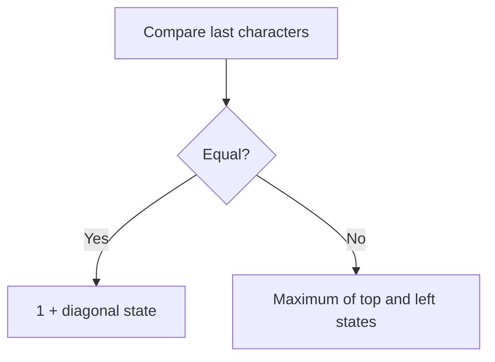
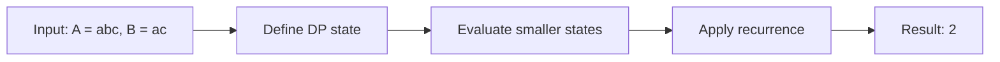

# 1143. Longest Common Subsequence

**Difficulty:** Medium  
**Concept family:** [String Matching and Sequence Alignment](https://github.com/gaurav1kr/Miscellaneous/blob/main/DSA/DP/DP_Mathematics_Master_Guide_Illustrated/Theory/Chapter-04.md)  
**Problem:** https://leetcode.com/problems/longest-common-subsequence/  
**Original submission:** https://leetcode.com/submissions/detail/1540742983/

## Understand the mathematics first

Match or skip final symbols of two prefixes.

### Problem-specific recurrence

Refer to the source-grounded algorithm walkthrough below for the state transitions used by your implementation. The generic family recurrence has been removed because it may not apply to this problem.

## Code landmarks

- `curr[j] = max(prev[j], curr[j - 1]);`

## Worked mathematical walkthrough (illustrated)

**State:** L(i,j): LCS length of first i chars of A and first j of B.

**Transition:** `If A[i-1]=B[j-1]: L(i,j)=1+L(i-1,j-1); else max(L(i-1,j),L(i,j-1))`

**Why:** If last characters match, extend a smaller optimal match. Otherwise at least one of the last characters is unused in an optimal common subsequence.



**Hand calculation:** A="abc", B="ac": row for empty A [0,0,0]; a [0,1,1]; ab [0,1,1]; abc [0,1,2]. Answer 2.

**Six-month revision test:** Without looking at the code, reconstruct the state, enumerate the legal choices, and justify why this transition does not miss or double-count any answer.

---

## Detailed dry run — LCS: match-or-drop prefixes

### Start from the mathematical question

Let L(i,j) be the LCS length of the first i characters of A and first j characters of B.

### Derive the recurrence

```math
L(i,j)=\begin{cases}1+L(i-1,j-1)&A[i-1]=B[j-1]\\\max(L(i-1,j),L(i,j-1))&otherwise\end{cases}
```

**Why the transition is correct:** Matching final characters can be paired; otherwise at least one final character must be excluded. This creates a complete case split.

### Concrete example

**Input:** `A = "abc", B = "ac"`



**Evaluate the states in dependency order:**

| A prefix / B prefix | empty | a | ac |
|---|---:|---:|---:|
| empty | 0 | 0 | 0 |
| a | 0 | 1 | 1 |
| ab | 0 | 1 | 1 |
| abc | 0 | 1 | 2 |

**Expected result:** `2`.

### What to remember six months later

Explain (1) what one state means, (2) which earlier states it needs, (3) why those cases are exhaustive, and (4) why the answer is `2` for this input. Then inspect your preserved C++ solution below and match its variables to the mathematical states.

---

## Your original Accepted C++ submission (unaltered)

```cpp
class Solution {
public:
    int longestCommonSubsequence(string text1, string text2) {
    int m = text1.size(), n = text2.size();
    vector<int> prev(n + 1, 0), curr(n + 1, 0);

    for (int i = 1; i <= m; ++i) {
        for (int j = 1; j <= n; ++j) {
            if (text1[i - 1] == text2[j - 1]) {
                curr[j] = 1 + prev[j - 1];
            } else {
                curr[j] = max(prev[j], curr[j - 1]);
            }
        }
        prev = curr;
    }

    return prev[n];
}
};
```

## Time and Space Complexity

- **Time:** `Depends on loop nesting and bounds`
- **Auxiliary space:** `Depends on auxiliary arrays/containers`

**Reasoning:** Count how many iterations each loop executes and whether loops are nested; do not assume all nested loops are quadratic.

**Status:** Code-informed complexity guidance; exact tight bounds have not been individually verified.
