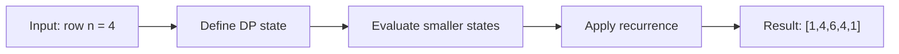

# 118. Pascal's Triangle

**Difficulty:** Easy  
**Concept family:** [Mathematical Recurrences and Combinatorics](https://github.com/gaurav1kr/Miscellaneous/blob/main/DSA/DP/DP_Mathematics_Master_Guide_Illustrated/Theory/Chapter-01.md)  
**Problem:** https://leetcode.com/problems/pascals-triangle/  
**Original submission:** https://leetcode.com/submissions/detail/1588085821/

## Understand the mathematics first

This problem belongs to the study family **Mathematical Recurrences and Combinatorics**. Start by defining the objective and minimal sufficient state; inspect the code to identify the actual transitions.

### Related concept template (not necessarily this problem’s recurrence)

$$
F(n)=\sum_{c\in Choices(n)}F(next(n,c))
$$

**What this template illustrates:** For counting, add disjoint cases. For optimization, replace sum with min or max. Base cases must express empty structures correctly.

**Derivation exercise:** Define exactly what each state variable means for this problem; list valid choices, base cases, and forbidden transitions. Check the submitted code against that invariant. The family template alone is not a substitute for a problem-specific proof.

## Code landmarks

Read the loops, recursion, and boundary conditions in the original code.

## Detailed dry run — Pascal triangle: choose-or-do-not-choose

### Start from the mathematical question

Let C(n,k) be the number of k-element subsets of n labeled elements.

### Derive the recurrence

```math
\binom nk=\binom{n-1}{k-1}+\binom{n-1}k
```

**Why the transition is correct:** Every k-subset either includes the final element or excludes it. These are disjoint and exhaustive groups.

### Concrete example

**Input:** `row n = 4`



**Evaluate the states in dependency order:**

| k | 0 | 1 | 2 | 3 | 4 |
|---|---:|---:|---:|---:|---:|
| C(4,k) | 1 | 4 | 6 | 4 | 1 |

**Expected result:** `[1,4,6,4,1]`.

### What to remember six months later

Explain (1) what one state means, (2) which earlier states it needs, (3) why those cases are exhaustive, and (4) why the answer is `[1,4,6,4,1]` for this input. Then inspect your preserved C++ solution below and match its variables to the mathematical states.

---

## Your original Accepted C++ submission (unaltered)

```cpp
class Solution {
public:
    vector<vector<int>> generate(int numRows) {
        vector<vector<int>> res(numRows);
        for (int i = 0; i < numRows; i++) {
            res[i] = vector<int>(i + 1, 1);
            for (int j = 1; j < i; j++) {
                res[i][j] = res[i - 1][j - 1] + res[i - 1][j];
            }
        }
        return res;
    }
};
```

## Time and Space Complexity

- **Time:** `Depends on table dimensions and transitions per cell`
- **Auxiliary space:** `O(rows × columns) for the allocated table`

**Reasoning:** The two-dimensional table determines memory; time is its state count multiplied by work per state.

**Status:** Code-informed complexity guidance; exact tight bounds have not been individually verified.
