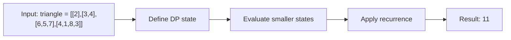

# 120. Triangle

**Difficulty:** Medium  
**Concept family:** [Grid Paths and Geometric DP](https://github.com/gaurav1kr/Miscellaneous/blob/main/DSA/DP/DP_Mathematics_Master_Guide_Illustrated/Theory/Chapter-03.md)  
**Problem:** https://leetcode.com/problems/triangle/  
**Original submission:** https://leetcode.com/submissions/detail/1536826275/

## Understand the mathematics first

This problem belongs to the study family **Grid Paths and Geometric DP**. Start by defining the objective and minimal sufficient state; inspect the code to identify the actual transitions.

### Problem-specific recurrence

Refer to the source-grounded algorithm walkthrough below for the state transitions used by your implementation. The generic family recurrence has been removed because it may not apply to this problem.

## Code landmarks

- `triangle[row][col] += min(triangle[row + 1][col], triangle[row + 1][col + 1]);`

## Detailed dry run — Triangle: bottom-up optimal continuation

### Start from the mathematical question

Let C(r,c) be the minimum path sum starting at triangle cell (r,c) and reaching the bottom.

### Derive the recurrence

```math
C(r,c)=a[r][c]+\min(C(r+1,c),C(r+1,c+1))
```

**Why the transition is correct:** At each cell you must choose exactly one of two children; bottom-up evaluation ensures both child answers are already known.

### Concrete example

**Input:** `triangle = [[2],[3,4],[6,5,7],[4,1,8,3]]`



**Evaluate the states in dependency order:**

| Row | Values after bottom-up update |
|---|---|
| 3 | [4,1,8,3] |
| 2 | [7,6,10] |
| 1 | [9,10] |
| 0 | [11] |

**Expected result:** `11`.

### What to remember six months later

Explain (1) what one state means, (2) which earlier states it needs, (3) why those cases are exhaustive, and (4) why the answer is `11` for this input. Then inspect your preserved C++ solution below and match its variables to the mathematical states.

---

## Your original Accepted C++ submission (unaltered)

```cpp
class Solution {
public:
    int minimumTotal(vector<vector<int>>& triangle) {
        for (int row = triangle.size() - 2; row >= 0; --row) {
            for (int col = 0; col < triangle[row].size(); ++col) {
                triangle[row][col] += min(triangle[row + 1][col], triangle[row + 1][col + 1]);
            }
        }
        return triangle[0][0];
    }
};
```

## Time and Space Complexity

- **Time:** `Depends on table dimensions and transitions per cell`
- **Auxiliary space:** `O(rows × columns) for the allocated table`

**Reasoning:** The two-dimensional table determines memory; time is its state count multiplied by work per state.

**Status:** Code-informed complexity guidance; exact tight bounds have not been individually verified.
