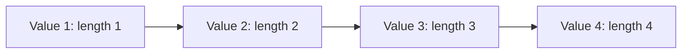
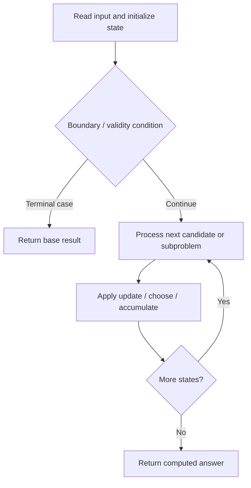

# 1218. Longest Arithmetic Subsequence of Given Difference

**Difficulty:** Medium  
**Concept family:** [Subsequence and Ordering DP](https://github.com/gaurav1kr/Miscellaneous/blob/main/DSA/DP/DP_Mathematics_Master_Guide_Illustrated/Theory/Chapter-05.md)  
**Problem:** https://leetcode.com/problems/longest-arithmetic-subsequence-of-given-difference/  
**Original submission:** https://leetcode.com/submissions/detail/1593839948/

## Understand the mathematics first

This problem belongs to the study family **Subsequence and Ordering DP**. Start by defining the objective and minimal sufficient state; inspect the code to identify the actual transitions.

### Problem-specific recurrence

Let `dp[x]` be the length of the longest valid arithmetic subsequence, among the elements processed so far, that ends with value `x`. Let `d` be the fixed difference.

```text
dp[x] = 1 + dp[x - d]
answer = max(answer, dp[x])
```

The map returns zero for a missing predecessor, so a single element starts a subsequence of length one. We process the array from left to right to preserve subsequence order.

**Example:** `arr = [1, 2, 3, 4]`, `d = 1`.

| Current x | Previous dp[x - 1] | New dp[x] | Best length |
|---:|---:|---:|---:|
| 1 | 0 | 1 | 1 |
| 2 | 1 | 2 | 2 |
| 3 | 2 | 3 | 3 |
| 4 | 3 | 4 | 4 |



**Complexity:** Expected `O(n)` time and `O(n)` auxiliary space using an `unordered_map`; worst-case hash-table behavior can be worse.


## Code landmarks

- `dp[a] = dp[a - diff] + 1;`
- `res = max(res, dp[a]);`

## Source-grounded algorithm walkthrough (expanded coverage)

> **Verification level:** The observations below are extracted from your actual Accepted C++ implementation. The symbolic trace is a **code-reading dry-run worksheet**, not a fabricated numerical run. The generic family formula above is not necessarily this problem's recurrence.

### 1. Identify the actual state and algorithm

**Problem:** 1218. Longest Arithmetic Subsequence of Given Difference. An explicit state table or memo is present. Interpret each index as a mathematical state and every update as a transition.

| Role | C++ source line | Evidence from your solution |
|---|---:|---|
| Candidate state / accumulator | 9 | `unordered_map<int, int> dp;` |
| Candidate state / accumulator | 10 | `int res = 0;` |
| Candidate state / accumulator | 12 | `dp[a] = dp[a - diff] + 1;` |
| Boundary / termination | — | No obvious matching statement; inspect the original C++ below. |
| Traversal order | 11 | `for (int a : arr) {` |
| Transition / update | 10 | `int res = 0;` |
| Transition / update | 12 | `dp[a] = dp[a - diff] + 1;` |
| Transition / update | 13 | `res = max(res, dp[a]);` |
| Return / result | 15 | `return res;` |

### 2. Trace the dependency chain



This is a **control-flow reading diagram**, not a claim about the exact shape of the mathematical state graph. Follow the code line numbers above to draw the actual dependency arrows.

### 3. Symbolic dry-run worksheet

| Stage | State to record | Mathematical question to answer |
|---|---|---|
| Initialize | Inputs, initialized containers/accumulators | What does the initial value mean? |
| First iteration / recursive call | Loop indices, branch, current state | Which predecessor states are available? |
| First update | Before → after for the updated variable | Why is this transition legal? Does it add, minimize, maximize, or overwrite? |
| Next iteration | Updated state and next candidate | Can a value be reused in this traversal order? |
| Finish | Return expression and its value | Why does this correspond to the problem's requested result? |

### 4. Mathematical explanation checklist

1. Define the exact meaning of each state variable, including all indices and constraints.
2. Translate the update expression into a mathematical equation **only after** establishing the state invariant.
3. Prove the transitions are exhaustive and do not double-count or reuse forbidden elements.
4. Check empty input, smallest input, impossible cases, and overflow/modulo behavior.
5. Compute a small numerical example using the actual problem constraints, then compare each row to the original C++.


---

## Your original Accepted C++ submission (unaltered)

```cpp
#include <vector>
#include <unordered_map>

using namespace std;

class Solution {
public:
    int longestSubsequence(vector<int>& arr, int diff) {
        unordered_map<int, int> dp;
        int res = 0;
        for (int a : arr) {
            dp[a] = dp[a - diff] + 1;
            res = max(res, dp[a]);
        }
        return res;
    }
};
```

## Time and Space Complexity

- **Time:** `Depends on operations (typically O(log n) per ordered-container operation)`
- **Auxiliary space:** `Depends on number of stored entries`

**Reasoning:** An ordered container or heap introduces logarithmic insertion, lookup, or removal costs; multiply by operation count.

**Status:** Code-informed complexity guidance; exact tight bounds have not been individually verified.
