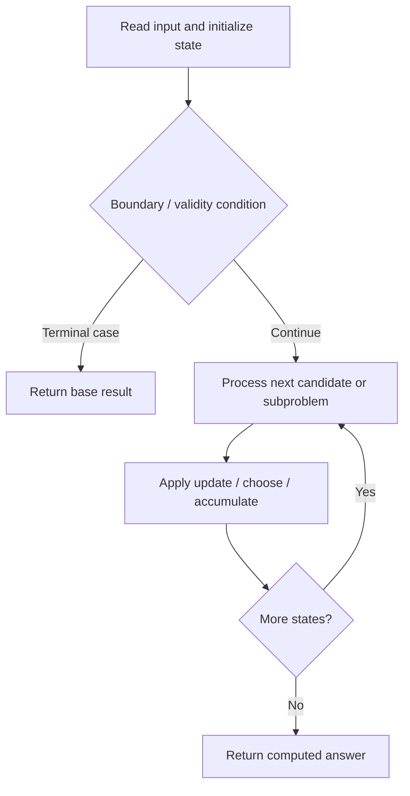

# 1289. Minimum Falling Path Sum II

**Difficulty:** Hard  
**Concept family:** [Grid Paths and Geometric DP](https://github.com/gaurav1kr/Miscellaneous/blob/main/DSA/DP/DP_Mathematics_Master_Guide_Illustrated/Theory/Chapter-03.md)  
**Problem:** https://leetcode.com/problems/minimum-falling-path-sum-ii/  
**Original submission:** https://leetcode.com/submissions/detail/1595395997/

## Understand the mathematics first

This problem belongs to the study family **Grid Paths and Geometric DP**. Start by defining the objective and minimal sufficient state; inspect the code to identify the actual transitions.

### Related concept template (not necessarily this problem’s recurrence)

$$
F(i,j)=F(i-1,j)+F(i,j-1)
$$

**What this template illustrates:** For minimum cost paths, replace + of paths with min of predecessor costs, then add the current cell cost. Obstacles contribute zero ways.

**Derivation exercise:** Define exactly what each state variable means for this problem; list valid choices, base cases, and forbidden transitions. Check the submitted code against that invariant. The family template alone is not a substitute for a problem-specific proof.

## Code landmarks

Read the loops, recursion, and boundary conditions in the original code.

## Source-grounded algorithm walkthrough (expanded coverage)

> **Verification level:** The observations below are extracted from your actual Accepted C++ implementation. The symbolic trace is a **code-reading dry-run worksheet**, not a fabricated numerical run. The generic family formula above is not necessarily this problem's recurrence.

### 1. Identify the actual state and algorithm

**Problem:** 1289. Minimum Falling Path Sum II. This solution does not expose an obvious `dp` or `memo` variable. Derive the algorithmic invariant from the code rather than assuming a DP recurrence.

| Role | C++ source line | Evidence from your solution |
|---|---:|---|
| Candidate state / accumulator | — | No obvious matching statement; inspect the original C++ below. |
| Boundary / termination | 15 | `if (prev[j] < min1) {` |
| Boundary / termination | 19 | `} else if (prev[j] < min2) {` |
| Traversal order | 12 | `for (int i = 1; i < m; ++i) {` |
| Traversal order | 14 | `for (int j = 0; j < n; ++j) {` |
| Traversal order | 24 | `for (int j = 0; j < n; ++j) {` |
| Transition / update | — | No obvious matching statement; inspect the original C++ below. |
| Return / result | 30 | `return *min_element(prev.begin(), prev.end());` |

### 2. Trace the dependency chain



This is a **control-flow reading diagram**, not a claim about the exact shape of the mathematical state graph. Follow the code line numbers above to draw the actual dependency arrows.

### 3. Symbolic dry-run worksheet

| Stage | State to record | Mathematical question to answer |
|---|---|---|
| Initialize | Inputs, initialized containers/accumulators | What does the initial value mean? |
| First iteration / recursive call | Loop indices, branch, current state | Which predecessor states are available? |
| First update | Before → after for the updated variable | Why is this transition legal? Does it add, minimize, maximize, or overwrite? |
| Next iteration | Updated state and next candidate | Can a value be reused in this traversal order? |
| Finish | Return expression and its value | Why does this correspond to the problem's requested result? |

### 4. Mathematical explanation checklist

1. Define the exact meaning of each state variable, including all indices and constraints.
2. Translate the update expression into a mathematical equation **only after** establishing the state invariant.
3. Prove the transitions are exhaustive and do not double-count or reuse forbidden elements.
4. Check empty input, smallest input, impossible cases, and overflow/modulo behavior.
5. Compute a small numerical example using the actual problem constraints, then compare each row to the original C++.


---

## Your original Accepted C++ submission (unaltered)

```cpp
#include <vector>
#include <climits>

using namespace std;

class Solution {
public:
    int minFallingPathSum(vector<vector<int>>& grid) {
        int m = grid.size(), n = grid[0].size();
        vector<int> prev = grid[0];

        for (int i = 1; i < m; ++i) {
            int min1 = INT_MAX, min2 = INT_MAX, idx1 = -1;
            for (int j = 0; j < n; ++j) {
                if (prev[j] < min1) {
                    min2 = min1;
                    min1 = prev[j];
                    idx1 = j;
                } else if (prev[j] < min2) {
                    min2 = prev[j];
                }
            }
            vector<int> curr(n);
            for (int j = 0; j < n; ++j) {
                curr[j] = grid[i][j] + (j == idx1 ? min2 : min1);
            }
            prev = curr;
        }

        return *min_element(prev.begin(), prev.end());
    }
};
```

## Time and Space Complexity

- **Time:** `Depends on table dimensions and transitions per cell`
- **Auxiliary space:** `O(rows × columns) for the allocated table`

**Reasoning:** The two-dimensional table determines memory; time is its state count multiplied by work per state.

**Status:** Code-informed complexity guidance; exact tight bounds have not been individually verified.
