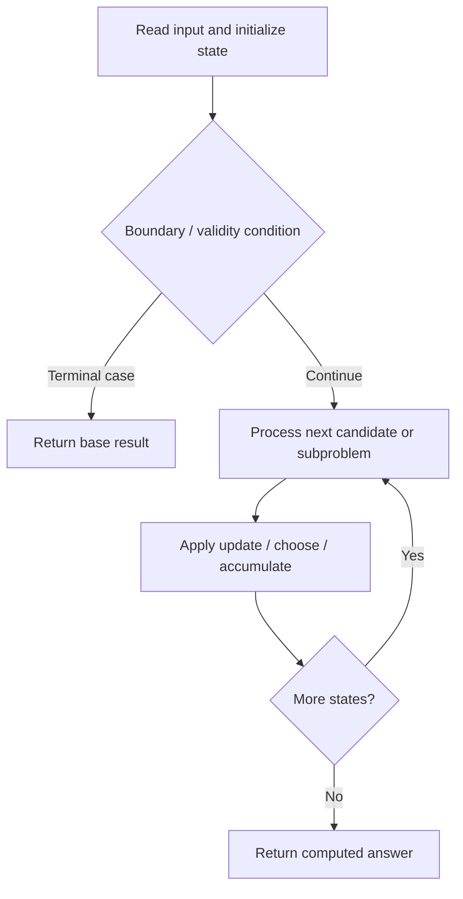

# 1301. Number of Paths with Max Score

**Difficulty:** Hard  
**Concept family:** [Grid Paths and Geometric DP](https://github.com/gaurav1kr/Miscellaneous/blob/main/DSA/DP/DP_Mathematics_Master_Guide_Illustrated/Theory/Chapter-03.md)  
**Problem:** https://leetcode.com/problems/number-of-paths-with-max-score/  
**Original submission:** https://leetcode.com/submissions/detail/1610629672/

## Understand the mathematics first

This problem belongs to the study family **Grid Paths and Geometric DP**. Start by defining the objective and minimal sufficient state; inspect the code to identify the actual transitions.

### Problem-specific recurrence

Refer to the source-grounded algorithm walkthrough below for the state transitions used by your implementation. The generic family recurrence has been removed because it may not apply to this problem.

## Code landmarks

Read the loops, recursion, and boundary conditions in the original code.

## Source-grounded algorithm walkthrough (expanded coverage)

> **Verification level:** The observations below are extracted from your actual Accepted C++ implementation. The symbolic trace is a **code-reading dry-run worksheet**, not a fabricated numerical run. The generic family formula above is not necessarily this problem's recurrence.

### 1. Identify the actual state and algorithm

**Problem:** 1301. Number of Paths with Max Score. This solution does not expose an obvious `dp` or `memo` variable. Derive the algorithmic invariant from the code rather than assuming a DP recurrence.

| Role | C++ source line | Evidence from your solution |
|---|---:|---|
| Candidate state / accumulator | 13 | `vector<vector<int>> ways(n, vector<int>(n, 0));` |
| Boundary / termination | 19 | `if (board[i][j] == 'X' \|\| score[i][j] == -1) continue;` |
| Boundary / termination | 22 | `if (x < 0 \|\| y < 0 \|\| board[x][y] == 'X') continue;` |
| Boundary / termination | 24 | `if (score[x][y] < score[i][j] + val) {` |
| Traversal order | 17 | `for (int i = n - 1; i >= 0; --i) {` |
| Traversal order | 18 | `for (int j = n - 1; j >= 0; --j) {` |
| Traversal order | 20 | `for (auto [dx, dy] : vector<pair<int, int>>{{-1, 0}, {0, -1}, {-1, -1}}) {` |
| Transition / update | 15 | `ways[n - 1][n - 1] = 1;` |
| Transition / update | 26 | `ways[x][y] = ways[i][j];` |
| Transition / update | 28 | `ways[x][y] = (ways[x][y] + ways[i][j]) % MOD;` |
| Return / result | 33 | `if (score[0][0] == -1) return {0, 0};` |
| Return / result | 34 | `return {score[0][0], ways[0][0]};` |

### 2. Trace the dependency chain



This is a **control-flow reading diagram**, not a claim about the exact shape of the mathematical state graph. Follow the code line numbers above to draw the actual dependency arrows.

### 3. Symbolic dry-run worksheet

| Stage | State to record | Mathematical question to answer |
|---|---|---|
| Initialize | Inputs, initialized containers/accumulators | What does the initial value mean? |
| First iteration / recursive call | Loop indices, branch, current state | Which predecessor states are available? |
| First update | Before → after for the updated variable | Why is this transition legal? Does it add, minimize, maximize, or overwrite? |
| Next iteration | Updated state and next candidate | Can a value be reused in this traversal order? |
| Finish | Return expression and its value | Why does this correspond to the problem's requested result? |

### 4. Mathematical explanation checklist

1. Define the exact meaning of each state variable, including all indices and constraints.
2. Translate the update expression into a mathematical equation **only after** establishing the state invariant.
3. Prove the transitions are exhaustive and do not double-count or reuse forbidden elements.
4. Check empty input, smallest input, impossible cases, and overflow/modulo behavior.
5. Compute a small numerical example using the actual problem constraints, then compare each row to the original C++.


---

## Your original Accepted C++ submission (unaltered)

```cpp
#include <vector>
#include <string>

using namespace std;

class Solution {
public:
    const int MOD = 1e9 + 7;

    vector<int> pathsWithMaxScore(vector<string>& board) {
        int n = board.size();
        vector<vector<int>> score(n, vector<int>(n, -1));
        vector<vector<int>> ways(n, vector<int>(n, 0));
        score[n - 1][n - 1] = 0;
        ways[n - 1][n - 1] = 1;

        for (int i = n - 1; i >= 0; --i) {
            for (int j = n - 1; j >= 0; --j) {
                if (board[i][j] == 'X' || score[i][j] == -1) continue;
                for (auto [dx, dy] : vector<pair<int, int>>{{-1, 0}, {0, -1}, {-1, -1}}) {
                    int x = i + dx, y = j + dy;
                    if (x < 0 || y < 0 || board[x][y] == 'X') continue;
                    int val = board[x][y] == 'E' || board[x][y] == 'S' ? 0 : board[x][y] - '0';
                    if (score[x][y] < score[i][j] + val) {
                        score[x][y] = score[i][j] + val;
                        ways[x][y] = ways[i][j];
                    } else if (score[x][y] == score[i][j] + val) {
                        ways[x][y] = (ways[x][y] + ways[i][j]) % MOD;
                    }
                }
            }
        }
        if (score[0][0] == -1) return {0, 0};
        return {score[0][0], ways[0][0]};
    }
};
```

## Time and Space Complexity

- **Time:** `Depends on table dimensions and transitions per cell`
- **Auxiliary space:** `O(rows × columns) for the allocated table`

**Reasoning:** The two-dimensional table determines memory; time is its state count multiplied by work per state.

**Status:** Code-informed complexity guidance; exact tight bounds have not been individually verified.
