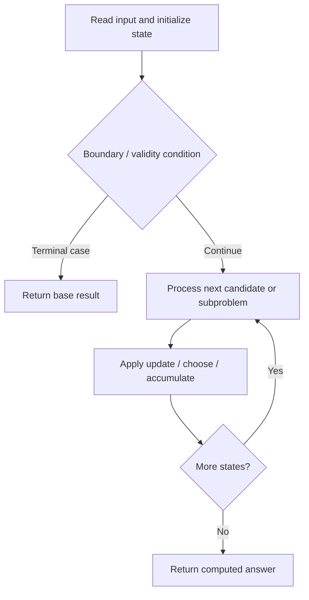

# 132. Palindrome Partitioning II

**Difficulty:** Hard  
**Concept family:** [Interval and Partition DP](https://github.com/gaurav1kr/Miscellaneous/blob/main/DSA/DP/DP_Mathematics_Master_Guide_Illustrated/Theory/Chapter-06.md)  
**Problem:** https://leetcode.com/problems/palindrome-partitioning-ii/  
**Original submission:** https://leetcode.com/submissions/detail/1498104120/

## Understand the mathematics first

This problem belongs to the study family **Interval and Partition DP**. Start by defining the objective and minimal sufficient state; inspect the code to identify the actual transitions.

### Related concept template (not necessarily this problem’s recurrence)

$$
F(l,r)=\min_{l\le k<r}(F(l,k)+F(k+1,r)+cost(l,k,r))
$$

**What this template illustrates:** Some interval problems maximize rather than minimize. Choosing the last operation can make otherwise interacting subproblems independent.

**Derivation exercise:** Define exactly what each state variable means for this problem; list valid choices, base cases, and forbidden transitions. Check the submitted code against that invariant. The family template alone is not a substitute for a problem-specific proof.

## Code landmarks

- `if(dp[i]!=INT_MAX)return dp[i];`
- `dp[i]=min(dp[i],solve(j+1,s,dp)+1);`
- `return dp[i];`

## Source-grounded algorithm walkthrough (expanded coverage)

> **Verification level:** The observations below are extracted from your actual Accepted C++ implementation. The symbolic trace is a **code-reading dry-run worksheet**, not a fabricated numerical run. The generic family formula above is not necessarily this problem's recurrence.

### 1. Identify the actual state and algorithm

**Problem:** 132. Palindrome Partitioning II. Recursive state transitions are present. Check memoization, state identity, termination, and whether branches are mutually exclusive.

| Role | C++ source line | Evidence from your solution |
|---|---:|---|
| Candidate state / accumulator | 4 | `int solve(int i,string &s, vector<int> &dp)` |
| Candidate state / accumulator | 10 | `if(dp[i]!=INT_MAX)return dp[i];` |
| Candidate state / accumulator | 16 | `dp[i]=min(dp[i],solve(j+1,s,dp)+1);` |
| Boundary / termination | 6 | `if(i==s.size())` |
| Boundary / termination | 8 | `return 0;` |
| Boundary / termination | 10 | `if(dp[i]!=INT_MAX)return dp[i];` |
| Traversal order | 12 | `for(int j=i;j<s.size();j++)` |
| Traversal order | 24 | `while(start<=end)` |
| Transition / update | 16 | `dp[i]=min(dp[i],solve(j+1,s,dp)+1);` |
| Return / result | 8 | `return 0;` |
| Return / result | 10 | `if(dp[i]!=INT_MAX)return dp[i];` |

### 2. Trace the dependency chain



This is a **control-flow reading diagram**, not a claim about the exact shape of the mathematical state graph. Follow the code line numbers above to draw the actual dependency arrows.

### 3. Symbolic dry-run worksheet

| Stage | State to record | Mathematical question to answer |
|---|---|---|
| Initialize | Inputs, initialized containers/accumulators | What does the initial value mean? |
| First iteration / recursive call | Loop indices, branch, current state | Which predecessor states are available? |
| First update | Before → after for the updated variable | Why is this transition legal? Does it add, minimize, maximize, or overwrite? |
| Next iteration | Updated state and next candidate | Can a value be reused in this traversal order? |
| Finish | Return expression and its value | Why does this correspond to the problem's requested result? |

### 4. Mathematical explanation checklist

1. Define the exact meaning of each state variable, including all indices and constraints.
2. Translate the update expression into a mathematical equation **only after** establishing the state invariant.
3. Prove the transitions are exhaustive and do not double-count or reuse forbidden elements.
4. Check empty input, smallest input, impossible cases, and overflow/modulo behavior.
5. Compute a small numerical example using the actual problem constraints, then compare each row to the original C++.


---

## Your original Accepted C++ submission (unaltered)

```cpp
class Solution 
{
public:
    int solve(int i,string &s, vector<int> &dp)
	{
        if(i==s.size())
		{
            return 0;
        }
        if(dp[i]!=INT_MAX)return dp[i];
        
        for(int j=i;j<s.size();j++)
		{
            if(isPalin(s,i,j))
			{
                dp[i]=min(dp[i],solve(j+1,s,dp)+1);
            }
        }
        return dp[i];
    }

    bool isPalin(string &s, int start,int end)
	{
        while(start<=end)
		{
            if(s[start++]!=s[end--])
				return false;
        }
        return true;
    }
    int minCut(string s) 
	{
        vector<int> dp(s.size()+1,INT_MAX);
        return solve(0,s,dp)-1;
    }
};
```

## Time and Space Complexity

- **Time:** `O(number of reachable states × work per state), if memoized`
- **Auxiliary space:** `O(number of memoized states + recursion depth)`

**Reasoning:** Count distinct memo keys and transitions. Without effective memoization, recursive branching can be exponential.

**Status:** Code-informed complexity guidance; exact tight bounds have not been individually verified.
