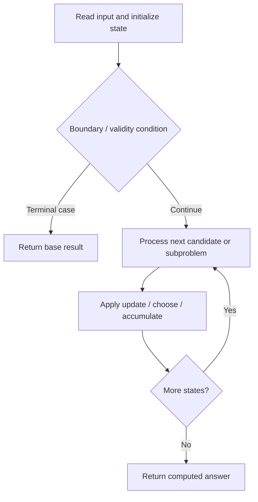

# 1335. Minimum Difficulty of a Job Schedule

**Difficulty:** Hard  
**Concept family:** [Interval and Partition DP](https://github.com/gaurav1kr/Miscellaneous/blob/main/DSA/DP/DP_Mathematics_Master_Guide_Illustrated/Theory/Chapter-06.md)  
**Problem:** https://leetcode.com/problems/minimum-difficulty-of-a-job-schedule/  
**Original submission:** https://leetcode.com/submissions/detail/1593693569/

## Understand the mathematics first

This problem belongs to the study family **Interval and Partition DP**. Start by defining the objective and minimal sufficient state; inspect the code to identify the actual transitions.

### Problem-specific recurrence

Refer to the source-grounded algorithm walkthrough below for the state transitions used by your implementation. The generic family recurrence has been removed because it may not apply to this problem.

## Code landmarks

- `dp[0][0] = 0;`
- `maxDiff = max(maxDiff, jobDifficulty[j]);`
- `if (dp[day - 1][j] != INT_MAX)`

## Source-grounded algorithm walkthrough (expanded coverage)

> **Verification level:** The observations below are extracted from your actual Accepted C++ implementation. The symbolic trace is a **code-reading dry-run worksheet**, not a fabricated numerical run. The generic family formula above is not necessarily this problem's recurrence.

### 1. Identify the actual state and algorithm

**Problem:** 1335. Minimum Difficulty of a Job Schedule. An explicit state table or memo is present. Interpret each index as a mathematical state and every update as a transition.

| Role | C++ source line | Evidence from your solution |
|---|---:|---|
| Candidate state / accumulator | 12 | `vector<vector<int>> dp(d + 1, vector<int>(n + 1, INT_MAX));` |
| Candidate state / accumulator | 13 | `dp[0][0] = 0;` |
| Candidate state / accumulator | 19 | `if (dp[day - 1][j] != INT_MAX)` |
| Boundary / termination | 11 | `if (n < d) return -1;` |
| Boundary / termination | 13 | `dp[0][0] = 0;` |
| Boundary / termination | 19 | `if (dp[day - 1][j] != INT_MAX)` |
| Traversal order | 14 | `for (int day = 1; day <= d; ++day) {` |
| Traversal order | 15 | `for (int i = day; i <= n; ++i) {` |
| Traversal order | 17 | `for (int j = i - 1; j >= day - 1; --j) {` |
| Transition / update | 13 | `dp[0][0] = 0;` |
| Transition / update | 18 | `maxDiff = max(maxDiff, jobDifficulty[j]);` |
| Transition / update | 20 | `dp[day][i] = min(dp[day][i], dp[day - 1][j] + maxDiff);` |
| Return / result | 11 | `if (n < d) return -1;` |
| Return / result | 24 | `return dp[d][n];` |

### 2. Trace the dependency chain



This is a **control-flow reading diagram**, not a claim about the exact shape of the mathematical state graph. Follow the code line numbers above to draw the actual dependency arrows.

### 3. Symbolic dry-run worksheet

| Stage | State to record | Mathematical question to answer |
|---|---|---|
| Initialize | Inputs, initialized containers/accumulators | What does the initial value mean? |
| First iteration / recursive call | Loop indices, branch, current state | Which predecessor states are available? |
| First update | Before → after for the updated variable | Why is this transition legal? Does it add, minimize, maximize, or overwrite? |
| Next iteration | Updated state and next candidate | Can a value be reused in this traversal order? |
| Finish | Return expression and its value | Why does this correspond to the problem's requested result? |

### 4. Mathematical explanation checklist

1. Define the exact meaning of each state variable, including all indices and constraints.
2. Translate the update expression into a mathematical equation **only after** establishing the state invariant.
3. Prove the transitions are exhaustive and do not double-count or reuse forbidden elements.
4. Check empty input, smallest input, impossible cases, and overflow/modulo behavior.
5. Compute a small numerical example using the actual problem constraints, then compare each row to the original C++.


---

## Your original Accepted C++ submission (unaltered)

```cpp
#include <vector>
#include <climits>
#include <algorithm>

using namespace std;

class Solution {
public:
    int minDifficulty(vector<int>& jobDifficulty, int d) {
        int n = jobDifficulty.size();
        if (n < d) return -1;
        vector<vector<int>> dp(d + 1, vector<int>(n + 1, INT_MAX));
        dp[0][0] = 0;
        for (int day = 1; day <= d; ++day) {
            for (int i = day; i <= n; ++i) {
                int maxDiff = 0;
                for (int j = i - 1; j >= day - 1; --j) {
                    maxDiff = max(maxDiff, jobDifficulty[j]);
                    if (dp[day - 1][j] != INT_MAX)
                        dp[day][i] = min(dp[day][i], dp[day - 1][j] + maxDiff);
                }
            }
        }
        return dp[d][n];
    }
};
```

## Time and Space Complexity

- **Time:** `Depends on table dimensions and transitions per cell`
- **Auxiliary space:** `O(rows × columns) for the allocated table`

**Reasoning:** The two-dimensional table determines memory; time is its state count multiplied by work per state.

**Status:** Code-informed complexity guidance; exact tight bounds have not been individually verified.
