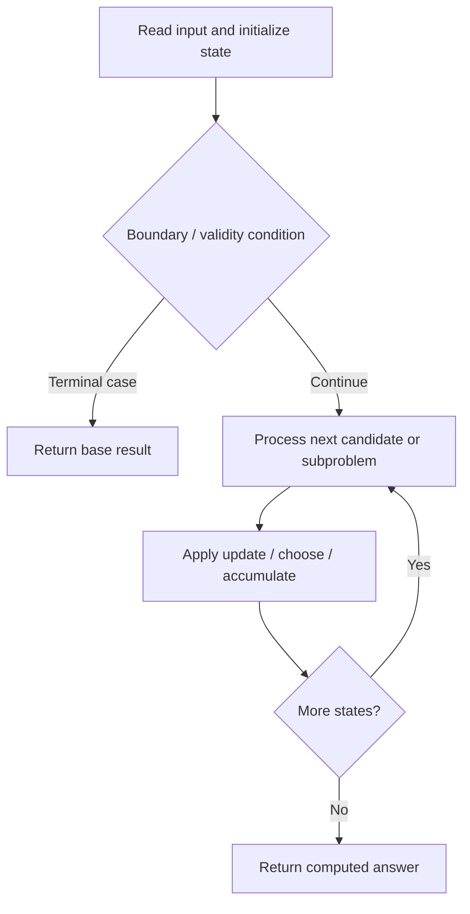

# 1373. Maximum Sum BST in Binary Tree

**Difficulty:** Hard  
**Concept family:** [Tree, Graph and DAG DP](https://github.com/gaurav1kr/Miscellaneous/blob/main/DSA/DP/DP_Mathematics_Master_Guide_Illustrated/Theory/Chapter-10.md)  
**Problem:** https://leetcode.com/problems/maximum-sum-bst-in-binary-tree/  
**Original submission:** https://leetcode.com/submissions/detail/1593833763/

## Understand the mathematics first

This problem belongs to the study family **Tree, Graph and DAG DP**. Start by defining the objective and minimal sufficient state; inspect the code to identify the actual transitions.

### Mathematical starting point

This family includes tree DP, DAG DP, shortest paths, and graph traversal. **There is no single recurrence for all these problems.** Identify the exact state and invariant from the algorithm below. For tree paths, distinguish the value returned to the parent from a complete answer within the subtree; for graph problems, establish whether edges form a DAG or whether shortest-path processing is required.

## Code landmarks

- `maxSum = max(maxSum, sum);`
- `return {true, sum, min(node->val, l_min), max(node->val, r_max)};`

## Source-grounded algorithm walkthrough (expanded coverage)

> **Verification level:** The observations below are extracted from your actual Accepted C++ implementation. The symbolic trace is a **code-reading dry-run worksheet**, not a fabricated numerical run. The generic family formula above is not necessarily this problem's recurrence.

### 1. Identify the actual state and algorithm

**Problem:** 1373. Maximum Sum BST in Binary Tree. Recursive state transitions are present. Check memoization, state identity, termination, and whether branches are mutually exclusive.

| Role | C++ source line | Evidence from your solution |
|---|---:|---|
| Candidate state / accumulator | 17 | `int sum = l_sum + r_sum + node->val;` |
| Boundary / termination | 11 | `if (!node) return {true, 0, INT_MAX, INT_MIN};` |
| Boundary / termination | 16 | `if (l_bst && r_bst && node->val > l_max && node->val < r_min) {` |
| Traversal order | — | No obvious matching statement; inspect the original C++ below. |
| Transition / update | 17 | `int sum = l_sum + r_sum + node->val;` |
| Transition / update | 18 | `maxSum = max(maxSum, sum);` |
| Transition / update | 19 | `return {true, sum, min(node->val, l_min), max(node->val, r_max)};` |
| Return / result | 7 | `return maxSum;` |
| Return / result | 11 | `if (!node) return {true, 0, INT_MAX, INT_MIN};` |

### 2. Trace the dependency chain



This is a **control-flow reading diagram**, not a claim about the exact shape of the mathematical state graph. Follow the code line numbers above to draw the actual dependency arrows.

### 3. Symbolic dry-run worksheet

| Stage | State to record | Mathematical question to answer |
|---|---|---|
| Initialize | Inputs, initialized containers/accumulators | What does the initial value mean? |
| First iteration / recursive call | Loop indices, branch, current state | Which predecessor states are available? |
| First update | Before → after for the updated variable | Why is this transition legal? Does it add, minimize, maximize, or overwrite? |
| Next iteration | Updated state and next candidate | Can a value be reused in this traversal order? |
| Finish | Return expression and its value | Why does this correspond to the problem's requested result? |

### 4. Mathematical explanation checklist

1. Define the exact meaning of each state variable, including all indices and constraints.
2. Translate the update expression into a mathematical equation **only after** establishing the state invariant.
3. Prove the transitions are exhaustive and do not double-count or reuse forbidden elements.
4. Check empty input, smallest input, impossible cases, and overflow/modulo behavior.
5. Compute a small numerical example using the actual problem constraints, then compare each row to the original C++.


---

## Your original Accepted C++ submission (unaltered)

```cpp
class Solution {
    int maxSum = 0;

public:
    int maxSumBST(TreeNode* root) {
        dfs(root);
        return maxSum;
    }

    tuple<bool, int, int, int> dfs(TreeNode* node) {
        if (!node) return {true, 0, INT_MAX, INT_MIN};

        auto [l_bst, l_sum, l_min, l_max] = dfs(node->left);
        auto [r_bst, r_sum, r_min, r_max] = dfs(node->right);

        if (l_bst && r_bst && node->val > l_max && node->val < r_min) {
            int sum = l_sum + r_sum + node->val;
            maxSum = max(maxSum, sum);
            return {true, sum, min(node->val, l_min), max(node->val, r_max)};
        }

        return {false, 0, 0, 0};
    }
};
```

## Time and Space Complexity

- **Time:** `O(number of reachable states × work per state), if memoized`
- **Auxiliary space:** `O(number of memoized states + recursion depth)`

**Reasoning:** Count distinct memo keys and transitions. Without effective memoization, recursive branching can be exponential.

**Status:** Code-informed complexity guidance; exact tight bounds have not been individually verified.
