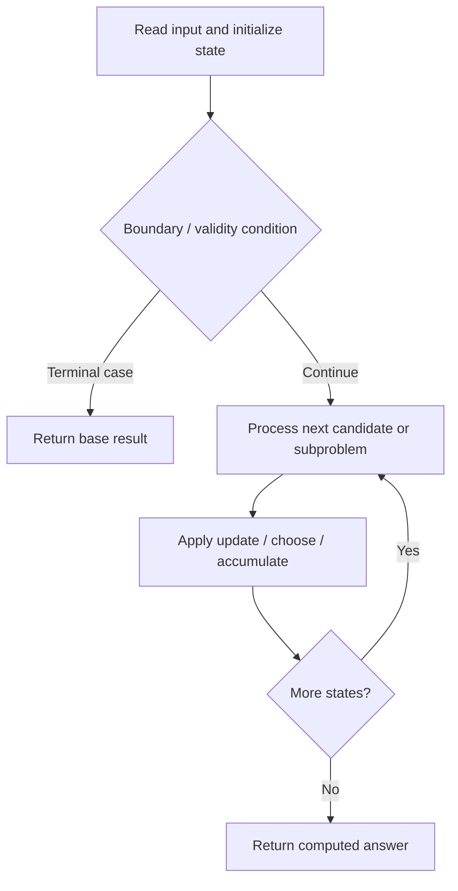

# 1397. Find All Good Strings

**Difficulty:** Hard  
**Concept family:** [Digit DP, Counting and Probability](https://github.com/gaurav1kr/Miscellaneous/blob/main/DSA/DP/DP_Mathematics_Master_Guide_Illustrated/Theory/Chapter-11.md)  
**Problem:** https://leetcode.com/problems/find-all-good-strings/  
**Original submission:** https://leetcode.com/submissions/detail/1610648566/

## Understand the mathematics first

This problem belongs to the study family **Digit DP, Counting and Probability**. Start by defining the objective and minimal sufficient state; inspect the code to identify the actual transitions.

### Related concept template (not necessarily this problem’s recurrence)

$$
bestEnding(i)=\max(a_i,a_i+bestEnding(i-1))
$$

**What this template illustrates:** This is Kadane’s recurrence; other problems in this group may use greedy, stacks, two pointers, prefix sums, or a specialized optimization—not necessarily DP.

**Derivation exercise:** Define exactly what each state variable means for this problem; list valid choices, base cases, and forbidden transitions. Check the submitted code against that invariant. The family template alone is not a substitute for a problem-specific proof.

## Code landmarks

- `while (j > 0 && evil[i] != evil[j]) j = lps[j - 1];`
- `int dp[501][51][2][2];`
- `if (dp[i][j][lo][hi] != -1) return dp[i][j][lo][hi];`

## Source-grounded algorithm walkthrough (expanded coverage)

> **Verification level:** The observations below are extracted from your actual Accepted C++ implementation. The symbolic trace is a **code-reading dry-run worksheet**, not a fabricated numerical run. The generic family formula above is not necessarily this problem's recurrence.

### 1. Identify the actual state and algorithm

**Problem:** 1397. Find All Good Strings. Recursive state transitions are present. Check memoization, state identity, termination, and whether branches are mutually exclusive.

| Role | C++ source line | Evidence from your solution |
|---|---:|---|
| Candidate state / accumulator | 19 | `int dp[501][51][2][2];` |
| Candidate state / accumulator | 24 | `if (dp[i][j][lo][hi] != -1) return dp[i][j][lo][hi];` |
| Candidate state / accumulator | 28 | `int res = 0;` |
| Boundary / termination | 14 | `if (evil[i] == evil[j]) lps[i] = ++j;` |
| Boundary / termination | 22 | `if (j == evil.size()) return 0;` |
| Boundary / termination | 23 | `if (i == s1.size()) return 1;` |
| Traversal order | 12 | `for (int i = 1; i < m; ++i) {` |
| Traversal order | 13 | `while (j > 0 && evil[i] != evil[j]) j = lps[j - 1];` |
| Traversal order | 30 | `for (char c = from; c <= to; ++c) {` |
| Transition / update | 28 | `int res = 0;` |
| Transition / update | 34 | `res = (res + dfs(s1, s2, evil, lps, i + 1, k, lo && c == from, hi && c == to)) % MOD;` |
| Transition / update | 37 | `return dp[i][j][lo][hi] = res;` |
| Return / result | 16 | `return lps;` |
| Return / result | 22 | `if (j == evil.size()) return 0;` |

### 2. Trace the dependency chain



This is a **control-flow reading diagram**, not a claim about the exact shape of the mathematical state graph. Follow the code line numbers above to draw the actual dependency arrows.

### 3. Symbolic dry-run worksheet

| Stage | State to record | Mathematical question to answer |
|---|---|---|
| Initialize | Inputs, initialized containers/accumulators | What does the initial value mean? |
| First iteration / recursive call | Loop indices, branch, current state | Which predecessor states are available? |
| First update | Before → after for the updated variable | Why is this transition legal? Does it add, minimize, maximize, or overwrite? |
| Next iteration | Updated state and next candidate | Can a value be reused in this traversal order? |
| Finish | Return expression and its value | Why does this correspond to the problem's requested result? |

### 4. Mathematical explanation checklist

1. Define the exact meaning of each state variable, including all indices and constraints.
2. Translate the update expression into a mathematical equation **only after** establishing the state invariant.
3. Prove the transitions are exhaustive and do not double-count or reuse forbidden elements.
4. Check empty input, smallest input, impossible cases, and overflow/modulo behavior.
5. Compute a small numerical example using the actual problem constraints, then compare each row to the original C++.


---

## Your original Accepted C++ submission (unaltered)

```cpp
#include <string>
#include <vector>

using namespace std;

class Solution {
    const int MOD = 1e9 + 7;

    vector<int> buildLPS(string evil) {
        int m = evil.size(), j = 0;
        vector<int> lps(m, 0);
        for (int i = 1; i < m; ++i) {
            while (j > 0 && evil[i] != evil[j]) j = lps[j - 1];
            if (evil[i] == evil[j]) lps[i] = ++j;
        }
        return lps;
    }

    int dp[501][51][2][2];

    int dfs(string& s1, string& s2, string& evil, vector<int>& lps, int i, int j, bool lo, bool hi) {
        if (j == evil.size()) return 0;
        if (i == s1.size()) return 1;
        if (dp[i][j][lo][hi] != -1) return dp[i][j][lo][hi];

        char from = lo ? s1[i] : 'a';
        char to = hi ? s2[i] : 'z';
        int res = 0;

        for (char c = from; c <= to; ++c) {
            int k = j;
            while (k > 0 && evil[k] != c) k = lps[k - 1];
            if (c == evil[k]) ++k;
            res = (res + dfs(s1, s2, evil, lps, i + 1, k, lo && c == from, hi && c == to)) % MOD;
        }

        return dp[i][j][lo][hi] = res;
    }

public:
    int findGoodStrings(int n, string s1, string s2, string evil) {
        vector<int> lps = buildLPS(evil);
        memset(dp, -1, sizeof(dp));
        return dfs(s1, s2, evil, lps, 0, 0, true, true);
    }
};
```

## Time and Space Complexity

- **Time:** `O(number of reachable states × work per state), if memoized`
- **Auxiliary space:** `O(number of memoized states + recursion depth)`

**Reasoning:** Count distinct memo keys and transitions. Without effective memoization, recursive branching can be exponential.

**Status:** Code-informed complexity guidance; exact tight bounds have not been individually verified.
