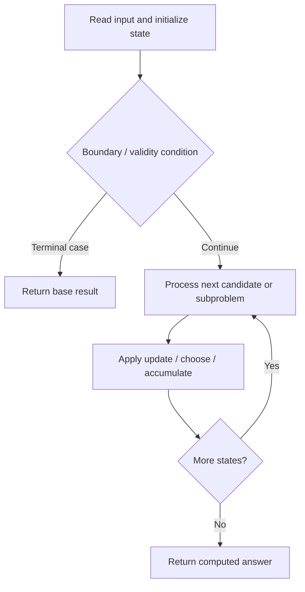

# 1406. Stone Game III

**Difficulty:** Hard  
**Concept family:** [Interval and Partition DP](https://github.com/gaurav1kr/Miscellaneous/blob/main/DSA/DP/DP_Mathematics_Master_Guide_Illustrated/Theory/Chapter-06.md)  
**Problem:** https://leetcode.com/problems/stone-game-iii/  
**Original submission:** https://leetcode.com/submissions/detail/1593834081/

## Understand the mathematics first

This problem belongs to the study family **Interval and Partition DP**. Start by defining the objective and minimal sufficient state; inspect the code to identify the actual transitions.

### Problem-specific recurrence

Refer to the source-grounded algorithm walkthrough below for the state transitions used by your implementation. The generic family recurrence has been removed because it may not apply to this problem.

## Code landmarks

- `dp[n] = 0;`
- `dp[i] = max(dp[i], total - dp[i + k + 1]);`
- `if (dp[0] > 0) return "Alice";`

## Source-grounded algorithm walkthrough (expanded coverage)

> **Verification level:** The observations below are extracted from your actual Accepted C++ implementation. The symbolic trace is a **code-reading dry-run worksheet**, not a fabricated numerical run. The generic family formula above is not necessarily this problem's recurrence.

### 1. Identify the actual state and algorithm

**Problem:** 1406. Stone Game III. An explicit state table or memo is present. Interpret each index as a mathematical state and every update as a transition.

| Role | C++ source line | Evidence from your solution |
|---|---:|---|
| Candidate state / accumulator | 10 | `vector<int> dp(n + 1, INT_MIN);` |
| Candidate state / accumulator | 11 | `dp[n] = 0;` |
| Candidate state / accumulator | 17 | `dp[i] = max(dp[i], total - dp[i + k + 1]);` |
| Boundary / termination | 11 | `dp[n] = 0;` |
| Boundary / termination | 21 | `if (dp[0] > 0) return "Alice";` |
| Boundary / termination | 22 | `else if (dp[0] < 0) return "Bob";` |
| Traversal order | 13 | `for (int i = n - 1; i >= 0; --i) {` |
| Traversal order | 15 | `for (int k = 0; k < 3 && i + k < n; ++k) {` |
| Transition / update | 11 | `dp[n] = 0;` |
| Transition / update | 17 | `dp[i] = max(dp[i], total - dp[i + k + 1]);` |
| Return / result | 21 | `if (dp[0] > 0) return "Alice";` |
| Return / result | 22 | `else if (dp[0] < 0) return "Bob";` |

### 2. Trace the dependency chain



This is a **control-flow reading diagram**, not a claim about the exact shape of the mathematical state graph. Follow the code line numbers above to draw the actual dependency arrows.

### 3. Symbolic dry-run worksheet

| Stage | State to record | Mathematical question to answer |
|---|---|---|
| Initialize | Inputs, initialized containers/accumulators | What does the initial value mean? |
| First iteration / recursive call | Loop indices, branch, current state | Which predecessor states are available? |
| First update | Before → after for the updated variable | Why is this transition legal? Does it add, minimize, maximize, or overwrite? |
| Next iteration | Updated state and next candidate | Can a value be reused in this traversal order? |
| Finish | Return expression and its value | Why does this correspond to the problem's requested result? |

### 4. Mathematical explanation checklist

1. Define the exact meaning of each state variable, including all indices and constraints.
2. Translate the update expression into a mathematical equation **only after** establishing the state invariant.
3. Prove the transitions are exhaustive and do not double-count or reuse forbidden elements.
4. Check empty input, smallest input, impossible cases, and overflow/modulo behavior.
5. Compute a small numerical example using the actual problem constraints, then compare each row to the original C++.


---

## Your original Accepted C++ submission (unaltered)

```cpp
#include <vector>
#include <string>

using namespace std;

class Solution {
public:
    string stoneGameIII(vector<int>& stoneValue) {
        int n = stoneValue.size();
        vector<int> dp(n + 1, INT_MIN);
        dp[n] = 0;

        for (int i = n - 1; i >= 0; --i) {
            int total = 0;
            for (int k = 0; k < 3 && i + k < n; ++k) {
                total += stoneValue[i + k];
                dp[i] = max(dp[i], total - dp[i + k + 1]);
            }
        }

        if (dp[0] > 0) return "Alice";
        else if (dp[0] < 0) return "Bob";
        return "Tie";
    }
};
```

## Time and Space Complexity

- **Time:** `Depends on loop nesting and bounds`
- **Auxiliary space:** `Depends on auxiliary arrays/containers`

**Reasoning:** Count how many iterations each loop executes and whether loops are nested; do not assume all nested loops are quadratic.

**Status:** Code-informed complexity guidance; exact tight bounds have not been individually verified.
