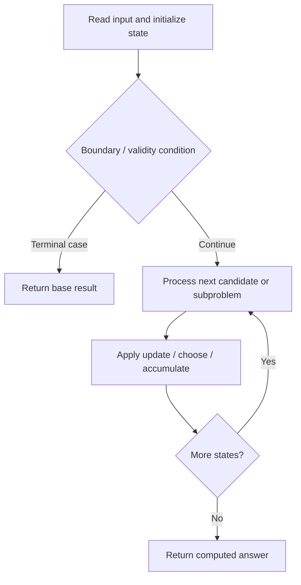

# 1420. Build Array Where You Can Find The Maximum Exactly K Comparisons

**Difficulty:** Hard  
**Concept family:** [Mathematical Recurrences and Combinatorics](https://github.com/gaurav1kr/Miscellaneous/blob/main/DSA/DP/DP_Mathematics_Master_Guide_Illustrated/Theory/Chapter-01.md)  
**Problem:** https://leetcode.com/problems/build-array-where-you-can-find-the-maximum-exactly-k-comparisons/  
**Original submission:** https://leetcode.com/submissions/detail/1617064985/

## Understand the mathematics first

This problem belongs to the study family **Mathematical Recurrences and Combinatorics**. Start by defining the objective and minimal sufficient state; inspect the code to identify the actual transitions.

### Related concept template (not necessarily this problem’s recurrence)

$$
F(n)=\sum_{c\in Choices(n)}F(next(n,c))
$$

**What this template illustrates:** For counting, add disjoint cases. For optimization, replace sum with min or max. Base cases must express empty structures correctly.

**Derivation exercise:** Define exactly what each state variable means for this problem; list valid choices, base cases, and forbidden transitions. Check the submitted code against that invariant. The family template alone is not a substitute for a problem-specific proof.

## Code landmarks

- `// Initialize dp[1][i][1] to 1, as there's only one way to create`
- `dp[1][i][1] = 1;`
- `// dp[len][maxVal][cost] can be calculated by summing up`

## Source-grounded algorithm walkthrough (expanded coverage)

> **Verification level:** The observations below are extracted from your actual Accepted C++ implementation. The symbolic trace is a **code-reading dry-run worksheet**, not a fabricated numerical run. The generic family formula above is not necessarily this problem's recurrence.

### 1. Identify the actual state and algorithm

**Problem:** 1420. Build Array Where You Can Find The Maximum Exactly K Comparisons. An explicit state table or memo is present. Interpret each index as a mathematical state and every update as a transition.

| Role | C++ source line | Evidence from your solution |
|---|---:|---|
| Candidate state / accumulator | 5 | `vector<vector<vector<long long>>> dp(n + 1, vector<vector<long long>>(m + 1, vector<long long>(k + 1, 0)));` |
| Candidate state / accumulator | 10 | `dp[1][i][1] = 1;` |
| Candidate state / accumulator | 19 | `long long sum = 0;` |
| Boundary / termination | 10 | `dp[1][i][1] = 1;` |
| Traversal order | 9 | `for (int i = 1; i <= m; i++) {` |
| Traversal order | 14 | `for (int len = 2; len <= n; len++) {` |
| Traversal order | 15 | `for (int maxVal = 1; maxVal <= m; maxVal++) {` |
| Transition / update | 10 | `dp[1][i][1] = 1;` |
| Transition / update | 19 | `long long sum = 0;` |
| Transition / update | 21 | `sum = (sum + dp[len - 1][i][cost - 1]) % MOD;` |
| Transition / update | 23 | `dp[len][maxVal][cost] = (dp[len - 1][maxVal][cost] * maxVal + sum) % MOD;` |
| Return / result | 34 | `return ans;` |

### 2. Trace the dependency chain



This is a **control-flow reading diagram**, not a claim about the exact shape of the mathematical state graph. Follow the code line numbers above to draw the actual dependency arrows.

### 3. Symbolic dry-run worksheet

| Stage | State to record | Mathematical question to answer |
|---|---|---|
| Initialize | Inputs, initialized containers/accumulators | What does the initial value mean? |
| First iteration / recursive call | Loop indices, branch, current state | Which predecessor states are available? |
| First update | Before → after for the updated variable | Why is this transition legal? Does it add, minimize, maximize, or overwrite? |
| Next iteration | Updated state and next candidate | Can a value be reused in this traversal order? |
| Finish | Return expression and its value | Why does this correspond to the problem's requested result? |

### 4. Mathematical explanation checklist

1. Define the exact meaning of each state variable, including all indices and constraints.
2. Translate the update expression into a mathematical equation **only after** establishing the state invariant.
3. Prove the transitions are exhaustive and do not double-count or reuse forbidden elements.
4. Check empty input, smallest input, impossible cases, and overflow/modulo behavior.
5. Compute a small numerical example using the actual problem constraints, then compare each row to the original C++.


---

## Your original Accepted C++ submission (unaltered)

```cpp
class Solution {
public:
    int numOfArrays(int n, int m, int k) {
        const int MOD = 1000000007;
        vector<vector<vector<long long>>> dp(n + 1, vector<vector<long long>>(m + 1, vector<long long>(k + 1, 0)));
        
        // Initialize dp[1][i][1] to 1, as there's only one way to create
        // a single-element array with any number from 1 to m.
        for (int i = 1; i <= m; i++) {
            dp[1][i][1] = 1;
        }
        
        // Fill in the dp table using dynamic programming.
        for (int len = 2; len <= n; len++) {
            for (int maxVal = 1; maxVal <= m; maxVal++) {
                for (int cost = 1; cost <= k; cost++) {
                    // dp[len][maxVal][cost] can be calculated by summing up
                    // dp[len-1][i][cost-1] for i < maxVal and dp[len-1][maxVal][cost] * maxVal.
                    long long sum = 0;
                    for (int i = 1; i < maxVal; i++) {
                        sum = (sum + dp[len - 1][i][cost - 1]) % MOD;
                    }
                    dp[len][maxVal][cost] = (dp[len - 1][maxVal][cost] * maxVal + sum) % MOD;
                }
            }
        }
        
        // Sum up the possibilities for the final state dp[n][1..m][k].
        long long ans = 0;
        for (int i = 1; i <= m; i++) {
            ans = (ans + dp[n][i][k]) % MOD;
        }
        
        return ans;
    }
};
```

## Time and Space Complexity

- **Time:** `Depends on 3D state count and transitions`
- **Auxiliary space:** `O(product of allocated DP dimensions)`

**Reasoning:** The code allocates a three-dimensional state table; inspect how many transitions are considered for each state.

**Status:** Code-informed complexity guidance; exact tight bounds have not been individually verified.
