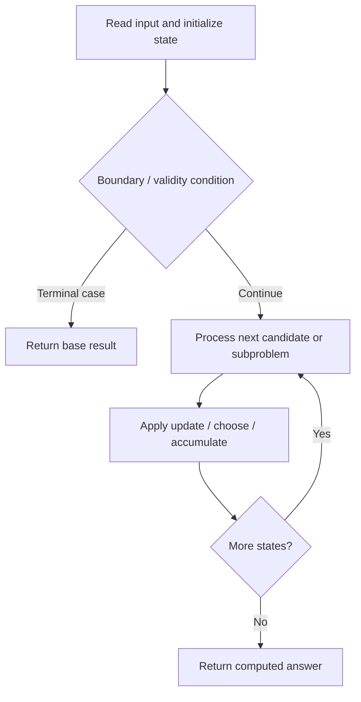

# 1444. Number of Ways of Cutting a Pizza

**Difficulty:** Hard  
**Concept family:** [Grid Paths and Geometric DP](https://github.com/gaurav1kr/Miscellaneous/blob/main/DSA/DP/DP_Mathematics_Master_Guide_Illustrated/Theory/Chapter-03.md)  
**Problem:** https://leetcode.com/problems/number-of-ways-of-cutting-a-pizza/  
**Original submission:** https://leetcode.com/submissions/detail/1610603338/

## Understand the mathematics first

This problem belongs to the study family **Grid Paths and Geometric DP**. Start by defining the objective and minimal sufficient state; inspect the code to identify the actual transitions.

### Related concept template (not necessarily this problem’s recurrence)

$$
F(i,j)=F(i-1,j)+F(i,j-1)
$$

**What this template illustrates:** For minimum cost paths, replace + of paths with min of predecessor costs, then add the current cell cost. Obstacles contribute zero ways.

**Derivation exercise:** Define exactly what each state variable means for this problem; list valid choices, base cases, and forbidden transitions. Check the submitted code against that invariant. The family template alone is not a substitute for a problem-specific proof.

## Code landmarks

- `dp[0][i][j] = pre[i][j] > 0;`
- `dp[l][i][j] = (dp[l][i][j] + dp[l - 1][ii][j]) % MOD;`
- `dp[l][i][j] = (dp[l][i][j] + dp[l - 1][i][jj]) % MOD;`

## Source-grounded algorithm walkthrough (expanded coverage)

> **Verification level:** The observations below are extracted from your actual Accepted C++ implementation. The symbolic trace is a **code-reading dry-run worksheet**, not a fabricated numerical run. The generic family formula above is not necessarily this problem's recurrence.

### 1. Identify the actual state and algorithm

**Problem:** 1444. Number of Ways of Cutting a Pizza. An explicit state table or memo is present. Interpret each index as a mathematical state and every update as a transition.

| Role | C++ source line | Evidence from your solution |
|---|---:|---|
| Candidate state / accumulator | 8 | `int ways(vector<string>& pizza, int k) {` |
| Candidate state / accumulator | 16 | `vector<vector<vector<int>>> dp(k, vector<vector<int>>(m, vector<int>(n)));` |
| Candidate state / accumulator | 19 | `dp[0][i][j] = pre[i][j] > 0;` |
| Boundary / termination | 25 | `if (pre[i][j] - pre[ii][j] > 0)` |
| Boundary / termination | 28 | `if (pre[i][j] - pre[i][jj] > 0)` |
| Traversal order | 12 | `for (int i = m - 1; i >= 0; --i)` |
| Traversal order | 13 | `for (int j = n - 1; j >= 0; --j)` |
| Traversal order | 17 | `for (int i = 0; i < m; ++i)` |
| Transition / update | 19 | `dp[0][i][j] = pre[i][j] > 0;` |
| Transition / update | 26 | `dp[l][i][j] = (dp[l][i][j] + dp[l - 1][ii][j]) % MOD;` |
| Transition / update | 29 | `dp[l][i][j] = (dp[l][i][j] + dp[l - 1][i][jj]) % MOD;` |
| Return / result | 32 | `return dp[k - 1][0][0];` |

### 2. Trace the dependency chain



This is a **control-flow reading diagram**, not a claim about the exact shape of the mathematical state graph. Follow the code line numbers above to draw the actual dependency arrows.

### 3. Symbolic dry-run worksheet

| Stage | State to record | Mathematical question to answer |
|---|---|---|
| Initialize | Inputs, initialized containers/accumulators | What does the initial value mean? |
| First iteration / recursive call | Loop indices, branch, current state | Which predecessor states are available? |
| First update | Before → after for the updated variable | Why is this transition legal? Does it add, minimize, maximize, or overwrite? |
| Next iteration | Updated state and next candidate | Can a value be reused in this traversal order? |
| Finish | Return expression and its value | Why does this correspond to the problem's requested result? |

### 4. Mathematical explanation checklist

1. Define the exact meaning of each state variable, including all indices and constraints.
2. Translate the update expression into a mathematical equation **only after** establishing the state invariant.
3. Prove the transitions are exhaustive and do not double-count or reuse forbidden elements.
4. Check empty input, smallest input, impossible cases, and overflow/modulo behavior.
5. Compute a small numerical example using the actual problem constraints, then compare each row to the original C++.


---

## Your original Accepted C++ submission (unaltered)

```cpp
#include <vector>
#include <string>

using namespace std;

class Solution {
public:
    int ways(vector<string>& pizza, int k) {
        const int MOD = 1e9 + 7;
        int m = pizza.size(), n = pizza[0].size();
        vector<vector<int>> pre(m + 1, vector<int>(n + 1));
        for (int i = m - 1; i >= 0; --i)
            for (int j = n - 1; j >= 0; --j)
                pre[i][j] = (pizza[i][j] == 'A') + pre[i + 1][j] + pre[i][j + 1] - pre[i + 1][j + 1];

        vector<vector<vector<int>>> dp(k, vector<vector<int>>(m, vector<int>(n)));
        for (int i = 0; i < m; ++i)
            for (int j = 0; j < n; ++j)
                dp[0][i][j] = pre[i][j] > 0;

        for (int l = 1; l < k; ++l)
            for (int i = 0; i < m; ++i)
                for (int j = 0; j < n; ++j) {
                    for (int ii = i + 1; ii < m; ++ii)
                        if (pre[i][j] - pre[ii][j] > 0)
                            dp[l][i][j] = (dp[l][i][j] + dp[l - 1][ii][j]) % MOD;
                    for (int jj = j + 1; jj < n; ++jj)
                        if (pre[i][j] - pre[i][jj] > 0)
                            dp[l][i][j] = (dp[l][i][j] + dp[l - 1][i][jj]) % MOD;
                }

        return dp[k - 1][0][0];
    }
};
```

## Time and Space Complexity

- **Time:** `Depends on 3D state count and transitions`
- **Auxiliary space:** `O(product of allocated DP dimensions)`

**Reasoning:** The code allocates a three-dimensional state table; inspect how many transitions are considered for each state.

**Status:** Code-informed complexity guidance; exact tight bounds have not been individually verified.
