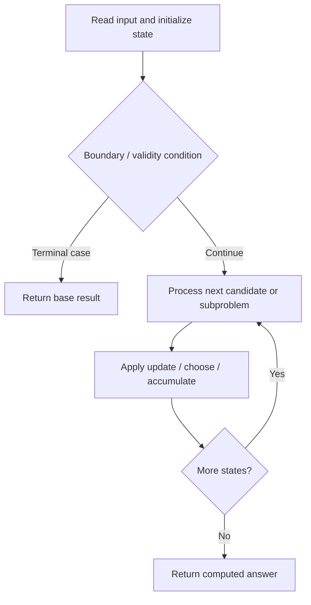

# 1463. Cherry Pickup II

**Difficulty:** Hard  
**Concept family:** [Grid Paths and Geometric DP](https://github.com/gaurav1kr/Miscellaneous/blob/main/DSA/DP/DP_Mathematics_Master_Guide_Illustrated/Theory/Chapter-03.md)  
**Problem:** https://leetcode.com/problems/cherry-pickup-ii/  
**Original submission:** https://leetcode.com/submissions/detail/1593692862/

## Understand the mathematics first

This problem belongs to the study family **Grid Paths and Geometric DP**. Start by defining the objective and minimal sufficient state; inspect the code to identify the actual transitions.

### Related concept template (not necessarily this problem’s recurrence)

$$
F(i,j)=F(i-1,j)+F(i,j-1)
$$

**What this template illustrates:** For minimum cost paths, replace + of paths with min of predecessor costs, then add the current cell cost. Obstacles contribute zero ways.

**Derivation exercise:** Define exactly what each state variable means for this problem; list valid choices, base cases, and forbidden transitions. Check the submitted code against that invariant. The family template alone is not a substitute for a problem-specific proof.

## Code landmarks

- `maxVal = max(maxVal, dp[row + 1][newCol1][newCol2]);`
- `dp[row][col1][col2] = result;`
- `return dp[0][0][n - 1];`

## Source-grounded algorithm walkthrough (expanded coverage)

> **Verification level:** The observations below are extracted from your actual Accepted C++ implementation. The symbolic trace is a **code-reading dry-run worksheet**, not a fabricated numerical run. The generic family formula above is not necessarily this problem's recurrence.

### 1. Identify the actual state and algorithm

**Problem:** 1463. Cherry Pickup II. An explicit state table or memo is present. Interpret each index as a mathematical state and every update as a transition.

| Role | C++ source line | Evidence from your solution |
|---|---:|---|
| Candidate state / accumulator | 10 | `vector<vector<vector<int>>> dp(m, vector<vector<int>>(n, vector<int>(n, 0)));` |
| Candidate state / accumulator | 26 | `maxVal = max(maxVal, dp[row + 1][newCol1][newCol2]);` |
| Candidate state / accumulator | 33 | `dp[row][col1][col2] = result;` |
| Boundary / termination | 17 | `if (col1 != col2)` |
| Boundary / termination | 20 | `if (row != m - 1) {` |
| Boundary / termination | 25 | `if (newCol1 >= 0 && newCol1 < n && newCol2 >= 0 && newCol2 < n) {` |
| Traversal order | 12 | `for (int row = m - 1; row >= 0; --row) {` |
| Traversal order | 13 | `for (int col1 = 0; col1 < n; ++col1) {` |
| Traversal order | 14 | `for (int col2 = 0; col2 < n; ++col2) {` |
| Transition / update | 26 | `maxVal = max(maxVal, dp[row + 1][newCol1][newCol2]);` |
| Transition / update | 33 | `dp[row][col1][col2] = result;` |
| Return / result | 38 | `return dp[0][0][n - 1];` |

### 2. Trace the dependency chain



This is a **control-flow reading diagram**, not a claim about the exact shape of the mathematical state graph. Follow the code line numbers above to draw the actual dependency arrows.

### 3. Symbolic dry-run worksheet

| Stage | State to record | Mathematical question to answer |
|---|---|---|
| Initialize | Inputs, initialized containers/accumulators | What does the initial value mean? |
| First iteration / recursive call | Loop indices, branch, current state | Which predecessor states are available? |
| First update | Before → after for the updated variable | Why is this transition legal? Does it add, minimize, maximize, or overwrite? |
| Next iteration | Updated state and next candidate | Can a value be reused in this traversal order? |
| Finish | Return expression and its value | Why does this correspond to the problem's requested result? |

### 4. Mathematical explanation checklist

1. Define the exact meaning of each state variable, including all indices and constraints.
2. Translate the update expression into a mathematical equation **only after** establishing the state invariant.
3. Prove the transitions are exhaustive and do not double-count or reuse forbidden elements.
4. Check empty input, smallest input, impossible cases, and overflow/modulo behavior.
5. Compute a small numerical example using the actual problem constraints, then compare each row to the original C++.


---

## Your original Accepted C++ submission (unaltered)

```cpp
#include <vector>
#include <algorithm>

using namespace std;

class Solution {
public:
    int cherryPickup(vector<vector<int>>& grid) {
        int m = grid.size(), n = grid[0].size();
        vector<vector<vector<int>>> dp(m, vector<vector<int>>(n, vector<int>(n, 0)));

        for (int row = m - 1; row >= 0; --row) {
            for (int col1 = 0; col1 < n; ++col1) {
                for (int col2 = 0; col2 < n; ++col2) {
                    int result = 0;
                    result += grid[row][col1];
                    if (col1 != col2)
                        result += grid[row][col2];

                    if (row != m - 1) {
                        int maxVal = 0;
                        for (int d1 = -1; d1 <= 1; ++d1) {
                            for (int d2 = -1; d2 <= 1; ++d2) {
                                int newCol1 = col1 + d1, newCol2 = col2 + d2;
                                if (newCol1 >= 0 && newCol1 < n && newCol2 >= 0 && newCol2 < n) {
                                    maxVal = max(maxVal, dp[row + 1][newCol1][newCol2]);
                                }
                            }
                        }
                        result += maxVal;
                    }

                    dp[row][col1][col2] = result;
                }
            }
        }

        return dp[0][0][n - 1];
    }
};
```

## Time and Space Complexity

- **Time:** `Depends on 3D state count and transitions`
- **Auxiliary space:** `O(product of allocated DP dimensions)`

**Reasoning:** The code allocates a three-dimensional state table; inspect how many transitions are considered for each state.

**Status:** Code-informed complexity guidance; exact tight bounds have not been individually verified.
