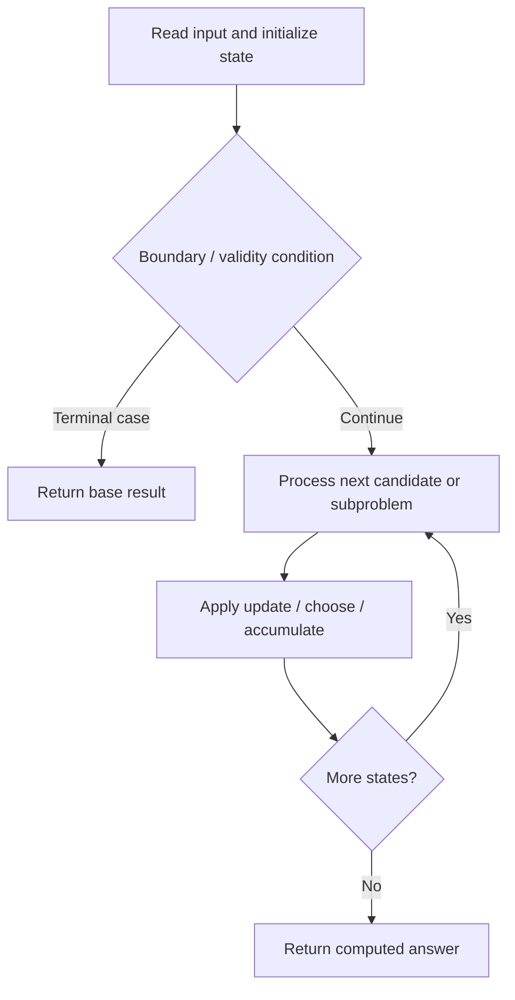

# 1467. Probability of a Two Boxes Having The Same Number of Distinct Balls

**Difficulty:** Hard  
**Concept family:** [Digit DP, Counting and Probability](https://github.com/gaurav1kr/Miscellaneous/blob/main/DSA/DP/DP_Mathematics_Master_Guide_Illustrated/Theory/Chapter-11.md)  
**Problem:** https://leetcode.com/problems/probability-of-a-two-boxes-having-the-same-number-of-distinct-balls/  
**Original submission:** https://leetcode.com/submissions/detail/1613520697/

## Understand the mathematics first

This problem belongs to the study family **Digit DP, Counting and Probability**. Start by defining the objective and minimal sufficient state; inspect the code to identify the actual transitions.

### Problem-specific recurrence

Refer to the source-grounded algorithm walkthrough below for the state transitions used by your implementation. The generic family recurrence has been removed because it may not apply to this problem.

## Code landmarks

- `if (memo[n].count(k)) return memo[n][k];`
- `return memo[n][k] = C(n - 1, k - 1) + C(n - 1, k);`

## Source-grounded algorithm walkthrough (expanded coverage)

> **Verification level:** The observations below are extracted from your actual Accepted C++ implementation. The symbolic trace is a **code-reading dry-run worksheet**, not a fabricated numerical run. The generic family formula above is not necessarily this problem's recurrence.

### 1. Identify the actual state and algorithm

**Problem:** 1467. Probability of a Two Boxes Having The Same Number of Distinct Balls. Recursive state transitions are present. Check memoization, state identity, termination, and whether branches are mutually exclusive.

| Role | C++ source line | Evidence from your solution |
|---|---:|---|
| Candidate state / accumulator | 12 | `void dfs(vector<int>& balls, int i, int c1, int c2, int u1, int u2, int sum, double prob) {` |
| Candidate state / accumulator | 28 | `static unordered_map<int, unordered_map<int, double>> memo;` |
| Candidate state / accumulator | 29 | `if (memo[n].count(k)) return memo[n][k];` |
| Boundary / termination | 13 | `if (i == balls.size()) {` |
| Boundary / termination | 14 | `if (sum == n / 2 && u1 == u2) {` |
| Boundary / termination | 17 | `if (sum == n / 2) all += prob;` |
| Traversal order | 7 | `for (int b : balls) n += b;` |
| Traversal order | 20 | `for (int j = 0; j <= balls[i]; ++j) {` |
| Transition / update | 14 | `if (sum == n / 2 && u1 == u2) {` |
| Transition / update | 17 | `if (sum == n / 2) all += prob;` |
| Transition / update | 31 | `return memo[n][k] = C(n - 1, k - 1) + C(n - 1, k);` |
| Return / result | 9 | `return same / all;` |
| Return / result | 18 | `return;` |

### 2. Trace the dependency chain



This is a **control-flow reading diagram**, not a claim about the exact shape of the mathematical state graph. Follow the code line numbers above to draw the actual dependency arrows.

### 3. Symbolic dry-run worksheet

| Stage | State to record | Mathematical question to answer |
|---|---|---|
| Initialize | Inputs, initialized containers/accumulators | What does the initial value mean? |
| First iteration / recursive call | Loop indices, branch, current state | Which predecessor states are available? |
| First update | Before → after for the updated variable | Why is this transition legal? Does it add, minimize, maximize, or overwrite? |
| Next iteration | Updated state and next candidate | Can a value be reused in this traversal order? |
| Finish | Return expression and its value | Why does this correspond to the problem's requested result? |

### 4. Mathematical explanation checklist

1. Define the exact meaning of each state variable, including all indices and constraints.
2. Translate the update expression into a mathematical equation **only after** establishing the state invariant.
3. Prove the transitions are exhaustive and do not double-count or reuse forbidden elements.
4. Check empty input, smallest input, impossible cases, and overflow/modulo behavior.
5. Compute a small numerical example using the actual problem constraints, then compare each row to the original C++.


---

## Your original Accepted C++ submission (unaltered)

```cpp
class Solution {
public:
    int total[7], n;
    double same = 0.0, all = 0.0;

    double getProbability(vector<int>& balls) {
        for (int b : balls) n += b;
        dfs(balls, 0, 0, 0, 0, 0, 0, 1.0);
        return same / all;
    }

    void dfs(vector<int>& balls, int i, int c1, int c2, int u1, int u2, int sum, double prob) {
        if (i == balls.size()) {
            if (sum == n / 2 && u1 == u2) {
                same += prob;
            }
            if (sum == n / 2) all += prob;
            return;
        }
        for (int j = 0; j <= balls[i]; ++j) {
            int k = balls[i] - j;
            dfs(balls, i + 1, c1 + j, c2 + k, u1 + (j > 0), u2 + (k > 0), sum + j,
                prob * C(balls[i], j));
        }
    }

    double C(int n, int k) {
        static unordered_map<int, unordered_map<int, double>> memo;
        if (memo[n].count(k)) return memo[n][k];
        if (k == 0 || k == n) return 1.0;
        return memo[n][k] = C(n - 1, k - 1) + C(n - 1, k);
    }
};
```

## Time and Space Complexity

- **Time:** `Depends on operations (typically O(log n) per ordered-container operation)`
- **Auxiliary space:** `Depends on number of stored entries`

**Reasoning:** An ordered container or heap introduces logarithmic insertion, lookup, or removal costs; multiply by operation count.

**Status:** Code-informed complexity guidance; exact tight bounds have not been individually verified.
