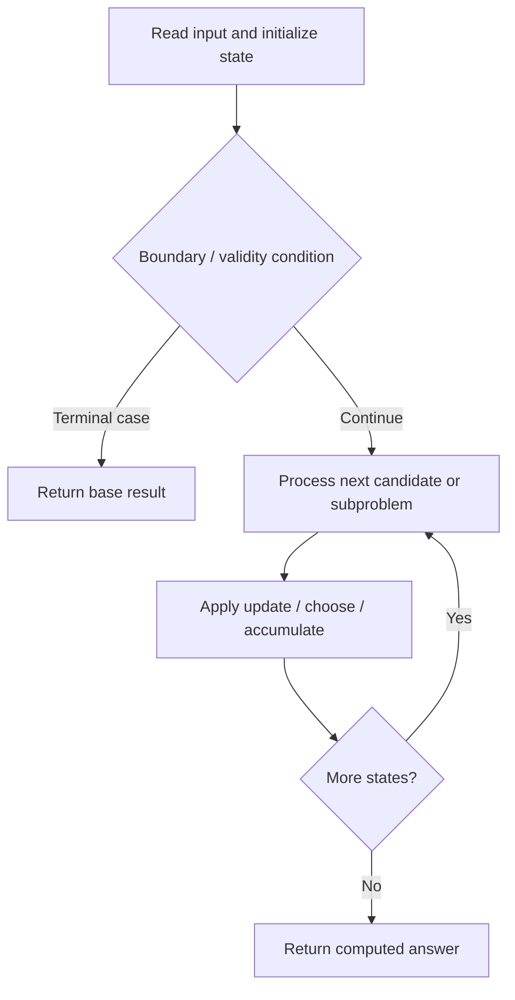

# 1473. Paint House III

**Difficulty:** Hard  
**Concept family:** [Grid Paths and Geometric DP](https://github.com/gaurav1kr/Miscellaneous/blob/main/DSA/DP/DP_Mathematics_Master_Guide_Illustrated/Theory/Chapter-03.md)  
**Problem:** https://leetcode.com/problems/paint-house-iii/  
**Original submission:** https://leetcode.com/submissions/detail/1610572532/

## Understand the mathematics first

This problem belongs to the study family **Grid Paths and Geometric DP**. Start by defining the objective and minimal sufficient state; inspect the code to identify the actual transitions.

### Problem-specific recurrence

Refer to the source-grounded algorithm walkthrough below for the state transitions used by your implementation. The generic family recurrence has been removed because it may not apply to this problem.

## Code landmarks

- `int dp[101][21][101];`
- `if (dp[i][prev][target] != -1) return dp[i][prev][target];`
- `res = min(res, c + dfs(houses, cost, i + 1, color, target - (color != prev), m, n));`

## Source-grounded algorithm walkthrough (expanded coverage)

> **Verification level:** The observations below are extracted from your actual Accepted C++ implementation. The symbolic trace is a **code-reading dry-run worksheet**, not a fabricated numerical run. The generic family formula above is not necessarily this problem's recurrence.

### 1. Identify the actual state and algorithm

**Problem:** 1473. Paint House III. Recursive state transitions are present. Check memoization, state identity, termination, and whether branches are mutually exclusive.

| Role | C++ source line | Evidence from your solution |
|---|---:|---|
| Candidate state / accumulator | 8 | `int dp[101][21][101];` |
| Candidate state / accumulator | 13 | `int res = dfs(houses, cost, 0, 0, target, m, n);` |
| Candidate state / accumulator | 20 | `if (dp[i][prev][target] != -1) return dp[i][prev][target];` |
| Boundary / termination | 18 | `if (target < 0) return INF;` |
| Boundary / termination | 19 | `if (i == m) return target == 0 ? 0 : INF;` |
| Boundary / termination | 20 | `if (dp[i][prev][target] != -1) return dp[i][prev][target];` |
| Traversal order | 26 | `for (int color = 1; color <= n; ++color) {` |
| Transition / update | 13 | `int res = dfs(houses, cost, 0, 0, target, m, n);` |
| Transition / update | 22 | `int res = INF;` |
| Transition / update | 24 | `res = dfs(houses, cost, i + 1, houses[i], target - (houses[i] != prev), m, n);` |
| Transition / update | 28 | `res = min(res, c + dfs(houses, cost, i + 1, color, target - (color != prev), m, n));` |
| Return / result | 14 | `return res >= INF ? -1 : res;` |
| Return / result | 18 | `if (target < 0) return INF;` |

### 2. Trace the dependency chain



This is a **control-flow reading diagram**, not a claim about the exact shape of the mathematical state graph. Follow the code line numbers above to draw the actual dependency arrows.

### 3. Symbolic dry-run worksheet

| Stage | State to record | Mathematical question to answer |
|---|---|---|
| Initialize | Inputs, initialized containers/accumulators | What does the initial value mean? |
| First iteration / recursive call | Loop indices, branch, current state | Which predecessor states are available? |
| First update | Before → after for the updated variable | Why is this transition legal? Does it add, minimize, maximize, or overwrite? |
| Next iteration | Updated state and next candidate | Can a value be reused in this traversal order? |
| Finish | Return expression and its value | Why does this correspond to the problem's requested result? |

### 4. Mathematical explanation checklist

1. Define the exact meaning of each state variable, including all indices and constraints.
2. Translate the update expression into a mathematical equation **only after** establishing the state invariant.
3. Prove the transitions are exhaustive and do not double-count or reuse forbidden elements.
4. Check empty input, smallest input, impossible cases, and overflow/modulo behavior.
5. Compute a small numerical example using the actual problem constraints, then compare each row to the original C++.


---

## Your original Accepted C++ submission (unaltered)

```cpp
#include <vector>
#include <cstring>

using namespace std;

class Solution {
public:
    int dp[101][21][101];
    const int INF = 1e8;

    int minCost(vector<int>& houses, vector<vector<int>>& cost, int m, int n, int target) {
        memset(dp, -1, sizeof(dp));
        int res = dfs(houses, cost, 0, 0, target, m, n);
        return res >= INF ? -1 : res;
    }

    int dfs(vector<int>& houses, vector<vector<int>>& cost, int i, int prev, int target, int m, int n) {
        if (target < 0) return INF;
        if (i == m) return target == 0 ? 0 : INF;
        if (dp[i][prev][target] != -1) return dp[i][prev][target];

        int res = INF;
        if (houses[i]) {
            res = dfs(houses, cost, i + 1, houses[i], target - (houses[i] != prev), m, n);
        } else {
            for (int color = 1; color <= n; ++color) {
                int c = cost[i][color - 1];
                res = min(res, c + dfs(houses, cost, i + 1, color, target - (color != prev), m, n));
            }
        }
        return dp[i][prev][target] = res;
    }
};
```

## Time and Space Complexity

- **Time:** `Depends on table dimensions and transitions per cell`
- **Auxiliary space:** `O(rows × columns) for the allocated table`

**Reasoning:** The two-dimensional table determines memory; time is its state count multiplied by work per state.

**Status:** Code-informed complexity guidance; exact tight bounds have not been individually verified.
