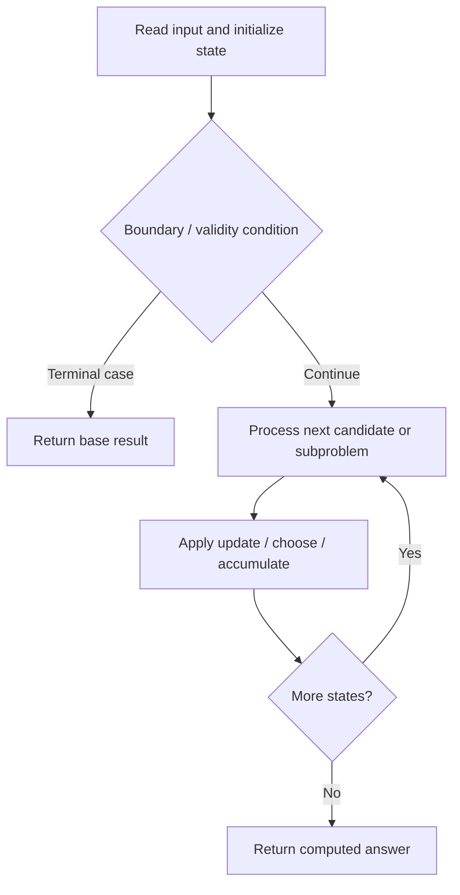

# 1477. Find Two Non-overlapping Sub-arrays Each With Target Sum

**Difficulty:** Medium  
**Concept family:** [Take-or-Skip and Knapsack](https://github.com/gaurav1kr/Miscellaneous/blob/main/DSA/DP/DP_Mathematics_Master_Guide_Illustrated/Theory/Chapter-02.md)  
**Problem:** https://leetcode.com/problems/find-two-non-overlapping-sub-arrays-each-with-target-sum/  
**Original submission:** https://leetcode.com/submissions/detail/1593692349/

## Understand the mathematics first

This problem belongs to the study family **Take-or-Skip and Knapsack**. Start by defining the objective and minimal sufficient state; inspect the code to identify the actual transitions.

### Problem-specific recurrence

Refer to the source-grounded algorithm walkthrough below for the state transitions used by your implementation. The generic family recurrence has been removed because it may not apply to this problem.

## Code landmarks

- `if (j >= 0 && dp[j] != INT_MAX) {`
- `res = min(res, currLen + dp[j]);`
- `dp[i] = min(currLen, (i > 0 ? dp[i - 1] : INT_MAX));`

## Source-grounded algorithm walkthrough (expanded coverage)

> **Verification level:** The observations below are extracted from your actual Accepted C++ implementation. The symbolic trace is a **code-reading dry-run worksheet**, not a fabricated numerical run. The generic family formula above is not necessarily this problem's recurrence.

### 1. Identify the actual state and algorithm

**Problem:** 1477. Find Two Non-overlapping Sub-arrays Each With Target Sum. An explicit state table or memo is present. Interpret each index as a mathematical state and every update as a transition.

| Role | C++ source line | Evidence from your solution |
|---|---:|---|
| Candidate state / accumulator | 11 | `vector<int> dp(n, INT_MAX);` |
| Candidate state / accumulator | 13 | `int sum = 0, minLen = INT_MAX, res = INT_MAX;` |
| Candidate state / accumulator | 20 | `int j = prefixSum[sum - target];` |
| Boundary / termination | 19 | `if (prefixSum.count(sum - target)) {` |
| Boundary / termination | 22 | `if (j >= 0 && dp[j] != INT_MAX) {` |
| Boundary / termination | 32 | `return res == INT_MAX ? -1 : res;` |
| Traversal order | 17 | `for (int i = 0; i < n; ++i) {` |
| Transition / update | 13 | `int sum = 0, minLen = INT_MAX, res = INT_MAX;` |
| Transition / update | 18 | `sum += arr[i];` |
| Transition / update | 23 | `res = min(res, currLen + dp[j]);` |
| Transition / update | 25 | `dp[i] = min(currLen, (i > 0 ? dp[i - 1] : INT_MAX));` |
| Return / result | 32 | `return res == INT_MAX ? -1 : res;` |

### 2. Trace the dependency chain



This is a **control-flow reading diagram**, not a claim about the exact shape of the mathematical state graph. Follow the code line numbers above to draw the actual dependency arrows.

### 3. Symbolic dry-run worksheet

| Stage | State to record | Mathematical question to answer |
|---|---|---|
| Initialize | Inputs, initialized containers/accumulators | What does the initial value mean? |
| First iteration / recursive call | Loop indices, branch, current state | Which predecessor states are available? |
| First update | Before → after for the updated variable | Why is this transition legal? Does it add, minimize, maximize, or overwrite? |
| Next iteration | Updated state and next candidate | Can a value be reused in this traversal order? |
| Finish | Return expression and its value | Why does this correspond to the problem's requested result? |

### 4. Mathematical explanation checklist

1. Define the exact meaning of each state variable, including all indices and constraints.
2. Translate the update expression into a mathematical equation **only after** establishing the state invariant.
3. Prove the transitions are exhaustive and do not double-count or reuse forbidden elements.
4. Check empty input, smallest input, impossible cases, and overflow/modulo behavior.
5. Compute a small numerical example using the actual problem constraints, then compare each row to the original C++.


---

## Your original Accepted C++ submission (unaltered)

```cpp
#include <vector>
#include <unordered_map>
#include <climits>

using namespace std;

class Solution {
public:
    int minSumOfLengths(vector<int>& arr, int target) {
        int n = arr.size();
        vector<int> dp(n, INT_MAX);
        unordered_map<int, int> prefixSum;
        int sum = 0, minLen = INT_MAX, res = INT_MAX;

        prefixSum[0] = -1;

        for (int i = 0; i < n; ++i) {
            sum += arr[i];
            if (prefixSum.count(sum - target)) {
                int j = prefixSum[sum - target];
                int currLen = i - j;
                if (j >= 0 && dp[j] != INT_MAX) {
                    res = min(res, currLen + dp[j]);
                }
                dp[i] = min(currLen, (i > 0 ? dp[i - 1] : INT_MAX));
            } else {
                dp[i] = (i > 0 ? dp[i - 1] : INT_MAX);
            }
            prefixSum[sum] = i;
        }

        return res == INT_MAX ? -1 : res;
    }
};
```

## Time and Space Complexity

- **Time:** `Depends on operations (typically O(log n) per ordered-container operation)`
- **Auxiliary space:** `Depends on number of stored entries`

**Reasoning:** An ordered container or heap introduces logarithmic insertion, lookup, or removal costs; multiply by operation count.

**Status:** Code-informed complexity guidance; exact tight bounds have not been individually verified.
