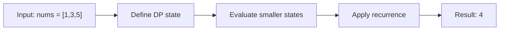

# 1524. Number of Sub-arrays With Odd Sum

**Difficulty:** Medium  
**Concept family:** [Digit DP, Counting and Probability](https://github.com/gaurav1kr/Miscellaneous/blob/main/DSA/DP/DP_Mathematics_Master_Guide_Illustrated/Theory/Chapter-11.md)  
**Problem:** https://leetcode.com/problems/number-of-sub-arrays-with-odd-sum/  
**Original submission:** https://leetcode.com/submissions/detail/1595384804/

## Understand the mathematics first

This problem belongs to the study family **Digit DP, Counting and Probability**. Start by defining the objective and minimal sufficient state; inspect the code to identify the actual transitions.

### Problem-specific recurrence

Refer to the source-grounded algorithm walkthrough below for the state transitions used by your implementation. The generic family recurrence has been removed because it may not apply to this problem.

## Code landmarks

Read the loops, recursion, and boundary conditions in the original code.

## Detailed dry run — Odd-sum subarrays: parity arithmetic

### Start from the mathematical question

A subarray has odd sum exactly when the two prefix sums bounding it have opposite parity.

### Derive the recurrence

```math
oddEnding_i=evenEnding_{i-1}\ (+1\ if\ a_i\ odd)
```

**Why the transition is correct:** Subtracting prefix sums is equivalent to XOR of their parities. Count earlier prefixes of opposite parity rather than enumerating every subarray.

### Concrete example

**Input:** `nums = [1,3,5]`



**Evaluate the states in dependency order:**

| Prefix position | Prefix parity | Previous opposite-parity prefixes | New odd subarrays |
|---|---|---:|---:|
| before | even | — | — |
| after 1 | odd | 1 | 1 |
| after 3 | even | 1 | 1 |
| after 5 | odd | 2 | 2 |

**Expected result:** `4`.

### What to remember six months later

Explain (1) what one state means, (2) which earlier states it needs, (3) why those cases are exhaustive, and (4) why the answer is `4` for this input. Then inspect your preserved C++ solution below and match its variables to the mathematical states.

---

## Your original Accepted C++ submission (unaltered)

```cpp
#include <vector>

using namespace std;

class Solution {
public:
    int numOfSubarrays(vector<int>& arr) {
        const int MOD = 1e9 + 7;
        int odd = 0, even = 1, sum = 0, res = 0;

        for (int a : arr) {
            sum += a;
            if (sum % 2)
                res = (res + even) % MOD, ++odd;
            else
                res = (res + odd) % MOD, ++even;
        }
        return res;
    }
};
```

## Time and Space Complexity

- **Time:** `Depends on loop nesting and bounds`
- **Auxiliary space:** `Depends on auxiliary arrays/containers`

**Reasoning:** Count how many iterations each loop executes and whether loops are nested; do not assume all nested loops are quadratic.

**Status:** Code-informed complexity guidance; exact tight bounds have not been individually verified.
