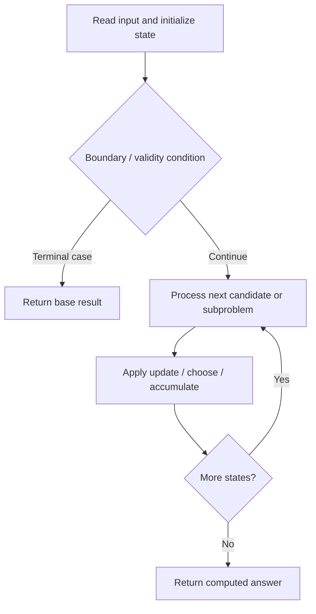

# 1525. Number of Good Ways to Split a String

**Difficulty:** Medium  
**Concept family:** [Digit DP, Counting and Probability](https://github.com/gaurav1kr/Miscellaneous/blob/main/DSA/DP/DP_Mathematics_Master_Guide_Illustrated/Theory/Chapter-11.md)  
**Problem:** https://leetcode.com/problems/number-of-good-ways-to-split-a-string/  
**Original submission:** https://leetcode.com/submissions/detail/1591372721/

## Understand the mathematics first

This problem belongs to the study family **Digit DP, Counting and Probability**. Start by defining the objective and minimal sufficient state; inspect the code to identify the actual transitions.

### Problem-specific recurrence

Refer to the source-grounded algorithm walkthrough below for the state transitions used by your implementation. The generic family recurrence has been removed because it may not apply to this problem.

## Code landmarks

Read the loops, recursion, and boundary conditions in the original code.

## Source-grounded algorithm walkthrough (expanded coverage)

> **Verification level:** The observations below are extracted from your actual Accepted C++ implementation. The symbolic trace is a **code-reading dry-run worksheet**, not a fabricated numerical run. The generic family formula above is not necessarily this problem's recurrence.

### 1. Identify the actual state and algorithm

**Problem:** 1525. Number of Good Ways to Split a String. This solution does not expose an obvious `dp` or `memo` variable. Derive the algorithmic invariant from the code rather than assuming a DP recurrence.

| Role | C++ source line | Evidence from your solution |
|---|---:|---|
| Candidate state / accumulator | 23 | `int count = 0;` |
| Boundary / termination | 25 | `if (left[i] == right[i + 1]) count++;` |
| Traversal order | 13 | `for (int i = 0; i < n; i++) {` |
| Traversal order | 18 | `for (int i = n - 1; i >= 0; i--) {` |
| Traversal order | 24 | `for (int i = 0; i < n - 1; i++) {` |
| Transition / update | 14 | `uniqueLeft.insert(s[i]);` |
| Transition / update | 19 | `uniqueRight.insert(s[i]);` |
| Transition / update | 23 | `int count = 0;` |
| Return / result | 27 | `return count;` |

### 2. Trace the dependency chain



This is a **control-flow reading diagram**, not a claim about the exact shape of the mathematical state graph. Follow the code line numbers above to draw the actual dependency arrows.

### 3. Symbolic dry-run worksheet

| Stage | State to record | Mathematical question to answer |
|---|---|---|
| Initialize | Inputs, initialized containers/accumulators | What does the initial value mean? |
| First iteration / recursive call | Loop indices, branch, current state | Which predecessor states are available? |
| First update | Before → after for the updated variable | Why is this transition legal? Does it add, minimize, maximize, or overwrite? |
| Next iteration | Updated state and next candidate | Can a value be reused in this traversal order? |
| Finish | Return expression and its value | Why does this correspond to the problem's requested result? |

### 4. Mathematical explanation checklist

1. Define the exact meaning of each state variable, including all indices and constraints.
2. Translate the update expression into a mathematical equation **only after** establishing the state invariant.
3. Prove the transitions are exhaustive and do not double-count or reuse forbidden elements.
4. Check empty input, smallest input, impossible cases, and overflow/modulo behavior.
5. Compute a small numerical example using the actual problem constraints, then compare each row to the original C++.


---

## Your original Accepted C++ submission (unaltered)

```cpp
#include <string>
#include <vector>
#include <unordered_set>
using namespace std;

class Solution {
public:
    int numSplits(string s) {
        int n = s.size();
        vector<int> left(n), right(n);
        unordered_set<char> uniqueLeft, uniqueRight;

        for (int i = 0; i < n; i++) {
            uniqueLeft.insert(s[i]);
            left[i] = uniqueLeft.size();
        }

        for (int i = n - 1; i >= 0; i--) {
            uniqueRight.insert(s[i]);
            right[i] = uniqueRight.size();
        }

        int count = 0;
        for (int i = 0; i < n - 1; i++) {
            if (left[i] == right[i + 1]) count++;
        }
        return count;
    }
};
```

## Time and Space Complexity

- **Time:** `Depends on operations (typically O(log n) per ordered-container operation)`
- **Auxiliary space:** `Depends on number of stored entries`

**Reasoning:** An ordered container or heap introduces logarithmic insertion, lookup, or removal costs; multiply by operation count.

**Status:** Code-informed complexity guidance; exact tight bounds have not been individually verified.
