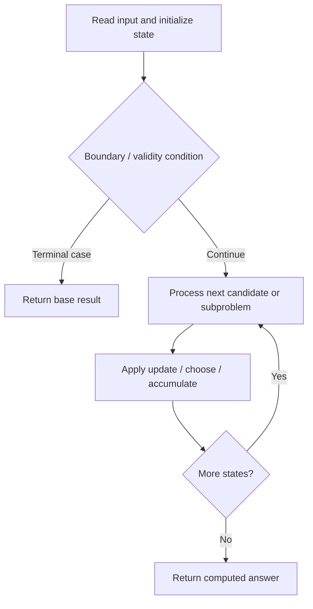

# 1537. Get the Maximum Score

**Difficulty:** Hard  
**Concept family:** [Digit DP, Counting and Probability](https://github.com/gaurav1kr/Miscellaneous/blob/main/DSA/DP/DP_Mathematics_Master_Guide_Illustrated/Theory/Chapter-11.md)  
**Problem:** https://leetcode.com/problems/get-the-maximum-score/  
**Original submission:** https://leetcode.com/submissions/detail/1610563559/

## Understand the mathematics first

This problem belongs to the study family **Digit DP, Counting and Probability**. Start by defining the objective and minimal sufficient state; inspect the code to identify the actual transitions.

### Problem-specific recurrence

Refer to the source-grounded algorithm walkthrough below for the state transitions used by your implementation. The generic family recurrence has been removed because it may not apply to this problem.

## Code landmarks

- `while (i < nums1.size() && j < nums2.size()) {`
- `total += max(sum1, sum2) + nums1[i];`
- `while (i < nums1.size()) sum1 += nums1[i++];`

## Source-grounded algorithm walkthrough (expanded coverage)

> **Verification level:** The observations below are extracted from your actual Accepted C++ implementation. The symbolic trace is a **code-reading dry-run worksheet**, not a fabricated numerical run. The generic family formula above is not necessarily this problem's recurrence.

### 1. Identify the actual state and algorithm

**Problem:** 1537. Get the Maximum Score. This solution does not expose an obvious `dp` or `memo` variable. Derive the algorithmic invariant from the code rather than assuming a DP recurrence.

| Role | C++ source line | Evidence from your solution |
|---|---:|---|
| Candidate state / accumulator | — | No obvious matching statement; inspect the original C++ below. |
| Boundary / termination | 13 | `if (nums1[i] < nums2[j]) {` |
| Boundary / termination | 15 | `} else if (nums1[i] > nums2[j]) {` |
| Traversal order | 12 | `while (i < nums1.size() && j < nums2.size()) {` |
| Traversal order | 24 | `while (i < nums1.size()) sum1 += nums1[i++];` |
| Traversal order | 25 | `while (j < nums2.size()) sum2 += nums2[j++];` |
| Transition / update | 18 | `total += max(sum1, sum2) + nums1[i];` |
| Transition / update | 27 | `total += max(sum1, sum2);` |
| Return / result | 28 | `return total % MOD;` |

### 2. Trace the dependency chain



This is a **control-flow reading diagram**, not a claim about the exact shape of the mathematical state graph. Follow the code line numbers above to draw the actual dependency arrows.

### 3. Symbolic dry-run worksheet

| Stage | State to record | Mathematical question to answer |
|---|---|---|
| Initialize | Inputs, initialized containers/accumulators | What does the initial value mean? |
| First iteration / recursive call | Loop indices, branch, current state | Which predecessor states are available? |
| First update | Before → after for the updated variable | Why is this transition legal? Does it add, minimize, maximize, or overwrite? |
| Next iteration | Updated state and next candidate | Can a value be reused in this traversal order? |
| Finish | Return expression and its value | Why does this correspond to the problem's requested result? |

### 4. Mathematical explanation checklist

1. Define the exact meaning of each state variable, including all indices and constraints.
2. Translate the update expression into a mathematical equation **only after** establishing the state invariant.
3. Prove the transitions are exhaustive and do not double-count or reuse forbidden elements.
4. Check empty input, smallest input, impossible cases, and overflow/modulo behavior.
5. Compute a small numerical example using the actual problem constraints, then compare each row to the original C++.


---

## Your original Accepted C++ submission (unaltered)

```cpp
#include <vector>

using namespace std;

class Solution {
public:
    int maxSum(vector<int>& nums1, vector<int>& nums2) {
        const int MOD = 1e9 + 7;
        int i = 0, j = 0;
        long sum1 = 0, sum2 = 0, total = 0;

        while (i < nums1.size() && j < nums2.size()) {
            if (nums1[i] < nums2[j]) {
                sum1 += nums1[i++];
            } else if (nums1[i] > nums2[j]) {
                sum2 += nums2[j++];
            } else {
                total += max(sum1, sum2) + nums1[i];
                sum1 = sum2 = 0;
                i++; j++;
            }
        }

        while (i < nums1.size()) sum1 += nums1[i++];
        while (j < nums2.size()) sum2 += nums2[j++];

        total += max(sum1, sum2);
        return total % MOD;
    }
};
```

## Time and Space Complexity

- **Time:** `Depends on input size and control flow`
- **Auxiliary space:** `Depends on auxiliary allocations / recursion depth`

**Reasoning:** The exact asymptotic bound requires examining the complete control flow and allocations in the preserved C++ code.

**Status:** Code-informed complexity guidance; exact tight bounds have not been individually verified.
