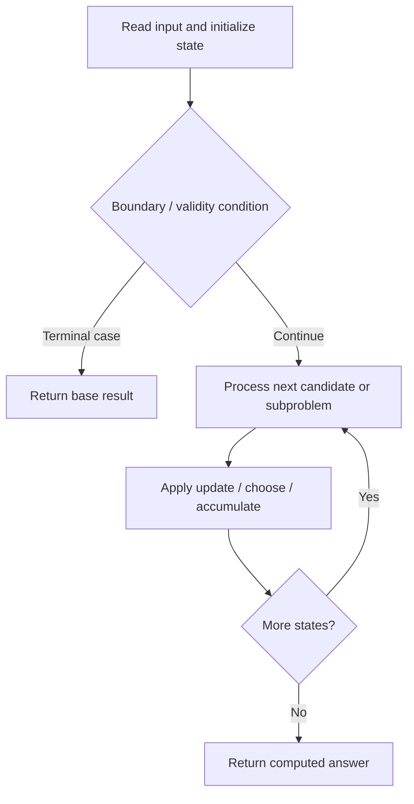

# 1569. Number of Ways to Reorder Array to Get Same BST

**Difficulty:** Hard  
**Concept family:** [Mathematical Recurrences and Combinatorics](https://github.com/gaurav1kr/Miscellaneous/blob/main/DSA/DP/DP_Mathematics_Master_Guide_Illustrated/Theory/Chapter-01.md)  
**Problem:** https://leetcode.com/problems/number-of-ways-to-reorder-array-to-get-same-bst/  
**Original submission:** https://leetcode.com/submissions/detail/1599290013/

## Understand the mathematics first

This problem belongs to the study family **Mathematical Recurrences and Combinatorics**. Start by defining the objective and minimal sufficient state; inspect the code to identify the actual transitions.

### Problem-specific recurrence

Refer to the source-grounded algorithm walkthrough below for the state transitions used by your implementation. The generic family recurrence has been removed because it may not apply to this problem.

## Code landmarks

Read the loops, recursion, and boundary conditions in the original code.

## Source-grounded algorithm walkthrough (expanded coverage)

> **Verification level:** The observations below are extracted from your actual Accepted C++ implementation. The symbolic trace is a **code-reading dry-run worksheet**, not a fabricated numerical run. The generic family formula above is not necessarily this problem's recurrence.

### 1. Identify the actual state and algorithm

**Problem:** 1569. Number of Ways to Reorder Array to Get Same BST. Recursive state transitions are present. Check memoization, state identity, termination, and whether branches are mutually exclusive.

| Role | C++ source line | Evidence from your solution |
|---|---:|---|
| Candidate state / accumulator | — | No obvious matching statement; inspect the original C++ below. |
| Boundary / termination | 22 | `if (nums.size() <= 2) return 1;` |
| Traversal order | 13 | `for (int i = 0; i <= n; ++i) {` |
| Traversal order | 15 | `for (int j = 1; j < i; ++j)` |
| Traversal order | 24 | `for (int i = 1; i < nums.size(); ++i)` |
| Transition / update | 25 | `(nums[i] < nums[0] ? left : right).push_back(nums[i]);` |
| Return / result | 18 | `return (dfs(nums) - 1 + MOD) % MOD;` |
| Return / result | 22 | `if (nums.size() <= 2) return 1;` |

### 2. Trace the dependency chain



This is a **control-flow reading diagram**, not a claim about the exact shape of the mathematical state graph. Follow the code line numbers above to draw the actual dependency arrows.

### 3. Symbolic dry-run worksheet

| Stage | State to record | Mathematical question to answer |
|---|---|---|
| Initialize | Inputs, initialized containers/accumulators | What does the initial value mean? |
| First iteration / recursive call | Loop indices, branch, current state | Which predecessor states are available? |
| First update | Before → after for the updated variable | Why is this transition legal? Does it add, minimize, maximize, or overwrite? |
| Next iteration | Updated state and next candidate | Can a value be reused in this traversal order? |
| Finish | Return expression and its value | Why does this correspond to the problem's requested result? |

### 4. Mathematical explanation checklist

1. Define the exact meaning of each state variable, including all indices and constraints.
2. Translate the update expression into a mathematical equation **only after** establishing the state invariant.
3. Prove the transitions are exhaustive and do not double-count or reuse forbidden elements.
4. Check empty input, smallest input, impossible cases, and overflow/modulo behavior.
5. Compute a small numerical example using the actual problem constraints, then compare each row to the original C++.


---

## Your original Accepted C++ submission (unaltered)

```cpp
#include <vector>

using namespace std;

class Solution {
public:
    int MOD = 1e9 + 7;
    vector<vector<int>> comb;

    int numOfWays(vector<int>& nums) {
        int n = nums.size();
        comb.resize(n + 1, vector<int>(n + 1, 0));
        for (int i = 0; i <= n; ++i) {
            comb[i][0] = comb[i][i] = 1;
            for (int j = 1; j < i; ++j)
                comb[i][j] = (comb[i - 1][j - 1] + comb[i - 1][j]) % MOD;
        }
        return (dfs(nums) - 1 + MOD) % MOD;
    }

    int dfs(vector<int>& nums) {
        if (nums.size() <= 2) return 1;
        vector<int> left, right;
        for (int i = 1; i < nums.size(); ++i)
            (nums[i] < nums[0] ? left : right).push_back(nums[i]);
        long long l = dfs(left), r = dfs(right);
        return comb[left.size() + right.size()][left.size()] * l % MOD * r % MOD;
    }
};
```

## Time and Space Complexity

- **Time:** `Depends on table dimensions and transitions per cell`
- **Auxiliary space:** `O(rows × columns) for the allocated table`

**Reasoning:** The two-dimensional table determines memory; time is its state count multiplied by work per state.

**Status:** Code-informed complexity guidance; exact tight bounds have not been individually verified.
