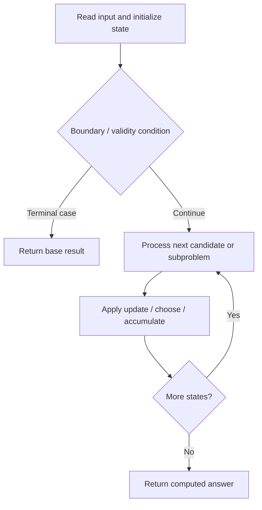

# 1595. Minimum Cost to Connect Two Groups of Points

**Difficulty:** Hard  
**Concept family:** [Bitmask, Assignment and Subset DP](https://github.com/gaurav1kr/Miscellaneous/blob/main/DSA/DP/DP_Mathematics_Master_Guide_Illustrated/Theory/Chapter-09.md)  
**Problem:** https://leetcode.com/problems/minimum-cost-to-connect-two-groups-of-points/  
**Original submission:** https://leetcode.com/submissions/detail/1617064565/

## Understand the mathematics first

This problem belongs to the study family **Bitmask, Assignment and Subset DP**. Start by defining the objective and minimal sufficient state; inspect the code to identify the actual transitions.

### Problem-specific recurrence

Refer to the source-grounded algorithm walkthrough below for the state transitions used by your implementation. The generic family recurrence has been removed because it may not apply to this problem.

## Code landmarks

- `if (dp[ind][mask]!=-1) return dp[ind][mask];`
- `res=min(res,cost[ind][j]+rec(ind+1,mask | (1<<j),cost,dp,mini));`
- `return dp[ind][mask]=res;`

## Source-grounded algorithm walkthrough (expanded coverage)

> **Verification level:** The observations below are extracted from your actual Accepted C++ implementation. The symbolic trace is a **code-reading dry-run worksheet**, not a fabricated numerical run. The generic family formula above is not necessarily this problem's recurrence.

### 1. Identify the actual state and algorithm

**Problem:** 1595. Minimum Cost to Connect Two Groups of Points. An explicit state table or memo is present. Interpret each index as a mathematical state and every update as a transition.

| Role | C++ source line | Evidence from your solution |
|---|---:|---|
| Candidate state / accumulator | 3 | `int rec (int ind,int mask,vector<vector<int>>& cost,vector<vector<int>>&dp,vector<int>&mini)` |
| Candidate state / accumulator | 5 | `if (dp[ind][mask]!=-1) return dp[ind][mask];` |
| Candidate state / accumulator | 6 | `int res=ind>=cost.size()?0:1e8;` |
| Boundary / termination | 5 | `if (dp[ind][mask]!=-1) return dp[ind][mask];` |
| Boundary / termination | 7 | `if (ind>=cost.size())` |
| Boundary / termination | 11 | `if ((mask&(1<<j))==0)` |
| Traversal order | 9 | `for (int j=0;j<cost[0].size();j++)` |
| Traversal order | 18 | `for (int j=0;j<cost[0].size();j++)` |
| Traversal order | 30 | `for (int j=0;j<cost[0].size();j++)` |
| Transition / update | 6 | `int res=ind>=cost.size()?0:1e8;` |
| Transition / update | 13 | `res+=mini[j];` |
| Transition / update | 20 | `res=min(res,cost[ind][j]+rec(ind+1,mask \| (1<<j),cost,dp,mini));` |
| Transition / update | 23 | `return dp[ind][mask]=res;` |
| Return / result | 5 | `if (dp[ind][mask]!=-1) return dp[ind][mask];` |
| Return / result | 23 | `return dp[ind][mask]=res;` |

### 2. Trace the dependency chain



This is a **control-flow reading diagram**, not a claim about the exact shape of the mathematical state graph. Follow the code line numbers above to draw the actual dependency arrows.

### 3. Symbolic dry-run worksheet

| Stage | State to record | Mathematical question to answer |
|---|---|---|
| Initialize | Inputs, initialized containers/accumulators | What does the initial value mean? |
| First iteration / recursive call | Loop indices, branch, current state | Which predecessor states are available? |
| First update | Before → after for the updated variable | Why is this transition legal? Does it add, minimize, maximize, or overwrite? |
| Next iteration | Updated state and next candidate | Can a value be reused in this traversal order? |
| Finish | Return expression and its value | Why does this correspond to the problem's requested result? |

### 4. Mathematical explanation checklist

1. Define the exact meaning of each state variable, including all indices and constraints.
2. Translate the update expression into a mathematical equation **only after** establishing the state invariant.
3. Prove the transitions are exhaustive and do not double-count or reuse forbidden elements.
4. Check empty input, smallest input, impossible cases, and overflow/modulo behavior.
5. Compute a small numerical example using the actual problem constraints, then compare each row to the original C++.


---

## Your original Accepted C++ submission (unaltered)

```cpp
class Solution {
public:
    int rec (int ind,int mask,vector<vector<int>>& cost,vector<vector<int>>&dp,vector<int>&mini)
    {
       if (dp[ind][mask]!=-1) return dp[ind][mask];
       int res=ind>=cost.size()?0:1e8;
       if (ind>=cost.size())
       {
           for (int j=0;j<cost[0].size();j++)
           {
               if ((mask&(1<<j))==0)
               {
                   res+=mini[j];
               }
           }
       }
       else {
           for (int j=0;j<cost[0].size();j++)
           {
               res=min(res,cost[ind][j]+rec(ind+1,mask | (1<<j),cost,dp,mini));
           }
       }
       return dp[ind][mask]=res;

    }
    int connectTwoGroups(vector<vector<int>>& cost) 
    {
        vector<vector<int>>dp(13,vector<int>(4096,-1));
        vector<int>mini(cost[0].size(),INT_MAX);
        for (int j=0;j<cost[0].size();j++)
        {
            for (int i=0;i<cost.size();i++)
            {
                mini[j]=min(mini[j],cost[i][j]);
            }
        }
        return rec(0,0,cost,dp,mini);
    }
};
```

## Time and Space Complexity

- **Time:** `Depends on table dimensions and transitions per cell`
- **Auxiliary space:** `O(rows × columns) for the allocated table`

**Reasoning:** The two-dimensional table determines memory; time is its state count multiplied by work per state.

**Status:** Code-informed complexity guidance; exact tight bounds have not been individually verified.
