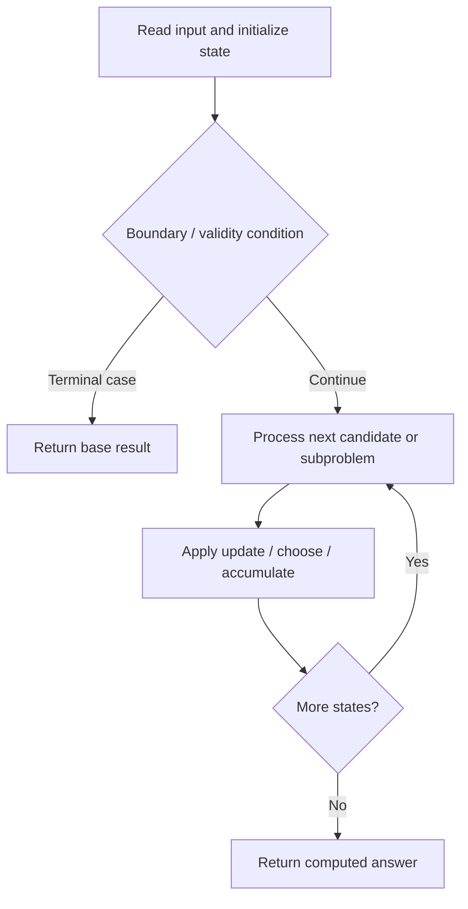

# 1617. Count Subtrees With Max Distance Between Cities

**Difficulty:** Hard  
**Concept family:** [Tree, Graph and DAG DP](https://github.com/gaurav1kr/Miscellaneous/blob/main/DSA/DP/DP_Mathematics_Master_Guide_Illustrated/Theory/Chapter-10.md)  
**Problem:** https://leetcode.com/problems/count-subtrees-with-max-distance-between-cities/  
**Original submission:** https://leetcode.com/submissions/detail/1610643743/

## Understand the mathematics first

This problem belongs to the study family **Tree, Graph and DAG DP**. Start by defining the objective and minimal sufficient state; inspect the code to identify the actual transitions.

### Mathematical starting point

This family includes tree DP, DAG DP, shortest paths, and graph traversal. **There is no single recurrence for all these problems.** Identify the exact state and invariant from the algorithm below. For tree paths, distinguish the value returned to the parent from a complete answer within the subtree; for graph problems, establish whether edges form a DAG or whether shortest-path processing is required.

## Code landmarks

- `while (!q.empty()) {`
- `while (!q.empty()) {`
- `maxDist = max(maxDist, dist[v]);`

## Source-grounded algorithm walkthrough (expanded coverage)

> **Verification level:** The observations below are extracted from your actual Accepted C++ implementation. The symbolic trace is a **code-reading dry-run worksheet**, not a fabricated numerical run. The generic family formula above is not necessarily this problem's recurrence.

### 1. Identify the actual state and algorithm

**Problem:** 1617. Count Subtrees With Max Distance Between Cities. This solution does not expose an obvious `dp` or `memo` variable. Derive the algorithmic invariant from the code rather than assuming a DP recurrence.

| Role | C++ source line | Evidence from your solution |
|---|---:|---|
| Candidate state / accumulator | 16 | `vector<int> res(n - 1);` |
| Candidate state / accumulator | 41 | `vector<int> dist(n, -1);` |
| Boundary / termination | 20 | `if (mask & (1 << i)) nodes.push_back(i);` |
| Boundary / termination | 21 | `if (nodes.size() < 2) continue;` |
| Boundary / termination | 31 | `if ((mask & (1 << v)) && !seen.count(v)) {` |
| Traversal order | 11 | `for (auto& e : edges) {` |
| Traversal order | 17 | `for (int mask = 1; mask < (1 << n); ++mask) {` |
| Traversal order | 19 | `for (int i = 0; i < n; ++i)` |
| Transition / update | 12 | `g[e[0] - 1].push_back(e[1] - 1);` |
| Transition / update | 13 | `g[e[1] - 1].push_back(e[0] - 1);` |
| Transition / update | 20 | `if (mask & (1 << i)) nodes.push_back(i);` |
| Transition / update | 26 | `seen.insert(nodes[0]);` |
| Return / result | 58 | `return res;` |

### 2. Trace the dependency chain



This is a **control-flow reading diagram**, not a claim about the exact shape of the mathematical state graph. Follow the code line numbers above to draw the actual dependency arrows.

### 3. Symbolic dry-run worksheet

| Stage | State to record | Mathematical question to answer |
|---|---|---|
| Initialize | Inputs, initialized containers/accumulators | What does the initial value mean? |
| First iteration / recursive call | Loop indices, branch, current state | Which predecessor states are available? |
| First update | Before → after for the updated variable | Why is this transition legal? Does it add, minimize, maximize, or overwrite? |
| Next iteration | Updated state and next candidate | Can a value be reused in this traversal order? |
| Finish | Return expression and its value | Why does this correspond to the problem's requested result? |

### 4. Mathematical explanation checklist

1. Define the exact meaning of each state variable, including all indices and constraints.
2. Translate the update expression into a mathematical equation **only after** establishing the state invariant.
3. Prove the transitions are exhaustive and do not double-count or reuse forbidden elements.
4. Check empty input, smallest input, impossible cases, and overflow/modulo behavior.
5. Compute a small numerical example using the actual problem constraints, then compare each row to the original C++.


---

## Your original Accepted C++ submission (unaltered)

```cpp
#include <vector>
#include <queue>
#include <unordered_set>

using namespace std;

class Solution {
public:
    vector<int> countSubgraphsForEachDiameter(int n, vector<vector<int>>& edges) {
        vector<vector<int>> g(n);
        for (auto& e : edges) {
            g[e[0] - 1].push_back(e[1] - 1);
            g[e[1] - 1].push_back(e[0] - 1);
        }

        vector<int> res(n - 1);
        for (int mask = 1; mask < (1 << n); ++mask) {
            vector<int> nodes;
            for (int i = 0; i < n; ++i)
                if (mask & (1 << i)) nodes.push_back(i);
            if (nodes.size() < 2) continue;

            unordered_set<int> seen;
            queue<int> q;
            q.push(nodes[0]);
            seen.insert(nodes[0]);

            while (!q.empty()) {
                int u = q.front(); q.pop();
                for (int v : g[u])
                    if ((mask & (1 << v)) && !seen.count(v)) {
                        seen.insert(v);
                        q.push(v);
                    }
            }

            if (seen.size() != nodes.size()) continue;

            int maxDist = 0;
            for (int u : nodes) {
                vector<int> dist(n, -1);
                queue<int> q;
                q.push(u);
                dist[u] = 0;
                while (!q.empty()) {
                    int x = q.front(); q.pop();
                    for (int v : g[x])
                        if ((mask & (1 << v)) && dist[v] == -1) {
                            dist[v] = dist[x] + 1;
                            maxDist = max(maxDist, dist[v]);
                            q.push(v);
                        }
                }
            }

            if (maxDist > 0) res[maxDist - 1]++;
        }
        return res;
    }
};
```

## Time and Space Complexity

- **Time:** `Depends on operations (typically O(log n) per ordered-container operation)`
- **Auxiliary space:** `Depends on number of stored entries`

**Reasoning:** An ordered container or heap introduces logarithmic insertion, lookup, or removal costs; multiply by operation count.

**Status:** Code-informed complexity guidance; exact tight bounds have not been individually verified.
