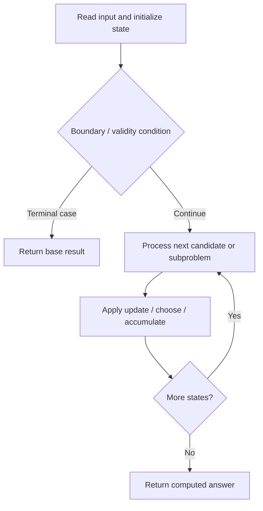

# 1626. Best Team With No Conflicts

**Difficulty:** Medium  
**Concept family:** [Subsequence and Ordering DP](https://github.com/gaurav1kr/Miscellaneous/blob/main/DSA/DP/DP_Mathematics_Master_Guide_Illustrated/Theory/Chapter-05.md)  
**Problem:** https://leetcode.com/problems/best-team-with-no-conflicts/  
**Original submission:** https://leetcode.com/submissions/detail/1595372498/

## Understand the mathematics first

This problem belongs to the study family **Subsequence and Ordering DP**. Start by defining the objective and minimal sufficient state; inspect the code to identify the actual transitions.

### Problem-specific recurrence

Refer to the source-grounded algorithm walkthrough below for the state transitions used by your implementation. The generic family recurrence has been removed because it may not apply to this problem.

## Code landmarks

- `sort(players.begin(), players.end());`
- `dp[i] = players[i].second;`
- `dp[i] = max(dp[i], dp[j] + players[i].second);`

## Source-grounded algorithm walkthrough (expanded coverage)

> **Verification level:** The observations below are extracted from your actual Accepted C++ implementation. The symbolic trace is a **code-reading dry-run worksheet**, not a fabricated numerical run. The generic family formula above is not necessarily this problem's recurrence.

### 1. Identify the actual state and algorithm

**Problem:** 1626. Best Team With No Conflicts. An explicit state table or memo is present. Interpret each index as a mathematical state and every update as a transition.

| Role | C++ source line | Evidence from your solution |
|---|---:|---|
| Candidate state / accumulator | 16 | `vector<int> dp(n, 0);` |
| Candidate state / accumulator | 17 | `int res = 0;` |
| Candidate state / accumulator | 20 | `dp[i] = players[i].second;` |
| Boundary / termination | 22 | `if (players[j].second <= players[i].second)` |
| Traversal order | 11 | `for (int i = 0; i < n; ++i)` |
| Traversal order | 19 | `for (int i = 0; i < n; ++i) {` |
| Traversal order | 21 | `for (int j = 0; j < i; ++j)` |
| Transition / update | 17 | `int res = 0;` |
| Transition / update | 20 | `dp[i] = players[i].second;` |
| Transition / update | 23 | `dp[i] = max(dp[i], dp[j] + players[i].second);` |
| Transition / update | 24 | `res = max(res, dp[i]);` |
| Return / result | 27 | `return res;` |

### 2. Trace the dependency chain



This is a **control-flow reading diagram**, not a claim about the exact shape of the mathematical state graph. Follow the code line numbers above to draw the actual dependency arrows.

### 3. Symbolic dry-run worksheet

| Stage | State to record | Mathematical question to answer |
|---|---|---|
| Initialize | Inputs, initialized containers/accumulators | What does the initial value mean? |
| First iteration / recursive call | Loop indices, branch, current state | Which predecessor states are available? |
| First update | Before → after for the updated variable | Why is this transition legal? Does it add, minimize, maximize, or overwrite? |
| Next iteration | Updated state and next candidate | Can a value be reused in this traversal order? |
| Finish | Return expression and its value | Why does this correspond to the problem's requested result? |

### 4. Mathematical explanation checklist

1. Define the exact meaning of each state variable, including all indices and constraints.
2. Translate the update expression into a mathematical equation **only after** establishing the state invariant.
3. Prove the transitions are exhaustive and do not double-count or reuse forbidden elements.
4. Check empty input, smallest input, impossible cases, and overflow/modulo behavior.
5. Compute a small numerical example using the actual problem constraints, then compare each row to the original C++.


---

## Your original Accepted C++ submission (unaltered)

```cpp
#include <vector>
#include <algorithm>

using namespace std;

class Solution {
public:
    int bestTeamScore(vector<int>& scores, vector<int>& ages) {
        vector<pair<int, int>> players;
        int n = scores.size();
        for (int i = 0; i < n; ++i)
            players.emplace_back(ages[i], scores[i]);

        sort(players.begin(), players.end());

        vector<int> dp(n, 0);
        int res = 0;

        for (int i = 0; i < n; ++i) {
            dp[i] = players[i].second;
            for (int j = 0; j < i; ++j)
                if (players[j].second <= players[i].second)
                    dp[i] = max(dp[i], dp[j] + players[i].second);
            res = max(res, dp[i]);
        }

        return res;
    }
};
```

## Time and Space Complexity

- **Time:** `At least O(n log n) for sorting; total depends on later work`
- **Auxiliary space:** `Depends on auxiliary containers`

**Reasoning:** Sorting alone costs O(n log n); inspect any subsequent nested passes for a tighter bound.

**Status:** Code-informed complexity guidance; exact tight bounds have not been individually verified.
