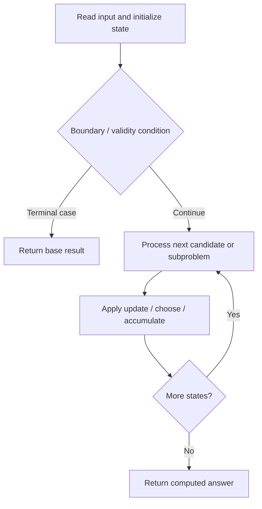

# 1639. Number of Ways to Form a Target String Given a Dictionary

**Difficulty:** Hard  
**Concept family:** [String Matching and Sequence Alignment](https://github.com/gaurav1kr/Miscellaneous/blob/main/DSA/DP/DP_Mathematics_Master_Guide_Illustrated/Theory/Chapter-04.md)  
**Problem:** https://leetcode.com/problems/number-of-ways-to-form-a-target-string-given-a-dictionary/  
**Original submission:** https://leetcode.com/submissions/detail/1610673682/

## Understand the mathematics first

This problem belongs to the study family **String Matching and Sequence Alignment**. Start by defining the objective and minimal sufficient state; inspect the code to identify the actual transitions.

### Problem-specific recurrence

Refer to the source-grounded algorithm walkthrough below for the state transitions used by your implementation. The generic family recurrence has been removed because it may not apply to this problem.

## Code landmarks

- `dp[0] = 1;`
- `dp[j + 1] += dp[j] * freq[i][target[j] - 'a'];`
- `dp[j + 1] %= MOD;`

## Source-grounded algorithm walkthrough (expanded coverage)

> **Verification level:** The observations below are extracted from your actual Accepted C++ implementation. The symbolic trace is a **code-reading dry-run worksheet**, not a fabricated numerical run. The generic family formula above is not necessarily this problem's recurrence.

### 1. Identify the actual state and algorithm

**Problem:** 1639. Number of Ways to Form a Target String Given a Dictionary. An explicit state table or memo is present. Interpret each index as a mathematical state and every update as a transition.

| Role | C++ source line | Evidence from your solution |
|---|---:|---|
| Candidate state / accumulator | 16 | `vector<long long> dp(n + 1);` |
| Candidate state / accumulator | 17 | `dp[0] = 1;` |
| Candidate state / accumulator | 21 | `dp[j + 1] += dp[j] * freq[i][target[j] - 'a'];` |
| Boundary / termination | 17 | `dp[0] = 1;` |
| Traversal order | 12 | `for (string& word : words)` |
| Traversal order | 13 | `for (int i = 0; i < m; ++i)` |
| Traversal order | 19 | `for (int i = 0; i < m; ++i) {` |
| Transition / update | 17 | `dp[0] = 1;` |
| Transition / update | 21 | `dp[j + 1] += dp[j] * freq[i][target[j] - 'a'];` |
| Return / result | 25 | `return dp[n];` |

### 2. Trace the dependency chain



This is a **control-flow reading diagram**, not a claim about the exact shape of the mathematical state graph. Follow the code line numbers above to draw the actual dependency arrows.

### 3. Symbolic dry-run worksheet

| Stage | State to record | Mathematical question to answer |
|---|---|---|
| Initialize | Inputs, initialized containers/accumulators | What does the initial value mean? |
| First iteration / recursive call | Loop indices, branch, current state | Which predecessor states are available? |
| First update | Before → after for the updated variable | Why is this transition legal? Does it add, minimize, maximize, or overwrite? |
| Next iteration | Updated state and next candidate | Can a value be reused in this traversal order? |
| Finish | Return expression and its value | Why does this correspond to the problem's requested result? |

### 4. Mathematical explanation checklist

1. Define the exact meaning of each state variable, including all indices and constraints.
2. Translate the update expression into a mathematical equation **only after** establishing the state invariant.
3. Prove the transitions are exhaustive and do not double-count or reuse forbidden elements.
4. Check empty input, smallest input, impossible cases, and overflow/modulo behavior.
5. Compute a small numerical example using the actual problem constraints, then compare each row to the original C++.


---

## Your original Accepted C++ submission (unaltered)

```cpp
#include <vector>
#include <string>
using namespace std;

class Solution {
    static constexpr int MOD = 1e9 + 7;

public:
    int numWays(vector<string>& words, string target) {
        int m = words[0].size(), n = target.size();
        vector<vector<int>> freq(m, vector<int>(26, 0));
        for (string& word : words)
            for (int i = 0; i < m; ++i)
                freq[i][word[i] - 'a']++;

        vector<long long> dp(n + 1);
        dp[0] = 1;

        for (int i = 0; i < m; ++i) {
            for (int j = n - 1; j >= 0; --j) {
                dp[j + 1] += dp[j] * freq[i][target[j] - 'a'];
                dp[j + 1] %= MOD;
            }
        }
        return dp[n];
    }
};
```

## Time and Space Complexity

- **Time:** `Depends on table dimensions and transitions per cell`
- **Auxiliary space:** `O(rows × columns) for the allocated table`

**Reasoning:** The two-dimensional table determines memory; time is its state count multiplied by work per state.

**Status:** Code-informed complexity guidance; exact tight bounds have not been individually verified.
