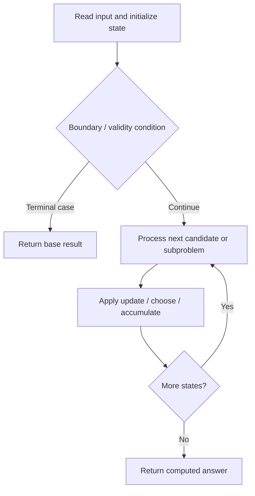

# 1655. Distribute Repeating Integers

**Difficulty:** Hard  
**Concept family:** [Take-or-Skip and Knapsack](https://github.com/gaurav1kr/Miscellaneous/blob/main/DSA/DP/DP_Mathematics_Master_Guide_Illustrated/Theory/Chapter-02.md)  
**Problem:** https://leetcode.com/problems/distribute-repeating-integers/  
**Original submission:** https://leetcode.com/submissions/detail/1610688882/

## Understand the mathematics first

This problem belongs to the study family **Take-or-Skip and Knapsack**. Start by defining the objective and minimal sufficient state; inspect the code to identify the actual transitions.

### Related concept template (not necessarily this problem’s recurrence)

$$
F(i,c)=\max(F(i-1,c),v_i+F(i-1,c-w_i))
$$

**What this template illustrates:** Only use the take branch when the remaining capacity is feasible. Counting versions use addition; feasibility versions use logical OR.

**Derivation exercise:** Define exactly what each state variable means for this problem; list valid choices, base cases, and forbidden transitions. Check the submitted code against that invariant. The family template alone is not a substitute for a problem-specific proof.

## Code landmarks

- `dp[0] = true;`
- `if (!dp[mask]) continue;`
- `return dp[(1 << m) - 1];`

## Source-grounded algorithm walkthrough (expanded coverage)

> **Verification level:** The observations below are extracted from your actual Accepted C++ implementation. The symbolic trace is a **code-reading dry-run worksheet**, not a fabricated numerical run. The generic family formula above is not necessarily this problem's recurrence.

### 1. Identify the actual state and algorithm

**Problem:** 1655. Distribute Repeating Integers. An explicit state table or memo is present. Interpret each index as a mathematical state and every update as a transition.

| Role | C++ source line | Evidence from your solution |
|---|---:|---|
| Candidate state / accumulator | 14 | `vector<bool> dp(1 << m, false);` |
| Candidate state / accumulator | 15 | `dp[0] = true;` |
| Candidate state / accumulator | 16 | `vector<int> sum(1 << m, 0);` |
| Boundary / termination | 15 | `dp[0] = true;` |
| Boundary / termination | 19 | `if (mask & (1 << i))` |
| Boundary / termination | 26 | `if (!dp[mask]) continue;` |
| Traversal order | 9 | `for (int x : nums) freq[x]++;` |
| Traversal order | 11 | `for (auto& [k, v] : freq) counts.push_back(v);` |
| Traversal order | 17 | `for (int mask = 1; mask < (1 << m); ++mask) {` |
| Transition / update | 11 | `for (auto& [k, v] : freq) counts.push_back(v);` |
| Transition / update | 15 | `dp[0] = true;` |
| Transition / update | 20 | `sum[mask] += quantity[i];` |
| Transition / update | 33 | `dp = move(ndp);` |
| Return / result | 35 | `return dp[(1 << m) - 1];` |

### 2. Trace the dependency chain



This is a **control-flow reading diagram**, not a claim about the exact shape of the mathematical state graph. Follow the code line numbers above to draw the actual dependency arrows.

### 3. Symbolic dry-run worksheet

| Stage | State to record | Mathematical question to answer |
|---|---|---|
| Initialize | Inputs, initialized containers/accumulators | What does the initial value mean? |
| First iteration / recursive call | Loop indices, branch, current state | Which predecessor states are available? |
| First update | Before → after for the updated variable | Why is this transition legal? Does it add, minimize, maximize, or overwrite? |
| Next iteration | Updated state and next candidate | Can a value be reused in this traversal order? |
| Finish | Return expression and its value | Why does this correspond to the problem's requested result? |

### 4. Mathematical explanation checklist

1. Define the exact meaning of each state variable, including all indices and constraints.
2. Translate the update expression into a mathematical equation **only after** establishing the state invariant.
3. Prove the transitions are exhaustive and do not double-count or reuse forbidden elements.
4. Check empty input, smallest input, impossible cases, and overflow/modulo behavior.
5. Compute a small numerical example using the actual problem constraints, then compare each row to the original C++.


---

## Your original Accepted C++ submission (unaltered)

```cpp
#include <vector>
#include <unordered_map>
using namespace std;

class Solution {
public:
    bool canDistribute(vector<int>& nums, vector<int>& quantity) {
        unordered_map<int, int> freq;
        for (int x : nums) freq[x]++;
        vector<int> counts;
        for (auto& [k, v] : freq) counts.push_back(v);

        int m = quantity.size(), n = counts.size();
        vector<bool> dp(1 << m, false);
        dp[0] = true;
        vector<int> sum(1 << m, 0);
        for (int mask = 1; mask < (1 << m); ++mask) {
            for (int i = 0; i < m; ++i)
                if (mask & (1 << i))
                    sum[mask] += quantity[i];
        }

        for (int c : counts) {
            vector<bool> ndp = dp;
            for (int mask = 0; mask < (1 << m); ++mask) {
                if (!dp[mask]) continue;
                int subset = ((1 << m) - 1) ^ mask;
                for (int sub = subset; sub; sub = (sub - 1) & subset) {
                    if (sum[sub] <= c)
                        ndp[mask | sub] = true;
                }
            }
            dp = move(ndp);
        }
        return dp[(1 << m) - 1];
    }
};
```

## Time and Space Complexity

- **Time:** `Depends on operations (typically O(log n) per ordered-container operation)`
- **Auxiliary space:** `Depends on number of stored entries`

**Reasoning:** An ordered container or heap introduces logarithmic insertion, lookup, or removal costs; multiply by operation count.

**Status:** Code-informed complexity guidance; exact tight bounds have not been individually verified.
