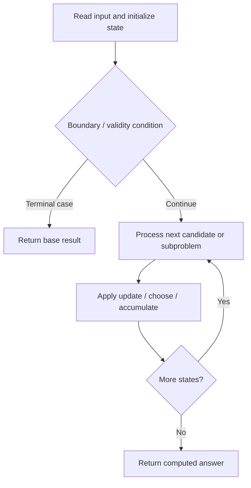

# 1659. Maximize Grid Happiness

**Difficulty:** Hard  
**Concept family:** [Grid Paths and Geometric DP](https://github.com/gaurav1kr/Miscellaneous/blob/main/DSA/DP/DP_Mathematics_Master_Guide_Illustrated/Theory/Chapter-03.md)  
**Problem:** https://leetcode.com/problems/maximize-grid-happiness/  
**Original submission:** https://leetcode.com/submissions/detail/1617063114/

## Understand the mathematics first

This problem belongs to the study family **Grid Paths and Geometric DP**. Start by defining the objective and minimal sufficient state; inspect the code to identify the actual transitions.

### Related concept template (not necessarily this problem’s recurrence)

$$
F(i,j)=F(i-1,j)+F(i,j-1)
$$

**What this template illustrates:** For minimum cost paths, replace + of paths with min of predecessor costs, then add the current cell cost. Obstacles contribute zero ways.

**Derivation exercise:** Define exactly what each state variable means for this problem; list valid choices, base cases, and forbidden transitions. Check the submitted code against that invariant. The family template alone is not a substitute for a problem-specific proof.

## Code landmarks

- `int dp[1<<5][1<<5][7][7][6][6][3];`
- `int &ans=dp[previ][preve][lefti][lefte][i][j][last];`
- `ans=max(ans, rec(i,j+1,previ&(~(1<<j)),preve&(~(1<<j)),0,lefti,lefte));`

## Source-grounded algorithm walkthrough (expanded coverage)

> **Verification level:** The observations below are extracted from your actual Accepted C++ implementation. The symbolic trace is a **code-reading dry-run worksheet**, not a fabricated numerical run. The generic family formula above is not necessarily this problem's recurrence.

### 1. Identify the actual state and algorithm

**Problem:** 1659. Maximize Grid Happiness. An explicit state table or memo is present. Interpret each index as a mathematical state and every update as a transition.

| Role | C++ source line | Evidence from your solution |
|---|---:|---|
| Candidate state / accumulator | 2 | `int dp[1<<5][1<<5][7][7][6][6][3];` |
| Candidate state / accumulator | 9 | `int &ans=dp[previ][preve][lefti][lefte][i][j][last];` |
| Boundary / termination | 5 | `if (lefti<0 \|\| lefte<0) return -1e9;` |
| Boundary / termination | 6 | `if (j==n) return rec(i+1,0,previ,preve,last,lefti,lefte);` |
| Boundary / termination | 7 | `if (i==m) return 0;` |
| Traversal order | — | No obvious matching statement; inspect the original C++ below. |
| Transition / update | 9 | `int &ans=dp[previ][preve][lefti][lefte][i][j][last];` |
| Transition / update | 12 | `ans=-1e9;` |
| Transition / update | 18 | `ans=max(ans, rec(i,j+1,previ&(~(1<<j)),preve&(~(1<<j)),0,lefti,lefte));` |
| Transition / update | 19 | `ans=max(ans, rec(i,j+1,previ\|(1<<j),preve&(~(1<<j)),1,lefti-1,lefte)+ihappy);` |
| Return / result | 5 | `if (lefti<0 \|\| lefte<0) return -1e9;` |
| Return / result | 6 | `if (j==n) return rec(i+1,0,previ,preve,last,lefti,lefte);` |

### 2. Trace the dependency chain



This is a **control-flow reading diagram**, not a claim about the exact shape of the mathematical state graph. Follow the code line numbers above to draw the actual dependency arrows.

### 3. Symbolic dry-run worksheet

| Stage | State to record | Mathematical question to answer |
|---|---|---|
| Initialize | Inputs, initialized containers/accumulators | What does the initial value mean? |
| First iteration / recursive call | Loop indices, branch, current state | Which predecessor states are available? |
| First update | Before → after for the updated variable | Why is this transition legal? Does it add, minimize, maximize, or overwrite? |
| Next iteration | Updated state and next candidate | Can a value be reused in this traversal order? |
| Finish | Return expression and its value | Why does this correspond to the problem's requested result? |

### 4. Mathematical explanation checklist

1. Define the exact meaning of each state variable, including all indices and constraints.
2. Translate the update expression into a mathematical equation **only after** establishing the state invariant.
3. Prove the transitions are exhaustive and do not double-count or reuse forbidden elements.
4. Check empty input, smallest input, impossible cases, and overflow/modulo behavior.
5. Compute a small numerical example using the actual problem constraints, then compare each row to the original C++.


---

## Your original Accepted C++ submission (unaltered)

```cpp
// Your solution here
int dp[1<<5][1<<5][7][7][6][6][3];
int m,n;
int rec(int i, int j, int previ, int preve, int last, int lefti, int lefte) {
    if (lefti<0 || lefte<0) return -1e9;
    if (j==n) return rec(i+1,0,previ,preve,last,lefti,lefte);
    if (i==m) return 0;

    int &ans=dp[previ][preve][lefti][lefte][i][j][last];
    if (ans!=-1) return ans;

    ans=-1e9;
    int ihappy=120, ehappy=40;
    if (i && (previ>>j)&1) { ihappy-=60; ehappy-=10; } 
    else if (i && (preve>>j)&1) { ihappy-=10; ehappy+=40; }
    if (j && last==1) { ihappy-=60; ehappy-=10; }
    else if (j && last==2) { ihappy-=10; ehappy+=40; }
    ans=max(ans, rec(i,j+1,previ&(~(1<<j)),preve&(~(1<<j)),0,lefti,lefte));
    ans=max(ans, rec(i,j+1,previ|(1<<j),preve&(~(1<<j)),1,lefti-1,lefte)+ihappy);
    ans=max(ans, rec(i,j+1,previ&(~(1<<j)),preve|(1<<j),2,lefti,lefte-1)+ehappy);
    return ans;
}

class Solution {
public:
int getMaxGridHappiness(int m_, int n_, int introvertsCount, int extrovertsCount) {
    m=m_,n=n_;
    if (n>m) swap(m,n);
    memset(dp,-1,sizeof(dp));
    return rec(0,0,0,0,0,introvertsCount,extrovertsCount);
}
};
```

## Interview self-check

1. What is the smallest state that determines the remaining answer?
2. Why are the transitions exhaustive and valid?
3. What is the exact base case, including empty and impossible cases?
4. What is the time complexity (states × work per state)?
5. Can the memory be compressed without overwriting needed dependencies?
