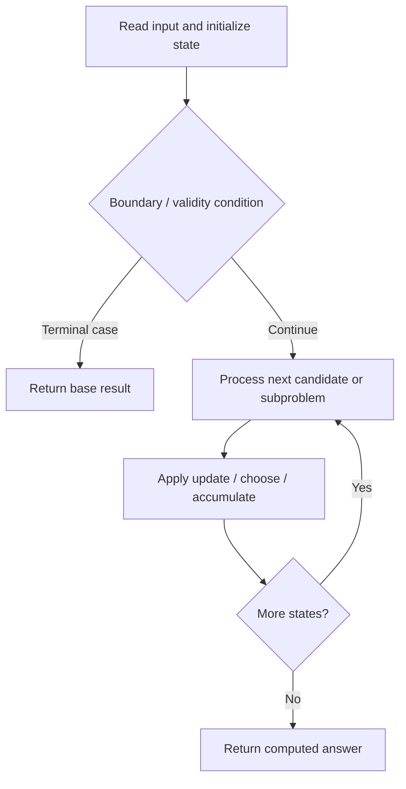

# 1723. Find Minimum Time to Finish All Jobs

**Difficulty:** Hard  
**Concept family:** [Bitmask, Assignment and Subset DP](https://github.com/gaurav1kr/Miscellaneous/blob/main/DSA/DP/DP_Mathematics_Master_Guide_Illustrated/Theory/Chapter-09.md)  
**Problem:** https://leetcode.com/problems/find-minimum-time-to-finish-all-jobs/  
**Original submission:** https://leetcode.com/submissions/detail/1610590196/

## Understand the mathematics first

This problem belongs to the study family **Bitmask, Assignment and Subset DP**. Start by defining the objective and minimal sufficient state; inspect the code to identify the actual transitions.

### Problem-specific recurrence

Refer to the source-grounded algorithm walkthrough below for the state transitions used by your implementation. The generic family recurrence has been removed because it may not apply to this problem.

## Code landmarks

- `sort(jobs.rbegin(), jobs.rend());`
- `while (low < high) {`

## Source-grounded algorithm walkthrough (expanded coverage)

> **Verification level:** The observations below are extracted from your actual Accepted C++ implementation. The symbolic trace is a **code-reading dry-run worksheet**, not a fabricated numerical run. The generic family formula above is not necessarily this problem's recurrence.

### 1. Identify the actual state and algorithm

**Problem:** 1723. Find Minimum Time to Finish All Jobs. Recursive state transitions are present. Check memoization, state identity, termination, and whether branches are mutually exclusive.

| Role | C++ source line | Evidence from your solution |
|---|---:|---|
| Candidate state / accumulator | — | No obvious matching statement; inspect the original C++ below. |
| Boundary / termination | 9 | `if (idx == jobs.size()) return true;` |
| Boundary / termination | 12 | `if (workers[i] + cur <= limit) {` |
| Boundary / termination | 14 | `if (backtrack(jobs, workers, idx + 1, limit)) return true;` |
| Traversal order | 11 | `for (int i = 0; i < workers.size(); ++i) {` |
| Traversal order | 25 | `while (low < high) {` |
| Transition / update | — | No obvious matching statement; inspect the original C++ below. |
| Return / result | 9 | `if (idx == jobs.size()) return true;` |
| Return / result | 14 | `if (backtrack(jobs, workers, idx + 1, limit)) return true;` |

### 2. Trace the dependency chain



This is a **control-flow reading diagram**, not a claim about the exact shape of the mathematical state graph. Follow the code line numbers above to draw the actual dependency arrows.

### 3. Symbolic dry-run worksheet

| Stage | State to record | Mathematical question to answer |
|---|---|---|
| Initialize | Inputs, initialized containers/accumulators | What does the initial value mean? |
| First iteration / recursive call | Loop indices, branch, current state | Which predecessor states are available? |
| First update | Before → after for the updated variable | Why is this transition legal? Does it add, minimize, maximize, or overwrite? |
| Next iteration | Updated state and next candidate | Can a value be reused in this traversal order? |
| Finish | Return expression and its value | Why does this correspond to the problem's requested result? |

### 4. Mathematical explanation checklist

1. Define the exact meaning of each state variable, including all indices and constraints.
2. Translate the update expression into a mathematical equation **only after** establishing the state invariant.
3. Prove the transitions are exhaustive and do not double-count or reuse forbidden elements.
4. Check empty input, smallest input, impossible cases, and overflow/modulo behavior.
5. Compute a small numerical example using the actual problem constraints, then compare each row to the original C++.


---

## Your original Accepted C++ submission (unaltered)

```cpp
#include <vector>
#include <algorithm>

using namespace std;

class Solution {
public:
    bool backtrack(vector<int>& jobs, vector<int>& workers, int idx, int limit) {
        if (idx == jobs.size()) return true;
        int cur = jobs[idx];
        for (int i = 0; i < workers.size(); ++i) {
            if (workers[i] + cur <= limit) {
                workers[i] += cur;
                if (backtrack(jobs, workers, idx + 1, limit)) return true;
                workers[i] -= cur;
            }
            if (workers[i] == 0) break;
        }
        return false;
    }

    int minimumTimeRequired(vector<int>& jobs, int k) {
        sort(jobs.rbegin(), jobs.rend());
        int low = jobs[0], high = accumulate(jobs.begin(), jobs.end(), 0);
        while (low < high) {
            int mid = (low + high) / 2;
            vector<int> workers(k, 0);
            if (backtrack(jobs, workers, 0, mid)) high = mid;
            else low = mid + 1;
        }
        return low;
    }
};
```

## Time and Space Complexity

- **Time:** `At least O(n log n) for sorting; total depends on later work`
- **Auxiliary space:** `Depends on auxiliary containers`

**Reasoning:** Sorting alone costs O(n log n); inspect any subsequent nested passes for a tighter bound.

**Status:** Code-informed complexity guidance; exact tight bounds have not been individually verified.
