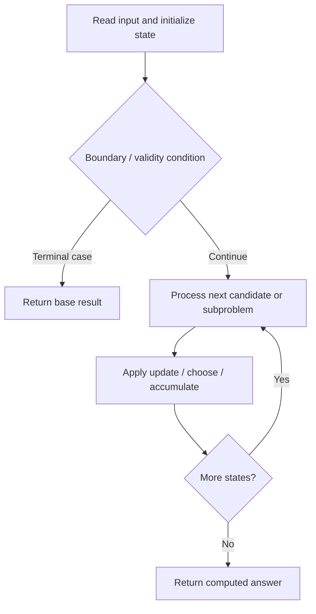

# 1751. Maximum Number of Events That Can Be Attended II

**Difficulty:** Hard  
**Concept family:** [Scheduling and Weighted Intervals](https://github.com/gaurav1kr/Miscellaneous/blob/main/DSA/DP/DP_Mathematics_Master_Guide_Illustrated/Theory/Chapter-07.md)  
**Problem:** https://leetcode.com/problems/maximum-number-of-events-that-can-be-attended-ii/  
**Original submission:** https://leetcode.com/submissions/detail/1610610879/

## Understand the mathematics first

This problem belongs to the study family **Scheduling and Weighted Intervals**. Start by defining the objective and minimal sufficient state; inspect the code to identify the actual transitions.

### Problem-specific recurrence

Refer to the source-grounded algorithm walkthrough below for the state transitions used by your implementation. The generic family recurrence has been removed because it may not apply to this problem.

## Code landmarks

- `sort(events.begin(), events.end());`
- `int j = upper_bound(events.begin(), events.end(), vector<int>{events[i][1], INT_MAX, INT_MAX}) - events.begin();`
- `dp[i][t] = max(dp[i + 1][t], events[i][2] + dp[j][t - 1]);`

## Source-grounded algorithm walkthrough (expanded coverage)

> **Verification level:** The observations below are extracted from your actual Accepted C++ implementation. The symbolic trace is a **code-reading dry-run worksheet**, not a fabricated numerical run. The generic family formula above is not necessarily this problem's recurrence.

### 1. Identify the actual state and algorithm

**Problem:** 1751. Maximum Number of Events That Can Be Attended II. Ordered search / boundary calculation is present. Identify the monotonic or ordering invariant before deriving a recurrence.

| Role | C++ source line | Evidence from your solution |
|---|---:|---|
| Candidate state / accumulator | 11 | `vector<vector<int>> dp(n + 1, vector<int>(k + 1));` |
| Candidate state / accumulator | 15 | `dp[i][t] = max(dp[i + 1][t], events[i][2] + dp[j][t - 1]);` |
| Candidate state / accumulator | 17 | `return dp[0][k];` |
| Boundary / termination | — | No obvious matching statement; inspect the original C++ below. |
| Traversal order | 12 | `for (int i = n - 1; i >= 0; --i) {` |
| Traversal order | 14 | `for (int t = 1; t <= k; ++t)` |
| Transition / update | 13 | `int j = upper_bound(events.begin(), events.end(), vector<int>{events[i][1], INT_MAX, INT_MAX}) - events.begin();` |
| Transition / update | 15 | `dp[i][t] = max(dp[i + 1][t], events[i][2] + dp[j][t - 1]);` |
| Return / result | 17 | `return dp[0][k];` |

### 2. Trace the dependency chain



This is a **control-flow reading diagram**, not a claim about the exact shape of the mathematical state graph. Follow the code line numbers above to draw the actual dependency arrows.

### 3. Symbolic dry-run worksheet

| Stage | State to record | Mathematical question to answer |
|---|---|---|
| Initialize | Inputs, initialized containers/accumulators | What does the initial value mean? |
| First iteration / recursive call | Loop indices, branch, current state | Which predecessor states are available? |
| First update | Before → after for the updated variable | Why is this transition legal? Does it add, minimize, maximize, or overwrite? |
| Next iteration | Updated state and next candidate | Can a value be reused in this traversal order? |
| Finish | Return expression and its value | Why does this correspond to the problem's requested result? |

### 4. Mathematical explanation checklist

1. Define the exact meaning of each state variable, including all indices and constraints.
2. Translate the update expression into a mathematical equation **only after** establishing the state invariant.
3. Prove the transitions are exhaustive and do not double-count or reuse forbidden elements.
4. Check empty input, smallest input, impossible cases, and overflow/modulo behavior.
5. Compute a small numerical example using the actual problem constraints, then compare each row to the original C++.


---

## Your original Accepted C++ submission (unaltered)

```cpp
#include <vector>
#include <algorithm>

using namespace std;

class Solution {
public:
    int maxValue(vector<vector<int>>& events, int k) {
        sort(events.begin(), events.end());
        int n = events.size();
        vector<vector<int>> dp(n + 1, vector<int>(k + 1));
        for (int i = n - 1; i >= 0; --i) {
            int j = upper_bound(events.begin(), events.end(), vector<int>{events[i][1], INT_MAX, INT_MAX}) - events.begin();
            for (int t = 1; t <= k; ++t)
                dp[i][t] = max(dp[i + 1][t], events[i][2] + dp[j][t - 1]);
        }
        return dp[0][k];
    }
};
```

## Time and Space Complexity

- **Time:** `O(n log n) or higher`
- **Auxiliary space:** `O(n) or higher`

**Reasoning:** Sorting costs O(n log n); additional data-structure operations may increase the bound. Confirm against the nested loops.

**Status:** Code-informed complexity guidance; exact tight bounds have not been individually verified.
