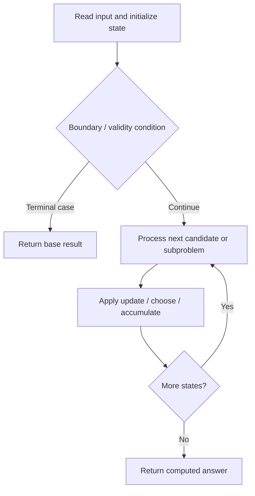

# 1787. Make the XOR of All Segments Equal to Zero

**Difficulty:** Hard  
**Concept family:** [State Machines and Stock DP](https://github.com/gaurav1kr/Miscellaneous/blob/main/DSA/DP/DP_Mathematics_Master_Guide_Illustrated/Theory/Chapter-08.md)  
**Problem:** https://leetcode.com/problems/make-the-xor-of-all-segments-equal-to-zero/  
**Original submission:** https://leetcode.com/submissions/detail/1610702692/

## Understand the mathematics first

This problem belongs to the study family **State Machines and Stock DP**. Start by defining the objective and minimal sufficient state; inspect the code to identify the actual transitions.

### Related concept template (not necessarily this problem’s recurrence)

$$
F(i,s)=\operatorname{opt}_{p\to s}(F(i-1,p)+cost(p,s,i))
$$

**What this template illustrates:** Examples include holding stock versus not holding, cooldown, and bounded operation counts. Draw a state-transition graph before coding.

**Derivation exercise:** Define exactly what each state variable means for this problem; list valid choices, base cases, and forbidden transitions. Check the submitted code against that invariant. The family template alone is not a substitute for a problem-specific proof.

## Code landmarks

- `dp[0] = 0;`
- `new_dp[x ^ val] = min(new_dp[x ^ val], dp[x] + count - f);`
- `return dp[0];`

## Source-grounded algorithm walkthrough (expanded coverage)

> **Verification level:** The observations below are extracted from your actual Accepted C++ implementation. The symbolic trace is a **code-reading dry-run worksheet**, not a fabricated numerical run. The generic family formula above is not necessarily this problem's recurrence.

### 1. Identify the actual state and algorithm

**Problem:** 1787. Make the XOR of All Segments Equal to Zero. An explicit state table or memo is present. Interpret each index as a mathematical state and every update as a transition.

| Role | C++ source line | Evidence from your solution |
|---|---:|---|
| Candidate state / accumulator | 6 | `vector<int> dp(MAX, INF);` |
| Candidate state / accumulator | 7 | `dp[0] = 0;` |
| Candidate state / accumulator | 11 | `int count = 0;` |
| Boundary / termination | 7 | `dp[0] = 0;` |
| Traversal order | 9 | `for (int i = 0; i < k; ++i) {` |
| Traversal order | 12 | `for (int j = i; j < nums.size(); j += k) {` |
| Traversal order | 20 | `for (auto& [val, f] : freq) {` |
| Transition / update | 7 | `dp[0] = 0;` |
| Transition / update | 11 | `int count = 0;` |
| Transition / update | 22 | `new_dp[x ^ val] = min(new_dp[x ^ val], dp[x] + count - f);` |
| Transition / update | 25 | `dp = move(new_dp);` |
| Return / result | 28 | `return dp[0];` |

### 2. Trace the dependency chain



This is a **control-flow reading diagram**, not a claim about the exact shape of the mathematical state graph. Follow the code line numbers above to draw the actual dependency arrows.

### 3. Symbolic dry-run worksheet

| Stage | State to record | Mathematical question to answer |
|---|---|---|
| Initialize | Inputs, initialized containers/accumulators | What does the initial value mean? |
| First iteration / recursive call | Loop indices, branch, current state | Which predecessor states are available? |
| First update | Before → after for the updated variable | Why is this transition legal? Does it add, minimize, maximize, or overwrite? |
| Next iteration | Updated state and next candidate | Can a value be reused in this traversal order? |
| Finish | Return expression and its value | Why does this correspond to the problem's requested result? |

### 4. Mathematical explanation checklist

1. Define the exact meaning of each state variable, including all indices and constraints.
2. Translate the update expression into a mathematical equation **only after** establishing the state invariant.
3. Prove the transitions are exhaustive and do not double-count or reuse forbidden elements.
4. Check empty input, smallest input, impossible cases, and overflow/modulo behavior.
5. Compute a small numerical example using the actual problem constraints, then compare each row to the original C++.


---

## Your original Accepted C++ submission (unaltered)

```cpp
class Solution {
public:
    int minChanges(vector<int>& nums, int k) {
        const int MAX = 1024;
        const int INF = 1e9;
        vector<int> dp(MAX, INF);
        dp[0] = 0;

        for (int i = 0; i < k; ++i) {
            unordered_map<int, int> freq;
            int count = 0;
            for (int j = i; j < nums.size(); j += k) {
                freq[nums[j]]++;
                count++;
            }

            int min_prev = *min_element(dp.begin(), dp.end());
            vector<int> new_dp(MAX, min_prev + count);

            for (auto& [val, f] : freq) {
                for (int x = 0; x < MAX; ++x) {
                    new_dp[x ^ val] = min(new_dp[x ^ val], dp[x] + count - f);
                }
            }
            dp = move(new_dp);
        }

        return dp[0];
    }
};
```

## Time and Space Complexity

- **Time:** `Depends on operations (typically O(log n) per ordered-container operation)`
- **Auxiliary space:** `Depends on number of stored entries`

**Reasoning:** An ordered container or heap introduces logarithmic insertion, lookup, or removal costs; multiply by operation count.

**Status:** Code-informed complexity guidance; exact tight bounds have not been individually verified.
