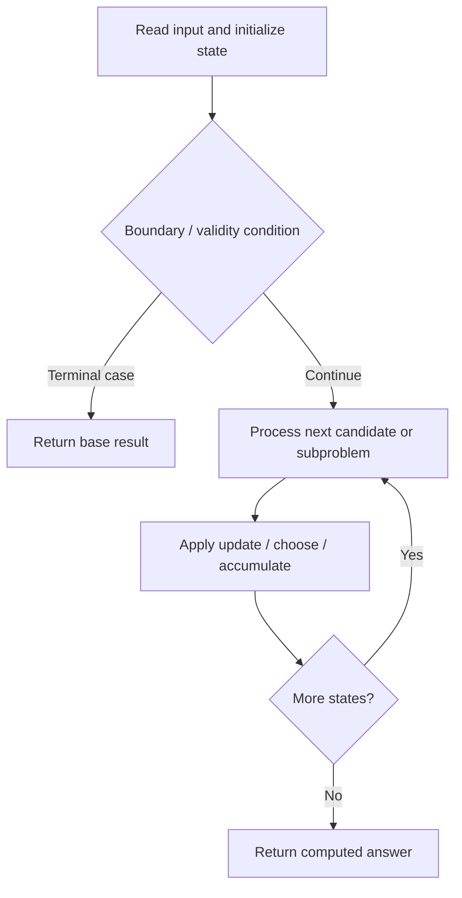

# 1815. Maximum Number of Groups Getting Fresh Donuts

**Difficulty:** Hard  
**Concept family:** [Bitmask, Assignment and Subset DP](https://github.com/gaurav1kr/Miscellaneous/blob/main/DSA/DP/DP_Mathematics_Master_Guide_Illustrated/Theory/Chapter-09.md)  
**Problem:** https://leetcode.com/problems/maximum-number-of-groups-getting-fresh-donuts/  
**Original submission:** https://leetcode.com/submissions/detail/1610681235/

## Understand the mathematics first

This problem belongs to the study family **Bitmask, Assignment and Subset DP**. Start by defining the objective and minimal sufficient state; inspect the code to identify the actual transitions.

### Problem-specific recurrence

Refer to the source-grounded algorithm walkthrough below for the state transitions used by your implementation. The generic family recurrence has been removed because it may not apply to this problem.

## Code landmarks

- `if (memo.count(key)) return memo[key];`
- `ans = max(ans, (prev == 0) + dfs((prev + i) % batchSize, r));`
- `return memo[key] = ans;`

## Source-grounded algorithm walkthrough (expanded coverage)

> **Verification level:** The observations below are extracted from your actual Accepted C++ implementation. The symbolic trace is a **code-reading dry-run worksheet**, not a fabricated numerical run. The generic family formula above is not necessarily this problem's recurrence.

### 1. Identify the actual state and algorithm

**Problem:** 1815. Maximum Number of Groups Getting Fresh Donuts. Recursive state transitions are present. Check memoization, state identity, termination, and whether branches are mutually exclusive.

| Role | C++ source line | Evidence from your solution |
|---|---:|---|
| Candidate state / accumulator | 9 | `int res = 0;` |
| Candidate state / accumulator | 16 | `unordered_map<long long, int> memo;` |
| Candidate state / accumulator | 21 | `if (memo.count(key)) return memo[key];` |
| Boundary / termination | 12 | `if (r == 0) res++;` |
| Boundary / termination | 21 | `if (memo.count(key)) return memo[key];` |
| Boundary / termination | 25 | `if (r[i]) {` |
| Traversal order | 10 | `for (int g : groups) {` |
| Traversal order | 19 | `for (int i = 1; i < batchSize; ++i)` |
| Traversal order | 24 | `for (int i = 1; i < batchSize; ++i) {` |
| Transition / update | 9 | `int res = 0;` |
| Transition / update | 23 | `int ans = 0;` |
| Transition / update | 27 | `ans = max(ans, (prev == 0) + dfs((prev + i) % batchSize, r));` |
| Transition / update | 31 | `return memo[key] = ans;` |
| Return / result | 21 | `if (memo.count(key)) return memo[key];` |
| Return / result | 31 | `return memo[key] = ans;` |

### 2. Trace the dependency chain



This is a **control-flow reading diagram**, not a claim about the exact shape of the mathematical state graph. Follow the code line numbers above to draw the actual dependency arrows.

### 3. Symbolic dry-run worksheet

| Stage | State to record | Mathematical question to answer |
|---|---|---|
| Initialize | Inputs, initialized containers/accumulators | What does the initial value mean? |
| First iteration / recursive call | Loop indices, branch, current state | Which predecessor states are available? |
| First update | Before → after for the updated variable | Why is this transition legal? Does it add, minimize, maximize, or overwrite? |
| Next iteration | Updated state and next candidate | Can a value be reused in this traversal order? |
| Finish | Return expression and its value | Why does this correspond to the problem's requested result? |

### 4. Mathematical explanation checklist

1. Define the exact meaning of each state variable, including all indices and constraints.
2. Translate the update expression into a mathematical equation **only after** establishing the state invariant.
3. Prove the transitions are exhaustive and do not double-count or reuse forbidden elements.
4. Check empty input, smallest input, impossible cases, and overflow/modulo behavior.
5. Compute a small numerical example using the actual problem constraints, then compare each row to the original C++.


---

## Your original Accepted C++ submission (unaltered)

```cpp
#include <vector>
#include <unordered_map>
using namespace std;

class Solution {
public:
    int maxHappyGroups(int batchSize, vector<int>& groups) {
        vector<int> rem(batchSize, 0);
        int res = 0;
        for (int g : groups) {
            int r = g % batchSize;
            if (r == 0) res++;
            else rem[r]++;
        }

        unordered_map<long long, int> memo;
        function<int(int, vector<int>&)> dfs = [&](int prev, vector<int>& r) {
            long long key = prev;
            for (int i = 1; i < batchSize; ++i)
                key = key * 31 + r[i];
            if (memo.count(key)) return memo[key];

            int ans = 0;
            for (int i = 1; i < batchSize; ++i) {
                if (r[i]) {
                    r[i]--;
                    ans = max(ans, (prev == 0) + dfs((prev + i) % batchSize, r));
                    r[i]++;
                }
            }
            return memo[key] = ans;
        };

        return res + dfs(0, rem);
    }
};
```

## Time and Space Complexity

- **Time:** `Depends on operations (typically O(log n) per ordered-container operation)`
- **Auxiliary space:** `Depends on number of stored entries`

**Reasoning:** An ordered container or heap introduces logarithmic insertion, lookup, or removal costs; multiply by operation count.

**Status:** Code-informed complexity guidance; exact tight bounds have not been individually verified.
