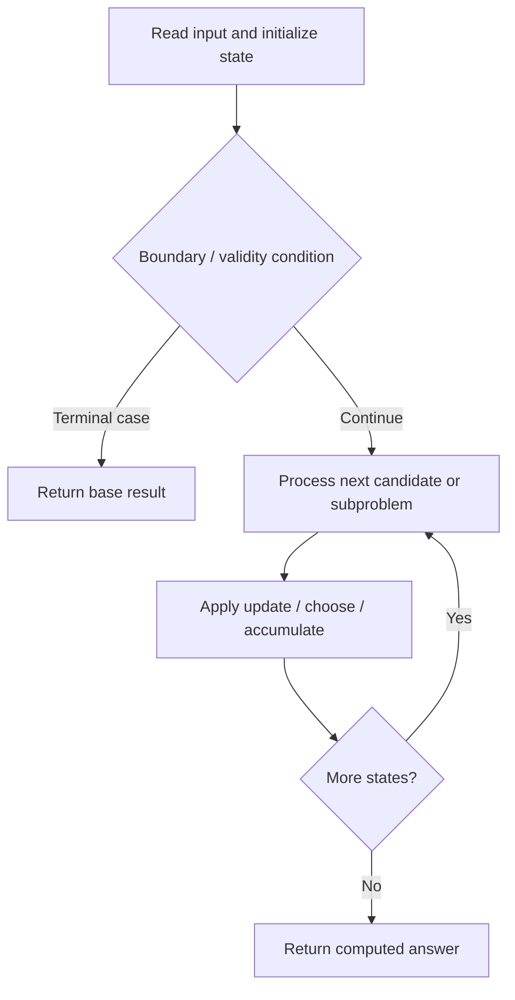

# 1857. Largest Color Value in a Directed Graph

**Difficulty:** Hard  
**Concept family:** [Tree, Graph and DAG DP](https://github.com/gaurav1kr/Miscellaneous/blob/main/DSA/DP/DP_Mathematics_Master_Guide_Illustrated/Theory/Chapter-10.md)  
**Problem:** https://leetcode.com/problems/largest-color-value-in-a-directed-graph/  
**Original submission:** https://leetcode.com/submissions/detail/1610615663/

## Understand the mathematics first

This problem belongs to the study family **Tree, Graph and DAG DP**. Start by defining the objective and minimal sufficient state; inspect the code to identify the actual transitions.

### Mathematical starting point

This family includes tree DP, DAG DP, shortest paths, and graph traversal. **There is no single recurrence for all these problems.** Identify the exact state and invariant from the algorithm below. For tree paths, distinguish the value returned to the parent from a complete answer within the subtree; for graph problems, establish whether edges form a DAG or whether shortest-path processing is required.

## Code landmarks

- `while (!q.empty()) {`
- `res = max(res, count[node][colors[node] - 'a']);`
- `count[nei][c] = max(count[nei][c], count[node][c]);`

## Source-grounded algorithm walkthrough (expanded coverage)

> **Verification level:** The observations below are extracted from your actual Accepted C++ implementation. The symbolic trace is a **code-reading dry-run worksheet**, not a fabricated numerical run. The generic family formula above is not necessarily this problem's recurrence.

### 1. Identify the actual state and algorithm

**Problem:** 1857. Largest Color Value in a Directed Graph. This solution does not expose an obvious `dp` or `memo` variable. Derive the algorithmic invariant from the code rather than assuming a DP recurrence.

| Role | C++ source line | Evidence from your solution |
|---|---:|---|
| Candidate state / accumulator | 20 | `vector<vector<int>> count(n, vector<int>(26));` |
| Candidate state / accumulator | 25 | `int seen = 0, res = 0;` |
| Boundary / termination | 23 | `if (indegree[i] == 0) q.push(i);` |
| Boundary / termination | 34 | `if (--indegree[nei] == 0) q.push(nei);` |
| Boundary / termination | 37 | `return seen == n ? res : -1;` |
| Traversal order | 15 | `for (auto& e : edges) {` |
| Traversal order | 22 | `for (int i = 0; i < n; ++i)` |
| Traversal order | 26 | `while (!q.empty()) {` |
| Transition / update | 16 | `graph[e[0]].push_back(e[1]);` |
| Transition / update | 25 | `int seen = 0, res = 0;` |
| Transition / update | 30 | `res = max(res, count[node][colors[node] - 'a']);` |
| Transition / update | 33 | `count[nei][c] = max(count[nei][c], count[node][c]);` |
| Return / result | 37 | `return seen == n ? res : -1;` |

### 2. Trace the dependency chain



This is a **control-flow reading diagram**, not a claim about the exact shape of the mathematical state graph. Follow the code line numbers above to draw the actual dependency arrows.

### 3. Symbolic dry-run worksheet

| Stage | State to record | Mathematical question to answer |
|---|---|---|
| Initialize | Inputs, initialized containers/accumulators | What does the initial value mean? |
| First iteration / recursive call | Loop indices, branch, current state | Which predecessor states are available? |
| First update | Before → after for the updated variable | Why is this transition legal? Does it add, minimize, maximize, or overwrite? |
| Next iteration | Updated state and next candidate | Can a value be reused in this traversal order? |
| Finish | Return expression and its value | Why does this correspond to the problem's requested result? |

### 4. Mathematical explanation checklist

1. Define the exact meaning of each state variable, including all indices and constraints.
2. Translate the update expression into a mathematical equation **only after** establishing the state invariant.
3. Prove the transitions are exhaustive and do not double-count or reuse forbidden elements.
4. Check empty input, smallest input, impossible cases, and overflow/modulo behavior.
5. Compute a small numerical example using the actual problem constraints, then compare each row to the original C++.


---

## Your original Accepted C++ submission (unaltered)

```cpp
#include <vector>
#include <string>
#include <queue>
#include <algorithm>

using namespace std;

class Solution {
public:
    int largestPathValue(string colors, vector<vector<int>>& edges) {
        int n = colors.size();
        vector<vector<int>> graph(n);
        vector<int> indegree(n, 0);

        for (auto& e : edges) {
            graph[e[0]].push_back(e[1]);
            indegree[e[1]]++;
        }

        vector<vector<int>> count(n, vector<int>(26));
        queue<int> q;
        for (int i = 0; i < n; ++i)
            if (indegree[i] == 0) q.push(i);

        int seen = 0, res = 0;
        while (!q.empty()) {
            int node = q.front(); q.pop();
            seen++;
            count[node][colors[node] - 'a']++;
            res = max(res, count[node][colors[node] - 'a']);
            for (int nei : graph[node]) {
                for (int c = 0; c < 26; ++c)
                    count[nei][c] = max(count[nei][c], count[node][c]);
                if (--indegree[nei] == 0) q.push(nei);
            }
        }
        return seen == n ? res : -1;
    }
};
```

## Time and Space Complexity

- **Time:** `Depends on table dimensions and transitions per cell`
- **Auxiliary space:** `O(rows × columns) for the allocated table`

**Reasoning:** The two-dimensional table determines memory; time is its state count multiplied by work per state.

**Status:** Code-informed complexity guidance; exact tight bounds have not been individually verified.
