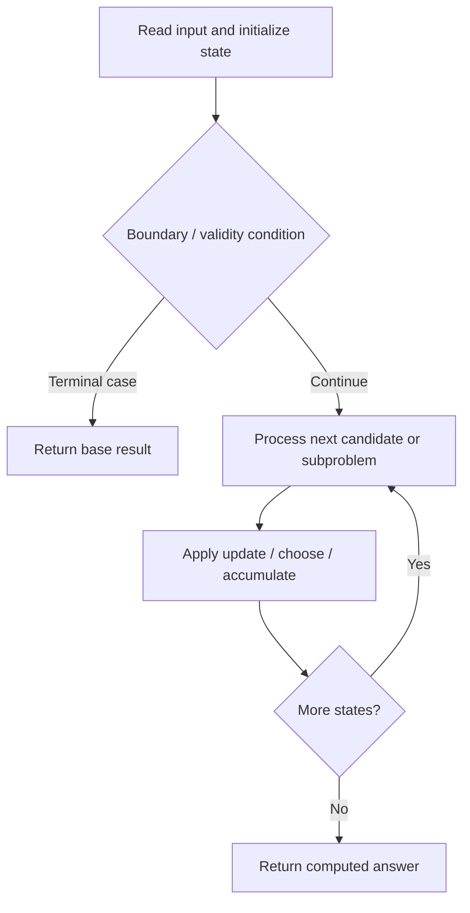

# 1928. Minimum Cost to Reach Destination in Time

**Difficulty:** Hard  
**Concept family:** [Tree, Graph and DAG DP](https://github.com/gaurav1kr/Miscellaneous/blob/main/DSA/DP/DP_Mathematics_Master_Guide_Illustrated/Theory/Chapter-10.md)  
**Problem:** https://leetcode.com/problems/minimum-cost-to-reach-destination-in-time/  
**Original submission:** https://leetcode.com/submissions/detail/1599284725/

## Understand the mathematics first

This problem belongs to the study family **Tree, Graph and DAG DP**. Start by defining the objective and minimal sufficient state; inspect the code to identify the actual transitions.

### Mathematical starting point

This family includes tree DP, DAG DP, shortest paths, and graph traversal. **There is no single recurrence for all these problems.** Identify the exact state and invariant from the algorithm below. For tree paths, distinguish the value returned to the parent from a complete answer within the subtree; for graph problems, establish whether edges form a DAG or whether shortest-path processing is required.

## Code landmarks

- `dp[0][0] = passingFees[0];`
- `priority_queue<tuple<int, int, int>, vector<tuple<int, int, int>>, greater<>> pq;`
- `while (!pq.empty()) {`

## Source-grounded algorithm walkthrough (expanded coverage)

> **Verification level:** The observations below are extracted from your actual Accepted C++ implementation. The symbolic trace is a **code-reading dry-run worksheet**, not a fabricated numerical run. The generic family formula above is not necessarily this problem's recurrence.

### 1. Identify the actual state and algorithm

**Problem:** 1928. Minimum Cost to Reach Destination in Time. Heap/selection operations are present. Explain why the selection order is safe; a DP recurrence may not be necessary.

| Role | C++ source line | Evidence from your solution |
|---|---:|---|
| Candidate state / accumulator | 14 | `vector<vector<int>> dp(n, vector<int>(maxTime + 1, 1e9));` |
| Candidate state / accumulator | 15 | `dp[0][0] = passingFees[0];` |
| Candidate state / accumulator | 23 | `if (t + w <= maxTime && fee + passingFees[v] < dp[v][t + w]) {` |
| Boundary / termination | 21 | `if (u == n - 1) return fee;` |
| Boundary / termination | 23 | `if (t + w <= maxTime && fee + passingFees[v] < dp[v][t + w]) {` |
| Traversal order | 11 | `for (auto& e : edges)` |
| Traversal order | 19 | `while (!pq.empty()) {` |
| Traversal order | 22 | `for (auto& [v, w] : graph[u]) {` |
| Transition / update | 15 | `dp[0][0] = passingFees[0];` |
| Transition / update | 24 | `dp[v][t + w] = fee + passingFees[v];` |
| Return / result | 21 | `if (u == n - 1) return fee;` |
| Return / result | 29 | `return -1;` |

### 2. Trace the dependency chain



This is a **control-flow reading diagram**, not a claim about the exact shape of the mathematical state graph. Follow the code line numbers above to draw the actual dependency arrows.

### 3. Symbolic dry-run worksheet

| Stage | State to record | Mathematical question to answer |
|---|---|---|
| Initialize | Inputs, initialized containers/accumulators | What does the initial value mean? |
| First iteration / recursive call | Loop indices, branch, current state | Which predecessor states are available? |
| First update | Before → after for the updated variable | Why is this transition legal? Does it add, minimize, maximize, or overwrite? |
| Next iteration | Updated state and next candidate | Can a value be reused in this traversal order? |
| Finish | Return expression and its value | Why does this correspond to the problem's requested result? |

### 4. Mathematical explanation checklist

1. Define the exact meaning of each state variable, including all indices and constraints.
2. Translate the update expression into a mathematical equation **only after** establishing the state invariant.
3. Prove the transitions are exhaustive and do not double-count or reuse forbidden elements.
4. Check empty input, smallest input, impossible cases, and overflow/modulo behavior.
5. Compute a small numerical example using the actual problem constraints, then compare each row to the original C++.


---

## Your original Accepted C++ submission (unaltered)

```cpp
#include <vector>
#include <queue>

using namespace std;

class Solution {
public:
    int minCost(int maxTime, vector<vector<int>>& edges, vector<int>& passingFees) {
        int n = passingFees.size();
        vector<vector<pair<int, int>>> graph(n);
        for (auto& e : edges)
            graph[e[0]].emplace_back(e[1], e[2]), graph[e[1]].emplace_back(e[0], e[2]);

        vector<vector<int>> dp(n, vector<int>(maxTime + 1, 1e9));
        dp[0][0] = passingFees[0];
        priority_queue<tuple<int, int, int>, vector<tuple<int, int, int>>, greater<>> pq;
        pq.emplace(passingFees[0], 0, 0);

        while (!pq.empty()) {
            auto [fee, u, t] = pq.top(); pq.pop();
            if (u == n - 1) return fee;
            for (auto& [v, w] : graph[u]) {
                if (t + w <= maxTime && fee + passingFees[v] < dp[v][t + w]) {
                    dp[v][t + w] = fee + passingFees[v];
                    pq.emplace(dp[v][t + w], v, t + w);
                }
            }
        }
        return -1;
    }
};
```

## Time and Space Complexity

- **Time:** `Depends on operations (typically O(log n) per ordered-container operation)`
- **Auxiliary space:** `Depends on number of stored entries`

**Reasoning:** An ordered container or heap introduces logarithmic insertion, lookup, or removal costs; multiply by operation count.

**Status:** Code-informed complexity guidance; exact tight bounds have not been individually verified.
