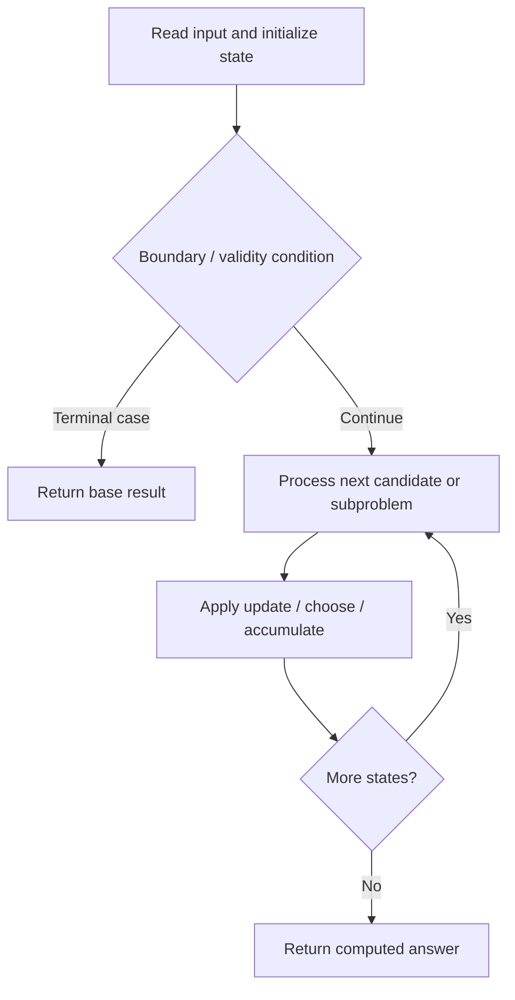

# 1931. Painting a Grid With Three Different Colors

**Difficulty:** Hard  
**Concept family:** [Grid Paths and Geometric DP](https://github.com/gaurav1kr/Miscellaneous/blob/main/DSA/DP/DP_Mathematics_Master_Guide_Illustrated/Theory/Chapter-03.md)  
**Problem:** https://leetcode.com/problems/painting-a-grid-with-three-different-colors/  
**Original submission:** https://leetcode.com/submissions/detail/1610641548/

## Understand the mathematics first

This problem belongs to the study family **Grid Paths and Geometric DP**. Start by defining the objective and minimal sufficient state; inspect the code to identify the actual transitions.

### Related concept template (not necessarily this problem’s recurrence)

$$
F(i,j)=F(i-1,j)+F(i,j-1)
$$

**What this template illustrates:** For minimum cost paths, replace + of paths with min of predecessor costs, then add the current cell cost. Obstacles contribute zero ways.

**Derivation exercise:** Define exactly what each state variable means for this problem; list valid choices, base cases, and forbidden transitions. Check the submitted code against that invariant. The family template alone is not a substitute for a problem-specific proof.

## Code landmarks

- `for (int a : valid) dp[a] = 1;`

## Source-grounded algorithm walkthrough (expanded coverage)

> **Verification level:** The observations below are extracted from your actual Accepted C++ implementation. The symbolic trace is a **code-reading dry-run worksheet**, not a fabricated numerical run. The generic family formula above is not necessarily this problem's recurrence.

### 1. Identify the actual state and algorithm

**Problem:** 1931. Painting a Grid With Three Different Colors. Recursive state transitions are present. Check memoization, state identity, termination, and whether branches are mutually exclusive.

| Role | C++ source line | Evidence from your solution |
|---|---:|---|
| Candidate state / accumulator | 37 | `unordered_map<int, int> dp;` |
| Candidate state / accumulator | 38 | `for (int a : valid) dp[a] = 1;` |
| Candidate state / accumulator | 42 | `for (auto& [a, cnt] : dp) {` |
| Boundary / termination | 12 | `if (row == m) {` |
| Boundary / termination | 17 | `if (row > 0 && ((code >> ((row - 1) * 2)) & 3) == c) continue;` |
| Boundary / termination | 28 | `if (((a >> (i * 2)) & 3) == ((b >> (i * 2)) & 3)) {` |
| Traversal order | 16 | `for (int c = 0; c < 3; ++c) {` |
| Traversal order | 24 | `for (int a : valid) {` |
| Traversal order | 25 | `for (int b : valid) {` |
| Transition / update | 13 | `valid.push_back(code);` |
| Transition / update | 33 | `if (ok) next[a].push_back(b);` |
| Transition / update | 38 | `for (int a : valid) dp[a] = 1;` |
| Transition / update | 47 | `dp = move(ndp);` |
| Return / result | 14 | `return;` |
| Return / result | 52 | `return res;` |

### 2. Trace the dependency chain



This is a **control-flow reading diagram**, not a claim about the exact shape of the mathematical state graph. Follow the code line numbers above to draw the actual dependency arrows.

### 3. Symbolic dry-run worksheet

| Stage | State to record | Mathematical question to answer |
|---|---|---|
| Initialize | Inputs, initialized containers/accumulators | What does the initial value mean? |
| First iteration / recursive call | Loop indices, branch, current state | Which predecessor states are available? |
| First update | Before → after for the updated variable | Why is this transition legal? Does it add, minimize, maximize, or overwrite? |
| Next iteration | Updated state and next candidate | Can a value be reused in this traversal order? |
| Finish | Return expression and its value | Why does this correspond to the problem's requested result? |

### 4. Mathematical explanation checklist

1. Define the exact meaning of each state variable, including all indices and constraints.
2. Translate the update expression into a mathematical equation **only after** establishing the state invariant.
3. Prove the transitions are exhaustive and do not double-count or reuse forbidden elements.
4. Check empty input, smallest input, impossible cases, and overflow/modulo behavior.
5. Compute a small numerical example using the actual problem constraints, then compare each row to the original C++.


---

## Your original Accepted C++ submission (unaltered)

```cpp
#include <vector>
#include <unordered_map>

using namespace std;

class Solution {
public:
    int colorTheGrid(int m, int n) {
        const int MOD = 1e9 + 7;
        vector<int> valid;
        function<void(int, int)> dfs = [&](int row, int code) {
            if (row == m) {
                valid.push_back(code);
                return;
            }
            for (int c = 0; c < 3; ++c) {
                if (row > 0 && ((code >> ((row - 1) * 2)) & 3) == c) continue;
                dfs(row + 1, code | (c << (row * 2)));
            }
        };
        dfs(0, 0);

        unordered_map<int, vector<int>> next;
        for (int a : valid) {
            for (int b : valid) {
                bool ok = true;
                for (int i = 0; i < m; ++i) {
                    if (((a >> (i * 2)) & 3) == ((b >> (i * 2)) & 3)) {
                        ok = false;
                        break;
                    }
                }
                if (ok) next[a].push_back(b);
            }
        }

        unordered_map<int, int> dp;
        for (int a : valid) dp[a] = 1;

        for (int col = 1; col < n; ++col) {
            unordered_map<int, int> ndp;
            for (auto& [a, cnt] : dp) {
                for (int b : next[a]) {
                    ndp[b] = (ndp[b] + cnt) % MOD;
                }
            }
            dp = move(ndp);
        }

        int res = 0;
        for (auto& [_, cnt] : dp) res = (res + cnt) % MOD;
        return res;
    }
};
```

## Time and Space Complexity

- **Time:** `Depends on operations (typically O(log n) per ordered-container operation)`
- **Auxiliary space:** `Depends on number of stored entries`

**Reasoning:** An ordered container or heap introduces logarithmic insertion, lookup, or removal costs; multiply by operation count.

**Status:** Code-informed complexity guidance; exact tight bounds have not been individually verified.
