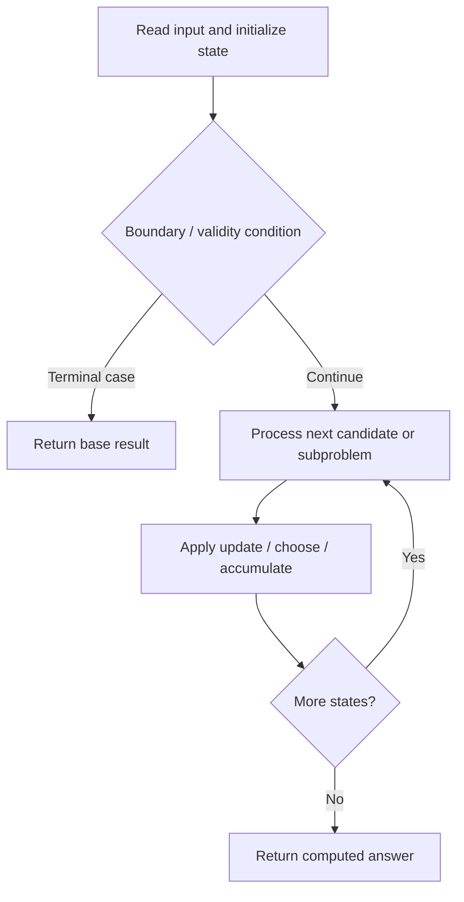

# 1976. Number of Ways to Arrive at Destination

**Difficulty:** Medium  
**Concept family:** [Tree, Graph and DAG DP](https://github.com/gaurav1kr/Miscellaneous/blob/main/DSA/DP/DP_Mathematics_Master_Guide_Illustrated/Theory/Chapter-10.md)  
**Problem:** https://leetcode.com/problems/number-of-ways-to-arrive-at-destination/  
**Original submission:** https://leetcode.com/submissions/detail/1595401128/

## Understand the mathematics first

This problem belongs to the study family **Tree, Graph and DAG DP**. Start by defining the objective and minimal sufficient state; inspect the code to identify the actual transitions.

### Mathematical starting point

This family includes tree DP, DAG DP, shortest paths, and graph traversal. **There is no single recurrence for all these problems.** Identify the exact state and invariant from the algorithm below. For tree paths, distinguish the value returned to the parent from a complete answer within the subtree; for graph problems, establish whether edges form a DAG or whether shortest-path processing is required.

## Code landmarks

- `priority_queue<pair<long, int>, vector<pair<long, int>>, greater<>> pq;`
- `while (!pq.empty()) {`

## Source-grounded algorithm walkthrough (expanded coverage)

> **Verification level:** The observations below are extracted from your actual Accepted C++ implementation. The symbolic trace is a **code-reading dry-run worksheet**, not a fabricated numerical run. The generic family formula above is not necessarily this problem's recurrence.

### 1. Identify the actual state and algorithm

**Problem:** 1976. Number of Ways to Arrive at Destination. Heap/selection operations are present. Explain why the selection order is safe; a DP recurrence may not be necessary.

| Role | C++ source line | Evidence from your solution |
|---|---:|---|
| Candidate state / accumulator | 15 | `vector<long> dist(n, LONG_MAX), ways(n, 0);` |
| Boundary / termination | 24 | `if (d > dist[u]) continue;` |
| Boundary / termination | 26 | `if (d + w < dist[v]) {` |
| Boundary / termination | 30 | `} else if (d + w == dist[v]) {` |
| Traversal order | 12 | `for (auto& r : roads)` |
| Traversal order | 22 | `while (!pq.empty()) {` |
| Traversal order | 25 | `for (auto& [v, w] : adj[u]) {` |
| Transition / update | 17 | `ways[0] = 1;` |
| Transition / update | 28 | `ways[v] = ways[u];` |
| Transition / update | 31 | `ways[v] = (ways[v] + ways[u]) % MOD;` |
| Return / result | 36 | `return ways[n - 1];` |

### 2. Trace the dependency chain



This is a **control-flow reading diagram**, not a claim about the exact shape of the mathematical state graph. Follow the code line numbers above to draw the actual dependency arrows.

### 3. Symbolic dry-run worksheet

| Stage | State to record | Mathematical question to answer |
|---|---|---|
| Initialize | Inputs, initialized containers/accumulators | What does the initial value mean? |
| First iteration / recursive call | Loop indices, branch, current state | Which predecessor states are available? |
| First update | Before → after for the updated variable | Why is this transition legal? Does it add, minimize, maximize, or overwrite? |
| Next iteration | Updated state and next candidate | Can a value be reused in this traversal order? |
| Finish | Return expression and its value | Why does this correspond to the problem's requested result? |

### 4. Mathematical explanation checklist

1. Define the exact meaning of each state variable, including all indices and constraints.
2. Translate the update expression into a mathematical equation **only after** establishing the state invariant.
3. Prove the transitions are exhaustive and do not double-count or reuse forbidden elements.
4. Check empty input, smallest input, impossible cases, and overflow/modulo behavior.
5. Compute a small numerical example using the actual problem constraints, then compare each row to the original C++.


---

## Your original Accepted C++ submission (unaltered)

```cpp
#include <vector>
#include <queue>
#include <climits>

using namespace std;

class Solution {
public:
    int countPaths(int n, vector<vector<int>>& roads) {
        const int MOD = 1e9 + 7;
        vector<vector<pair<int, int>>> adj(n);
        for (auto& r : roads)
            adj[r[0]].emplace_back(r[1], r[2]), adj[r[1]].emplace_back(r[0], r[2]);

        vector<long> dist(n, LONG_MAX), ways(n, 0);
        dist[0] = 0;
        ways[0] = 1;

        priority_queue<pair<long, int>, vector<pair<long, int>>, greater<>> pq;
        pq.emplace(0, 0);

        while (!pq.empty()) {
            auto [d, u] = pq.top(); pq.pop();
            if (d > dist[u]) continue;
            for (auto& [v, w] : adj[u]) {
                if (d + w < dist[v]) {
                    dist[v] = d + w;
                    ways[v] = ways[u];
                    pq.emplace(dist[v], v);
                } else if (d + w == dist[v]) {
                    ways[v] = (ways[v] + ways[u]) % MOD;
                }
            }
        }

        return ways[n - 1];
    }
};
```

## Time and Space Complexity

- **Time:** `Depends on operations (typically O(log n) per ordered-container operation)`
- **Auxiliary space:** `Depends on number of stored entries`

**Reasoning:** An ordered container or heap introduces logarithmic insertion, lookup, or removal costs; multiply by operation count.

**Status:** Code-informed complexity guidance; exact tight bounds have not been individually verified.
