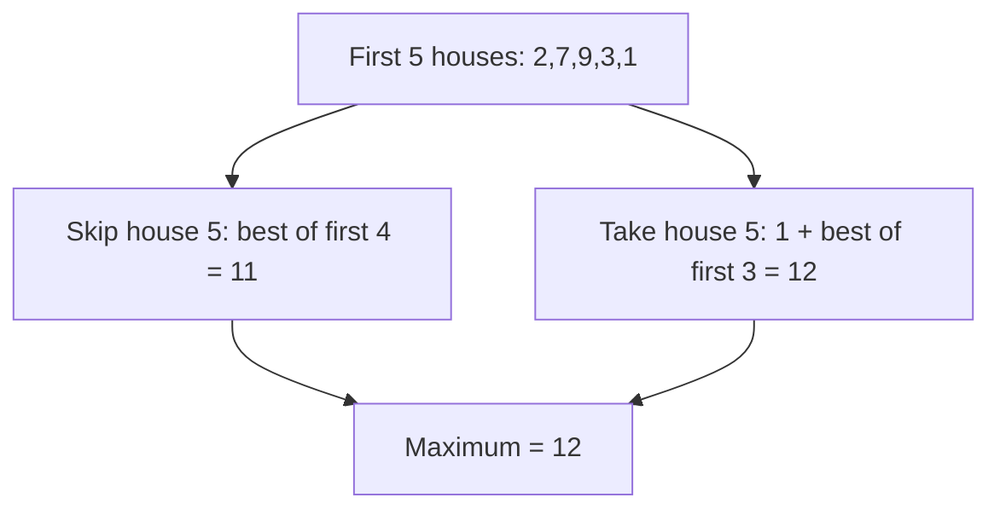
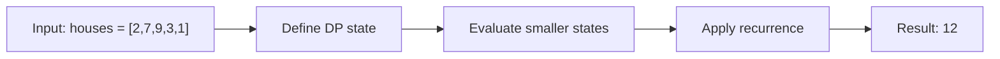

# 198. House Robber

**Difficulty:** Medium  
**Concept family:** [Take-or-Skip and Knapsack](https://github.com/gaurav1kr/Miscellaneous/blob/main/DSA/DP/DP_Mathematics_Master_Guide_Illustrated/Theory/Chapter-02.md)  
**Problem:** https://leetcode.com/problems/house-robber/  
**Original submission:** https://leetcode.com/submissions/detail/2151960218/

## Understand the mathematics first

Let F(i) be best from first i houses.

### Related concept template (not necessarily this problem’s recurrence)

$$
F(i)=max(F(i-1),a_i+F(i-2))
$$

**What this template illustrates:** Take/skip. Adjacent houses cannot both be chosen.

**Derivation exercise:** Define exactly what each state variable means for this problem; list valid choices, base cases, and forbidden transitions. Check the submitted code against that invariant. The family template alone is not a substitute for a problem-specific proof.

## Code landmarks

- `prev1 = max(prev2 + num , prev1) ;`
- `// dp[i] = max(dp[i-1], nums[i] + dp[i-2])`

## Worked mathematical walkthrough (illustrated)

**State:** Maximum money from first i houses.

**Transition:** `F(i)=max(F(i-1), a[i]+F(i-2))`

**Why:** Every optimum either excludes the last house or includes it; inclusion forbids its neighbor. Take the larger of these two exhaustive cases.



**Hand calculation:** Values [2,7,9,3,1]: F(0)=0, F(1)=2, F(2)=7, F(3)=11, F(4)=11, F(5)=12

**Six-month revision test:** Without looking at the code, reconstruct the state, enumerate the legal choices, and justify why this transition does not miss or double-count any answer.

---

## Detailed dry run — House Robber: exhaustive take/skip

### Start from the mathematical question

Let F(i) be the maximum value obtainable from the first i houses, indexed 1..i. F(0)=0 and F(1)=a1.

### Derive the recurrence

```math
F(i)=\max(F(i-1),\ a_i+F(i-2))
```

**Why the transition is correct:** The last house is either selected or not. These two cases cover every feasible solution and cannot overlap.

### Concrete example

**Input:** `houses = [2,7,9,3,1]`



**Evaluate the states in dependency order:**

| i | House | Skip: F(i−1) | Take: house + F(i−2) | F(i) |
|---|---:|---:|---:|---:|
| 1 | 2 | 0 | 2 | 2 |
| 2 | 7 | 2 | 7 | 7 |
| 3 | 9 | 7 | 9+2=11 | 11 |
| 4 | 3 | 11 | 3+7=10 | 11 |
| 5 | 1 | 11 | 1+11=12 | 12 |

**Expected result:** `12`.

### What to remember six months later

Explain (1) what one state means, (2) which earlier states it needs, (3) why those cases are exhaustive, and (4) why the answer is `12` for this input. Then inspect your preserved C++ solution below and match its variables to the mathematical states.

---

## Your original Accepted C++ submission (unaltered)

```cpp
class Solution {
public:
    int rob(vector<int>& nums) 
    {
        int prev1 = 0;
        int prev2 = 0 ;
        for(int num:nums)
        {
            int temp = prev1 ;
            prev1 = max(prev2 + num , prev1) ;
            prev2 = temp ;
        }
        return prev1 ;
    }
};

//Reoccurrence
// dp[i] = max(dp[i-1], nums[i] + dp[i-2])
```

## Time and Space Complexity

- **Time:** `O(n)`
- **Auxiliary space:** `O(1)`

**Reasoning:** Each house is visited once, and only two previous optimal values are retained.

**Basis:** Analyzed algorithm structure in the preserved C++ submission.
