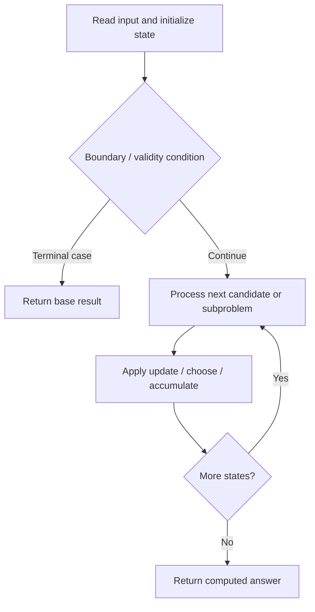

# 1986. Minimum Number of Work Sessions to Finish the Tasks

**Difficulty:** Medium  
**Concept family:** [Bitmask, Assignment and Subset DP](https://github.com/gaurav1kr/Miscellaneous/blob/main/DSA/DP/DP_Mathematics_Master_Guide_Illustrated/Theory/Chapter-09.md)  
**Problem:** https://leetcode.com/problems/minimum-number-of-work-sessions-to-finish-the-tasks/  
**Original submission:** https://leetcode.com/submissions/detail/1617065287/

## Understand the mathematics first

This problem belongs to the study family **Bitmask, Assignment and Subset DP**. Start by defining the objective and minimal sufficient state; inspect the code to identify the actual transitions.

### Problem-specific recurrence

Refer to the source-grounded algorithm walkthrough below for the state transitions used by your implementation. The generic family recurrence has been removed because it may not apply to this problem.

## Code landmarks

- `sort(tasks.rbegin(), tasks.rend());`
- `while (left < right) {`

## Source-grounded algorithm walkthrough (expanded coverage)

> **Verification level:** The observations below are extracted from your actual Accepted C++ implementation. The symbolic trace is a **code-reading dry-run worksheet**, not a fabricated numerical run. The generic family formula above is not necessarily this problem's recurrence.

### 1. Identify the actual state and algorithm

**Problem:** 1986. Minimum Number of Work Sessions to Finish the Tasks. This solution does not expose an obvious `dp` or `memo` variable. Derive the algorithmic invariant from the code rather than assuming a DP recurrence.

| Role | C++ source line | Evidence from your solution |
|---|---:|---|
| Candidate state / accumulator | — | No obvious matching statement; inspect the original C++ below. |
| Boundary / termination | 10 | `if (canPartition(tasks, sessions, 0, sessionTime)) {` |
| Boundary / termination | 20 | `if (index == tasks.size()) return true;` |
| Boundary / termination | 24 | `if (seen.count(session)) continue;` |
| Traversal order | 7 | `while (left < right) {` |
| Traversal order | 23 | `for (int& session : sessions) {` |
| Transition / update | 30 | `seen.insert(session);` |
| Return / result | 16 | `return left;` |
| Return / result | 20 | `if (index == tasks.size()) return true;` |

### 2. Trace the dependency chain



This is a **control-flow reading diagram**, not a claim about the exact shape of the mathematical state graph. Follow the code line numbers above to draw the actual dependency arrows.

### 3. Symbolic dry-run worksheet

| Stage | State to record | Mathematical question to answer |
|---|---|---|
| Initialize | Inputs, initialized containers/accumulators | What does the initial value mean? |
| First iteration / recursive call | Loop indices, branch, current state | Which predecessor states are available? |
| First update | Before → after for the updated variable | Why is this transition legal? Does it add, minimize, maximize, or overwrite? |
| Next iteration | Updated state and next candidate | Can a value be reused in this traversal order? |
| Finish | Return expression and its value | Why does this correspond to the problem's requested result? |

### 4. Mathematical explanation checklist

1. Define the exact meaning of each state variable, including all indices and constraints.
2. Translate the update expression into a mathematical equation **only after** establishing the state invariant.
3. Prove the transitions are exhaustive and do not double-count or reuse forbidden elements.
4. Check empty input, smallest input, impossible cases, and overflow/modulo behavior.
5. Compute a small numerical example using the actual problem constraints, then compare each row to the original C++.


---

## Your original Accepted C++ submission (unaltered)

```cpp
class Solution {
public:
    int minSessions(vector<int>& tasks, int sessionTime) {
        sort(tasks.rbegin(), tasks.rend());
        int left = 1, right = tasks.size();

        while (left < right) {
            int mid = (left + right) / 2;
            vector<int> sessions(mid, 0);
            if (canPartition(tasks, sessions, 0, sessionTime)) {
                right = mid;
            } else {
                left = mid + 1;
            }
        }
        return left;
    }
    
    bool canPartition(vector<int>& tasks, vector<int>& sessions, int index, int sessionTime) {
        if (index == tasks.size()) return true;
        unordered_set<int> seen;

        for (int& session : sessions) {
            if (seen.count(session)) continue;
            if (session + tasks[index] <= sessionTime) {
                session += tasks[index];
                if (canPartition(tasks, sessions, index + 1, sessionTime)) return true;
                session -= tasks[index];
                
                seen.insert(session);
                if (session == 0) break;
            }
        }

        return false;
    }
};
```

## Time and Space Complexity

- **Time:** `Depends on operations (typically O(log n) per ordered-container operation)`
- **Auxiliary space:** `Depends on number of stored entries`

**Reasoning:** An ordered container or heap introduces logarithmic insertion, lookup, or removal costs; multiply by operation count.

**Status:** Code-informed complexity guidance; exact tight bounds have not been individually verified.
