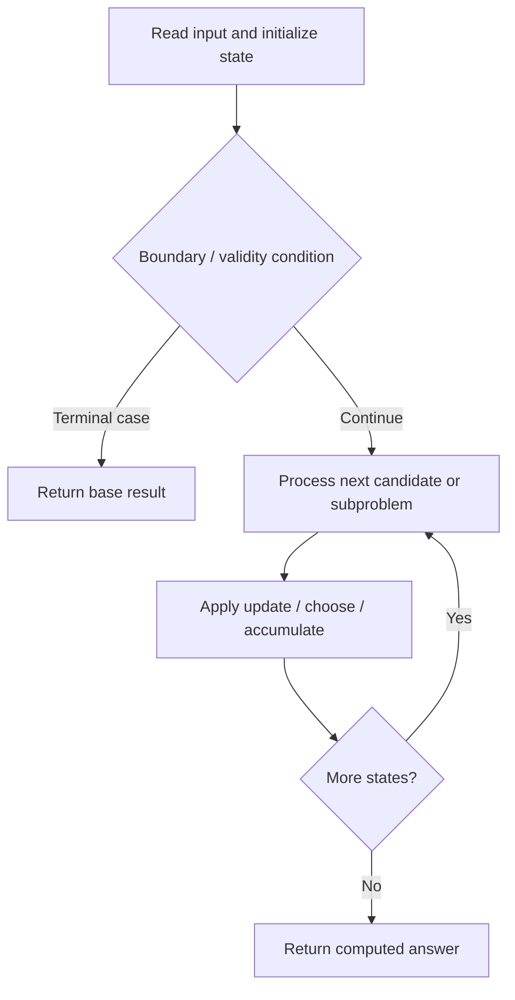

# 2003. Smallest Missing Genetic Value in Each Subtree

**Difficulty:** Hard  
**Concept family:** [Tree, Graph and DAG DP](https://github.com/gaurav1kr/Miscellaneous/blob/main/DSA/DP/DP_Mathematics_Master_Guide_Illustrated/Theory/Chapter-10.md)  
**Problem:** https://leetcode.com/problems/smallest-missing-genetic-value-in-each-subtree/  
**Original submission:** https://leetcode.com/submissions/detail/1617063362/

## Understand the mathematics first

This problem belongs to the study family **Tree, Graph and DAG DP**. Start by defining the objective and minimal sufficient state; inspect the code to identify the actual transitions.

### Mathematical starting point

This family includes tree DP, DAG DP, shortest paths, and graph traversal. **There is no single recurrence for all these problems.** Identify the exact state and invariant from the algorithm below. For tree paths, distinguish the value returned to the parent from a complete answer within the subtree; for graph problems, establish whether edges form a DAG or whether shortest-path processing is required.

## Code landmarks

- `while (u != -1) {`
- `while (vis[lo]) lo++;`

## Source-grounded algorithm walkthrough (expanded coverage)

> **Verification level:** The observations below are extracted from your actual Accepted C++ implementation. The symbolic trace is a **code-reading dry-run worksheet**, not a fabricated numerical run. The generic family formula above is not necessarily this problem's recurrence.

### 1. Identify the actual state and algorithm

**Problem:** 2003. Smallest Missing Genetic Value in Each Subtree. Recursive state transitions are present. Check memoization, state identity, termination, and whether branches are mutually exclusive.

| Role | C++ source line | Evidence from your solution |
|---|---:|---|
| Candidate state / accumulator | 20 | `vector<int> ans(n, 1);` |
| Boundary / termination | 12 | `if (!vis[nums[v]]) dfs(v);` |
| Boundary / termination | 23 | `if (par[i] != -1)` |
| Boundary / termination | 28 | `if (nums[i] == 1) {` |
| Traversal order | 11 | `for (int v : adj[u]) {` |
| Traversal order | 22 | `for (int i = 0; i < n; i++) {` |
| Traversal order | 27 | `for (int i = 0; i < n; i++) {` |
| Transition / update | 24 | `adj[par[i]].push_back(i);` |
| Transition / update | 36 | `ans[u] = lo;` |
| Return / result | 39 | `return ans;` |

### 2. Trace the dependency chain



This is a **control-flow reading diagram**, not a claim about the exact shape of the mathematical state graph. Follow the code line numbers above to draw the actual dependency arrows.

### 3. Symbolic dry-run worksheet

| Stage | State to record | Mathematical question to answer |
|---|---|---|
| Initialize | Inputs, initialized containers/accumulators | What does the initial value mean? |
| First iteration / recursive call | Loop indices, branch, current state | Which predecessor states are available? |
| First update | Before → after for the updated variable | Why is this transition legal? Does it add, minimize, maximize, or overwrite? |
| Next iteration | Updated state and next candidate | Can a value be reused in this traversal order? |
| Finish | Return expression and its value | Why does this correspond to the problem's requested result? |

### 4. Mathematical explanation checklist

1. Define the exact meaning of each state variable, including all indices and constraints.
2. Translate the update expression into a mathematical equation **only after** establishing the state invariant.
3. Prove the transitions are exhaustive and do not double-count or reuse forbidden elements.
4. Check empty input, smallest input, impossible cases, and overflow/modulo behavior.
5. Compute a small numerical example using the actual problem constraints, then compare each row to the original C++.


---

## Your original Accepted C++ submission (unaltered)

```cpp
// Your solution here
class Solution {
public:
    int n;
    vector<int> adj[100001];
    vector<int> nums, par;
    int vis[100002];

    void dfs(int u) {
        vis[nums[u]] = 1;
        for (int v : adj[u]) {
            if (!vis[nums[v]]) dfs(v);
        }
    }

    vector<int> smallestMissingValueSubtree(vector<int>& _par, vector<int>& _nums) {
        nums = std::move(_nums);
        par = std::move(_par);
        n = nums.size();
        vector<int> ans(n, 1);

        for (int i = 0; i < n; i++) {
            if (par[i] != -1)
                adj[par[i]].push_back(i);
        }
        int u = 0;
        for (int i = 0; i < n; i++) {
            if (nums[i] == 1) {
                u = i; break;
            }
        }
        int lo = 1;
        while (u != -1) {
            dfs(u);
            while (vis[lo]) lo++;
            ans[u] = lo;
            u = par[u];
        }
        return ans;
    }
};
```

## Time and Space Complexity

- **Time:** `O(number of reachable states × work per state), if memoized`
- **Auxiliary space:** `O(number of memoized states + recursion depth)`

**Reasoning:** Count distinct memo keys and transitions. Without effective memoization, recursive branching can be exponential.

**Status:** Code-informed complexity guidance; exact tight bounds have not been individually verified.
