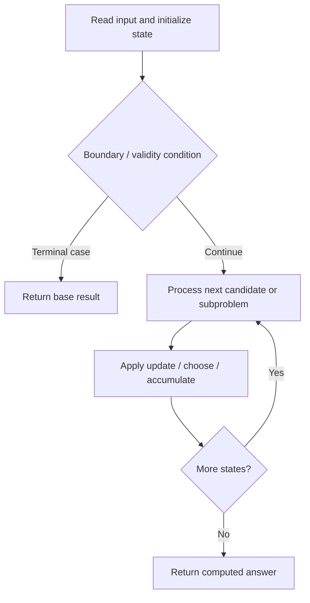

# 2008. Maximum Earnings From Taxi

**Difficulty:** Medium  
**Concept family:** [Scheduling and Weighted Intervals](https://github.com/gaurav1kr/Miscellaneous/blob/main/DSA/DP/DP_Mathematics_Master_Guide_Illustrated/Theory/Chapter-07.md)  
**Problem:** https://leetcode.com/problems/maximum-earnings-from-taxi/  
**Original submission:** https://leetcode.com/submissions/detail/1610696979/

## Understand the mathematics first

This problem belongs to the study family **Scheduling and Weighted Intervals**. Start by defining the objective and minimal sufficient state; inspect the code to identify the actual transitions.

### Problem-specific recurrence

Refer to the source-grounded algorithm walkthrough below for the state transitions used by your implementation. The generic family recurrence has been removed because it may not apply to this problem.

## Code landmarks

- `sort(rides.begin(), rides.end(), [](const auto& a, const auto& b) { return a[1] < b[1]; });`
- `int j = upper_bound(ends.begin(), ends.begin() + i, start) - ends.begin();`
- `dp[i + 1] = max(dp[i], profit + (j >= 0 ? dp[j + 1] : 0));`

## Source-grounded algorithm walkthrough (expanded coverage)

> **Verification level:** The observations below are extracted from your actual Accepted C++ implementation. The symbolic trace is a **code-reading dry-run worksheet**, not a fabricated numerical run. The generic family formula above is not necessarily this problem's recurrence.

### 1. Identify the actual state and algorithm

**Problem:** 2008. Maximum Earnings From Taxi. Ordered search / boundary calculation is present. Identify the monotonic or ordering invariant before deriving a recurrence.

| Role | C++ source line | Evidence from your solution |
|---|---:|---|
| Candidate state / accumulator | 9 | `vector<long long> dp(rides.size() + 1);` |
| Candidate state / accumulator | 19 | `dp[i + 1] = max(dp[i], profit + (j >= 0 ? dp[j + 1] : 0));` |
| Candidate state / accumulator | 21 | `return dp[rides.size()];` |
| Boundary / termination | 16 | `if (j) j--;` |
| Traversal order | 11 | `for (auto& r : rides) ends.push_back(r[1]);` |
| Traversal order | 13 | `for (int i = 0; i < rides.size(); ++i) {` |
| Transition / update | 11 | `for (auto& r : rides) ends.push_back(r[1]);` |
| Transition / update | 15 | `int j = upper_bound(ends.begin(), ends.begin() + i, start) - ends.begin();` |
| Transition / update | 19 | `dp[i + 1] = max(dp[i], profit + (j >= 0 ? dp[j + 1] : 0));` |
| Return / result | 8 | `sort(rides.begin(), rides.end(), [](const auto& a, const auto& b) { return a[1] < b[1]; });` |
| Return / result | 21 | `return dp[rides.size()];` |

### 2. Trace the dependency chain



This is a **control-flow reading diagram**, not a claim about the exact shape of the mathematical state graph. Follow the code line numbers above to draw the actual dependency arrows.

### 3. Symbolic dry-run worksheet

| Stage | State to record | Mathematical question to answer |
|---|---|---|
| Initialize | Inputs, initialized containers/accumulators | What does the initial value mean? |
| First iteration / recursive call | Loop indices, branch, current state | Which predecessor states are available? |
| First update | Before → after for the updated variable | Why is this transition legal? Does it add, minimize, maximize, or overwrite? |
| Next iteration | Updated state and next candidate | Can a value be reused in this traversal order? |
| Finish | Return expression and its value | Why does this correspond to the problem's requested result? |

### 4. Mathematical explanation checklist

1. Define the exact meaning of each state variable, including all indices and constraints.
2. Translate the update expression into a mathematical equation **only after** establishing the state invariant.
3. Prove the transitions are exhaustive and do not double-count or reuse forbidden elements.
4. Check empty input, smallest input, impossible cases, and overflow/modulo behavior.
5. Compute a small numerical example using the actual problem constraints, then compare each row to the original C++.


---

## Your original Accepted C++ submission (unaltered)

```cpp
#include <vector>
#include <algorithm>
using namespace std;

class Solution {
public:
    long long maxTaxiEarnings(int n, vector<vector<int>>& rides) {
        sort(rides.begin(), rides.end(), [](const auto& a, const auto& b) { return a[1] < b[1]; });
        vector<long long> dp(rides.size() + 1);
        vector<int> ends;
        for (auto& r : rides) ends.push_back(r[1]);

        for (int i = 0; i < rides.size(); ++i) {
            auto [start, end, tip] = tie(rides[i][0], rides[i][1], rides[i][2]);
            int j = upper_bound(ends.begin(), ends.begin() + i, start) - ends.begin();
            if (j) j--;
            else j = -1;
            long long profit = end - start + tip;
            dp[i + 1] = max(dp[i], profit + (j >= 0 ? dp[j + 1] : 0));
        }
        return dp[rides.size()];
    }
};
```

## Time and Space Complexity

- **Time:** `O(n log n) or higher`
- **Auxiliary space:** `O(n) or higher`

**Reasoning:** Sorting costs O(n log n); additional data-structure operations may increase the bound. Confirm against the nested loops.

**Status:** Code-informed complexity guidance; exact tight bounds have not been individually verified.
