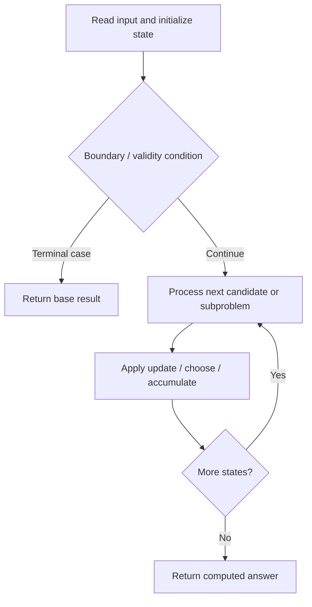

# 2050. Parallel Courses III

**Difficulty:** Hard  
**Concept family:** [Bitmask, Assignment and Subset DP](https://github.com/gaurav1kr/Miscellaneous/blob/main/DSA/DP/DP_Mathematics_Master_Guide_Illustrated/Theory/Chapter-09.md)  
**Problem:** https://leetcode.com/problems/parallel-courses-iii/  
**Original submission:** https://leetcode.com/submissions/detail/1610659305/

## Understand the mathematics first

This problem belongs to the study family **Bitmask, Assignment and Subset DP**. Start by defining the objective and minimal sufficient state; inspect the code to identify the actual transitions.

### Related concept template (not necessarily this problem’s recurrence)

$$
F(mask)=\operatorname{opt}_{i\notin mask}(cost(mask,i)+F(mask\cup\{i\}))
$$

**What this template illustrates:** There are 2^n subsets. Each transition adds or removes one element, subject to feasibility.

**Derivation exercise:** Define exactly what each state variable means for this problem; list valid choices, base cases, and forbidden transitions. Check the submitted code against that invariant. The family template alone is not a substitute for a problem-specific proof.

## Code landmarks

- `dp[i] = time[i];`
- `while (!q.empty()) {`
- `dp[v] = max(dp[v], dp[u] + time[v]);`

## Source-grounded algorithm walkthrough (expanded coverage)

> **Verification level:** The observations below are extracted from your actual Accepted C++ implementation. The symbolic trace is a **code-reading dry-run worksheet**, not a fabricated numerical run. The generic family formula above is not necessarily this problem's recurrence.

### 1. Identify the actual state and algorithm

**Problem:** 2050. Parallel Courses III. An explicit state table or memo is present. Interpret each index as a mathematical state and every update as a transition.

| Role | C++ source line | Evidence from your solution |
|---|---:|---|
| Candidate state / accumulator | 9 | `vector<int> indeg(n, 0), dp(n, 0);` |
| Candidate state / accumulator | 19 | `dp[i] = time[i];` |
| Candidate state / accumulator | 25 | `dp[v] = max(dp[v], dp[u] + time[v]);` |
| Boundary / termination | 17 | `if (indeg[i] == 0) {` |
| Boundary / termination | 26 | `if (--indeg[v] == 0) q.push(v);` |
| Traversal order | 10 | `for (auto& r : relations) {` |
| Traversal order | 16 | `for (int i = 0; i < n; ++i)` |
| Traversal order | 22 | `while (!q.empty()) {` |
| Transition / update | 11 | `graph[r[0] - 1].push_back(r[1] - 1);` |
| Transition / update | 19 | `dp[i] = time[i];` |
| Transition / update | 25 | `dp[v] = max(dp[v], dp[u] + time[v]);` |
| Return / result | 30 | `return *max_element(dp.begin(), dp.end());` |

### 2. Trace the dependency chain



This is a **control-flow reading diagram**, not a claim about the exact shape of the mathematical state graph. Follow the code line numbers above to draw the actual dependency arrows.

### 3. Symbolic dry-run worksheet

| Stage | State to record | Mathematical question to answer |
|---|---|---|
| Initialize | Inputs, initialized containers/accumulators | What does the initial value mean? |
| First iteration / recursive call | Loop indices, branch, current state | Which predecessor states are available? |
| First update | Before → after for the updated variable | Why is this transition legal? Does it add, minimize, maximize, or overwrite? |
| Next iteration | Updated state and next candidate | Can a value be reused in this traversal order? |
| Finish | Return expression and its value | Why does this correspond to the problem's requested result? |

### 4. Mathematical explanation checklist

1. Define the exact meaning of each state variable, including all indices and constraints.
2. Translate the update expression into a mathematical equation **only after** establishing the state invariant.
3. Prove the transitions are exhaustive and do not double-count or reuse forbidden elements.
4. Check empty input, smallest input, impossible cases, and overflow/modulo behavior.
5. Compute a small numerical example using the actual problem constraints, then compare each row to the original C++.


---

## Your original Accepted C++ submission (unaltered)

```cpp
#include <vector>
#include <queue>
using namespace std;

class Solution {
public:
    int minimumTime(int n, vector<vector<int>>& relations, vector<int>& time) {
        vector<vector<int>> graph(n);
        vector<int> indeg(n, 0), dp(n, 0);
        for (auto& r : relations) {
            graph[r[0] - 1].push_back(r[1] - 1);
            indeg[r[1] - 1]++;
        }

        queue<int> q;
        for (int i = 0; i < n; ++i)
            if (indeg[i] == 0) {
                q.push(i);
                dp[i] = time[i];
            }

        while (!q.empty()) {
            int u = q.front(); q.pop();
            for (int v : graph[u]) {
                dp[v] = max(dp[v], dp[u] + time[v]);
                if (--indeg[v] == 0) q.push(v);
            }
        }

        return *max_element(dp.begin(), dp.end());
    }
};
```

## Time and Space Complexity

- **Time:** `Depends on table dimensions and transitions per cell`
- **Auxiliary space:** `O(rows × columns) for the allocated table`

**Reasoning:** The two-dimensional table determines memory; time is its state count multiplied by work per state.

**Status:** Code-informed complexity guidance; exact tight bounds have not been individually verified.
