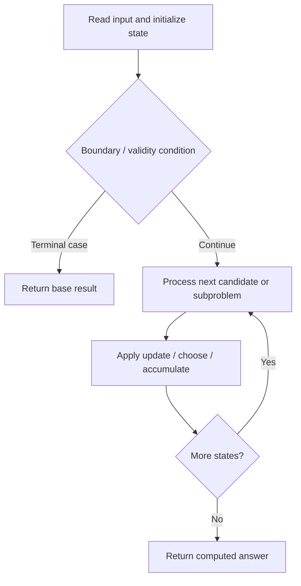

# 2054. Two Best Non-Overlapping Events

**Difficulty:** Medium  
**Concept family:** [Scheduling and Weighted Intervals](https://github.com/gaurav1kr/Miscellaneous/blob/main/DSA/DP/DP_Mathematics_Master_Guide_Illustrated/Theory/Chapter-07.md)  
**Problem:** https://leetcode.com/problems/two-best-non-overlapping-events/  
**Original submission:** https://leetcode.com/submissions/detail/1617064259/

## Understand the mathematics first

This problem belongs to the study family **Scheduling and Weighted Intervals**. Start by defining the objective and minimal sufficient state; inspect the code to identify the actual transitions.

### Related concept template (not necessarily this problem’s recurrence)

$$
F(i,k)=\max(F(i+1,k),w_i+F(next(i),k-1))
$$

**What this template illustrates:** For inclusive intervals, compatibility requires next.start > current.end. Binary search can find next(i).

**Derivation exercise:** Define exactly what each state variable means for this problem; list valid choices, base cases, and forbidden transitions. Check the submitted code against that invariant. The family template alone is not a substitute for a problem-specific proof.

## Code landmarks

- `sort(events.begin(), events.end(), [](const vector<int>& a, const vector<int>& b) {`
- `suffixMax[i] = max(events[i][2], suffixMax[i + 1]);`
- `while (left <= right) {`

## Source-grounded algorithm walkthrough (expanded coverage)

> **Verification level:** The observations below are extracted from your actual Accepted C++ implementation. The symbolic trace is a **code-reading dry-run worksheet**, not a fabricated numerical run. The generic family formula above is not necessarily this problem's recurrence.

### 1. Identify the actual state and algorithm

**Problem:** 2054. Two Best Non-Overlapping Events. This solution does not expose an obvious `dp` or `memo` variable. Derive the algorithmic invariant from the code rather than assuming a DP recurrence.

| Role | C++ source line | Evidence from your solution |
|---|---:|---|
| Candidate state / accumulator | — | No obvious matching statement; inspect the original C++ below. |
| Boundary / termination | 25 | `if (events[mid][0] > events[i][1]) {` |
| Boundary / termination | 33 | `if (nextEventIndex != -1) {` |
| Traversal order | 13 | `for (int i = n - 2; i >= 0; --i) {` |
| Traversal order | 19 | `for (int i = 0; i < n; ++i) {` |
| Traversal order | 23 | `while (left <= right) {` |
| Transition / update | 14 | `suffixMax[i] = max(events[i][2], suffixMax[i + 1]);` |
| Transition / update | 34 | `maxSum = max(maxSum, events[i][2] + suffixMax[nextEventIndex]);` |
| Transition / update | 37 | `maxSum = max(maxSum, events[i][2]);` |
| Return / result | 7 | `return a[0] < b[0];` |
| Return / result | 40 | `return maxSum;` |

### 2. Trace the dependency chain



This is a **control-flow reading diagram**, not a claim about the exact shape of the mathematical state graph. Follow the code line numbers above to draw the actual dependency arrows.

### 3. Symbolic dry-run worksheet

| Stage | State to record | Mathematical question to answer |
|---|---|---|
| Initialize | Inputs, initialized containers/accumulators | What does the initial value mean? |
| First iteration / recursive call | Loop indices, branch, current state | Which predecessor states are available? |
| First update | Before → after for the updated variable | Why is this transition legal? Does it add, minimize, maximize, or overwrite? |
| Next iteration | Updated state and next candidate | Can a value be reused in this traversal order? |
| Finish | Return expression and its value | Why does this correspond to the problem's requested result? |

### 4. Mathematical explanation checklist

1. Define the exact meaning of each state variable, including all indices and constraints.
2. Translate the update expression into a mathematical equation **only after** establishing the state invariant.
3. Prove the transitions are exhaustive and do not double-count or reuse forbidden elements.
4. Check empty input, smallest input, impossible cases, and overflow/modulo behavior.
5. Compute a small numerical example using the actual problem constraints, then compare each row to the original C++.


---

## Your original Accepted C++ submission (unaltered)

```cpp
class Solution {
public:
    int maxTwoEvents(vector<vector<int>>& events) {
        int n = events.size();
        
        sort(events.begin(), events.end(), [](const vector<int>& a, const vector<int>& b) {
            return a[0] < b[0];
        });
        
        vector<int> suffixMax(n);
        suffixMax[n - 1] = events[n - 1][2];
        
        for (int i = n - 2; i >= 0; --i) {
            suffixMax[i] = max(events[i][2], suffixMax[i + 1]);
        }
        
        int maxSum = 0;
        
        for (int i = 0; i < n; ++i) {
            int left = i + 1, right = n - 1;
            int nextEventIndex = -1;
            
            while (left <= right) {
                int mid = left + (right - left) / 2;
                if (events[mid][0] > events[i][1]) {
                    nextEventIndex = mid;
                    right = mid - 1;
                } else {
                    left = mid + 1;
                }
            }
            
            if (nextEventIndex != -1) {
                maxSum = max(maxSum, events[i][2] + suffixMax[nextEventIndex]);
            }
            
            maxSum = max(maxSum, events[i][2]);
        }
        
        return maxSum;
    }
};
```

## Interview self-check

1. What is the smallest state that determines the remaining answer?
2. Why are the transitions exhaustive and valid?
3. What is the exact base case, including empty and impossible cases?
4. What is the time complexity (states × work per state)?
5. Can the memory be compressed without overwriting needed dependencies?
