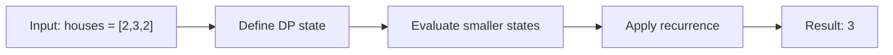

# 213. House Robber II

**Difficulty:** Medium  
**Concept family:** [Take-or-Skip and Knapsack](https://github.com/gaurav1kr/Miscellaneous/blob/main/DSA/DP/DP_Mathematics_Master_Guide_Illustrated/Theory/Chapter-02.md)  
**Problem:** https://leetcode.com/problems/house-robber-ii/  
**Original submission:** https://leetcode.com/submissions/detail/1538705289/

## Understand the mathematics first

The circular endpoints cannot both be selected.

### Related concept template (not necessarily this problem’s recurrence)

`answer=max(rob(0..n-2),rob(1..n-1))`

**What this template illustrates:** Reduce to two linear House Robber instances.

**Derivation exercise:** Define exactly what each state variable means for this problem; list valid choices, base cases, and forbidden transitions. Check the submitted code against that invariant. The family template alone is not a substitute for a problem-specific proof.

## Code landmarks

- `return max(robRange(nums, 0, n - 2), robRange(nums, 1, n - 1));`
- `int temp = max(prev1, prev2 + nums[i]);`

## Detailed dry run — Circular House Robber: break the cycle

### Start from the mathematical question

First and last houses are adjacent, so no valid choice contains both. Solve two linear instances and take their maximum.

### Derive the recurrence

```math
answer=\max(rob(a_0,\ldots,a_{n-2}),\ rob(a_1,\ldots,a_{n-1}))
```

**Why the transition is correct:** Every legal circular solution excludes the first or the last house (or both); therefore one of these linear subproblems contains the optimum.

### Concrete example

**Input:** `houses = [2,3,2]`



**Evaluate the states in dependency order:**

| Linear case | Houses | Best |
|---|---|---:|
| Exclude last | [2,3] | 3 |
| Exclude first | [3,2] | 3 |
| Take maximum | — | 3 |

**Expected result:** `3`.

### What to remember six months later

Explain (1) what one state means, (2) which earlier states it needs, (3) why those cases are exhaustive, and (4) why the answer is `3` for this input. Then inspect your preserved C++ solution below and match its variables to the mathematical states.

---

## Your original Accepted C++ submission (unaltered)

```cpp
class Solution {
public:
    int rob(vector<int>& nums) {
        int n = nums.size();
        if (n == 1) return nums[0];
        return max(robRange(nums, 0, n - 2), robRange(nums, 1, n - 1));
    }

private:
    int robRange(const vector<int>& nums, int start, int end) {
        int prev1 = 0, prev2 = 0;
        for (int i = start; i <= end; ++i) {
            int temp = max(prev1, prev2 + nums[i]);
            prev2 = prev1;
            prev1 = temp;
        }
        return prev1;
    }
};
```

## Time and Space Complexity

- **Time:** `Depends on loop nesting and bounds`
- **Auxiliary space:** `Depends on auxiliary arrays/containers`

**Reasoning:** Count how many iterations each loop executes and whether loops are nested; do not assume all nested loops are quadratic.

**Status:** Code-informed complexity guidance; exact tight bounds have not been individually verified.
