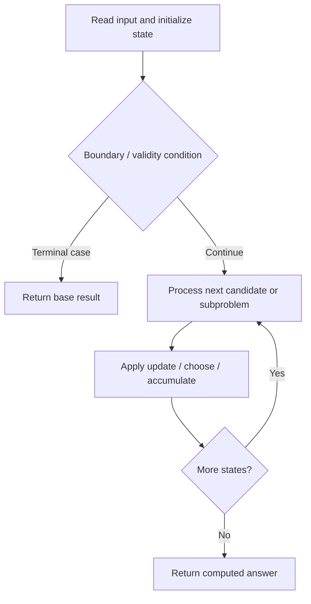

# 221. Maximal Square

**Difficulty:** Medium  
**Concept family:** [Grid Paths and Geometric DP](https://github.com/gaurav1kr/Miscellaneous/blob/main/DSA/DP/DP_Mathematics_Master_Guide_Illustrated/Theory/Chapter-03.md)  
**Problem:** https://leetcode.com/problems/maximal-square/  
**Original submission:** https://leetcode.com/submissions/detail/1615749531/

## Understand the mathematics first

This problem belongs to the study family **Grid Paths and Geometric DP**. Start by defining the objective and minimal sufficient state; inspect the code to identify the actual transitions.

### Related concept template (not necessarily this problem’s recurrence)

$$
F(i,j)=F(i-1,j)+F(i,j-1)
$$

**What this template illustrates:** For minimum cost paths, replace + of paths with min of predecessor costs, then add the current cell cost. Obstacles contribute zero ways.

**Derivation exercise:** Define exactly what each state variable means for this problem; list valid choices, base cases, and forbidden transitions. Check the submitted code against that invariant. The family template alone is not a substitute for a problem-specific proof.

## Code landmarks

- `dp[i][j] = min({dp[i-1][j], dp[i][j-1], dp[i-1][j-1]}) + 1;`
- `maxlen = max(maxlen, dp[i][j]);`

## Source-grounded algorithm walkthrough (expanded coverage)

> **Verification level:** The observations below are extracted from your actual Accepted C++ implementation. The symbolic trace is a **code-reading dry-run worksheet**, not a fabricated numerical run. The generic family formula above is not necessarily this problem's recurrence.

### 1. Identify the actual state and algorithm

**Problem:** 221. Maximal Square. An explicit state table or memo is present. Interpret each index as a mathematical state and every update as a transition.

| Role | C++ source line | Evidence from your solution |
|---|---:|---|
| Candidate state / accumulator | 5 | `vector<vector<int>> dp(m+1, vector<int>(n+1, 0));` |
| Candidate state / accumulator | 9 | `dp[i][j] = min({dp[i-1][j], dp[i][j-1], dp[i-1][j-1]}) + 1;` |
| Candidate state / accumulator | 10 | `maxlen = max(maxlen, dp[i][j]);` |
| Boundary / termination | 8 | `if (matrix[i-1][j-1] == '1') {` |
| Traversal order | 6 | `for (int i = 1; i <= m; i++) {` |
| Traversal order | 7 | `for (int j = 1; j <= n; j++) {` |
| Transition / update | 9 | `dp[i][j] = min({dp[i-1][j], dp[i][j-1], dp[i-1][j-1]}) + 1;` |
| Transition / update | 10 | `maxlen = max(maxlen, dp[i][j]);` |
| Return / result | 14 | `return maxlen * maxlen;` |

### 2. Trace the dependency chain



This is a **control-flow reading diagram**, not a claim about the exact shape of the mathematical state graph. Follow the code line numbers above to draw the actual dependency arrows.

### 3. Symbolic dry-run worksheet

| Stage | State to record | Mathematical question to answer |
|---|---|---|
| Initialize | Inputs, initialized containers/accumulators | What does the initial value mean? |
| First iteration / recursive call | Loop indices, branch, current state | Which predecessor states are available? |
| First update | Before → after for the updated variable | Why is this transition legal? Does it add, minimize, maximize, or overwrite? |
| Next iteration | Updated state and next candidate | Can a value be reused in this traversal order? |
| Finish | Return expression and its value | Why does this correspond to the problem's requested result? |

### 4. Mathematical explanation checklist

1. Define the exact meaning of each state variable, including all indices and constraints.
2. Translate the update expression into a mathematical equation **only after** establishing the state invariant.
3. Prove the transitions are exhaustive and do not double-count or reuse forbidden elements.
4. Check empty input, smallest input, impossible cases, and overflow/modulo behavior.
5. Compute a small numerical example using the actual problem constraints, then compare each row to the original C++.


---

## Your original Accepted C++ submission (unaltered)

```cpp
class Solution {
public:
    int maximalSquare(vector<vector<char>>& matrix) {
        int m = matrix.size(), n = matrix[0].size(), maxlen = 0;
        vector<vector<int>> dp(m+1, vector<int>(n+1, 0));
        for (int i = 1; i <= m; i++) {
            for (int j = 1; j <= n; j++) {
                if (matrix[i-1][j-1] == '1') {
                    dp[i][j] = min({dp[i-1][j], dp[i][j-1], dp[i-1][j-1]}) + 1;
                    maxlen = max(maxlen, dp[i][j]);
                }
            }
        }
        return maxlen * maxlen;
    }
};
```

## Time and Space Complexity

- **Time:** `Depends on table dimensions and transitions per cell`
- **Auxiliary space:** `O(rows × columns) for the allocated table`

**Reasoning:** The two-dimensional table determines memory; time is its state count multiplied by work per state.

**Status:** Code-informed complexity guidance; exact tight bounds have not been individually verified.
